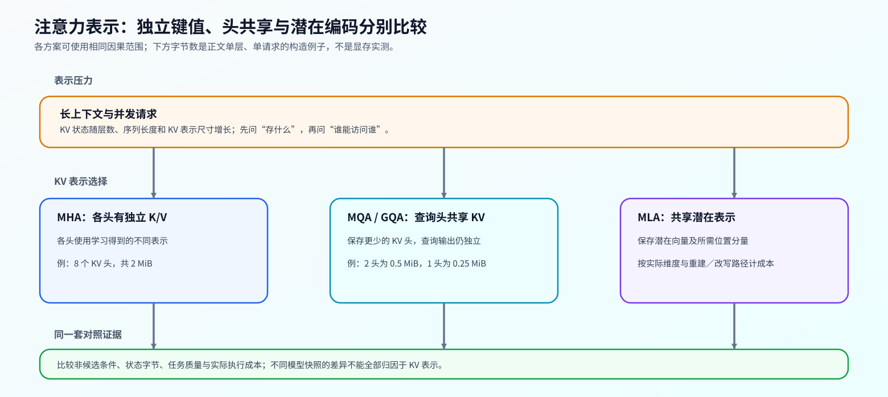

# 04 注意力表示与 KV Cache 演进（Attention Representation Evolution）

## 学习问题

解码一个新词元时，每个查询头要读取历史键和值。若查询头很多，是否每个头都需要独立的键值表示？头共享与潜在表示分别改变保存的头数和历史编码方式，需要先分清它们怎样读取同一段历史。

查询（Q）与键（K）形成注意力分数，值（V）按归一化权重合成输出。历史键值缓存（KV Cache）保存后续查询需要的 K/V 或相应编码；位置与访问掩码决定怎样计算分数、哪些位置可见，是另外两类选择。

## 核心机制

### 每个查询头是否都需要独立的键和值

多头注意力（MHA）为不同头学习各自的投影，并保存对应 K/V；这些值不是同一数据的重复副本。多查询注意力（MQA）让所有查询头共享一组 K/V，分组查询注意力（GQA）则让每组查询头共享一组。查询头仍分别计算输出，共享发生在键和值的表示上。

以单层、单请求为例，若历史长度为 $S$、KV 头数为 $H_{kv}$、K/V 头维度都为 $d$、每元素占 $b$ 字节，逻辑缓存为 $2SH_{kv}db$ 字节。固定 $S=1024,d=64,b=2$，八个 KV 头需要 2 MiB，两个头需要 0.5 MiB，一个头需要 0.25 MiB。这是忽略布局填充、元数据与分配器预留的构造账本，不是显存实测。

多头潜在注意力（MLA）改变的是编码方式：把多头需要的键值信息压入共享的低维潜在向量，而非简单地把每个头独立缩小。具体路径还可能保存位置分量，并通过重建或等价改写参与注意力计算。它的状态应按实际潜在维度和位置分量单独计算。

| 要固定的比较条件 | 观察的对象 | 不能忽略的原因 |
|:---|:---|:---|
| 层数、隐藏维度、单头维度 | 单层 KV 的表示尺寸 | 否则不同模型规模会掩盖结构差异 |
| 序列长度、批次、生成长度 | 历史状态的增长 | KV Cache 是随请求生命周期增长的状态 |
| 数据类型、执行后端、硬件 | 实际显存与延迟 | 理论字节数不等于真实执行代价 |
| 任务质量约束 | 共享或压缩后的输出质量 | 状态更小不自动表示可用 |

### 头共享与潜在表示分别改变什么

下表只比较 K/V 的保存方式。这些方案都可以在相同因果掩码下访问历史；“能访问哪些词元”属于局部、窗口和稀疏注意力问题，而不是注意力头共享问题。

| 结构 | 保存的状态 | 结构变化 | 主要收益 | 需要验证的取舍 |
|:---|:---|:---|:---|:---|
| MHA | 每个注意力头的完整 K/V | Q、K、V 注意力头数相同 | 表达基线明确 | KV 状态与带宽随注意力头数增加 |
| MQA | 一组共享 K/V | 所有 Q 注意力头读取同一组 K/V | 在同头维度下减少 KV 头数 | 共享后的任务质量需要验证 |
| GQA | 少量共享 KV 组 | 多个 Q 注意力头对应一个 KV 组 | 在状态成本与质量间折中 | 分组数需要随模型和任务验证 |
| MLA | 压缩后的潜在 KV | 保存潜在状态，再按需要参与注意力 | 改变每个词元的状态表示尺寸 | 投影、重建和执行后端支持带来额外路径 |

MQA/GQA 减少独立 KV 头数，MLA 改变历史信息的编码和计算路径；它们都可以在相同的因果可见范围内工作。缩小访问窗口是另一个变量，不能用它的读取减少来解释头共享本身的收益。

## 选择条件与验证证据

先用同一组结构参数计算理论状态账本，再决定是否做真实模型比较。对于同家族、训练和实现条件可比的变体，可以讨论相对取舍；对于不同公开模型快照，只能将结果记为跨模型观察，不能把差异归因于某一个注意力改动。

| 证据层级 | 可以回答的问题 | 入口与应保留的证据 |
|:---|:---|:---|
| 理论账本 | MHA/GQA/MLA 的 KV 表示为何随长度、注意力头数变化 | [Part 02 · 04](../../02_PyTorch_Algorithms/04_Attention_MHA_GQA.md)：分组关系、状态公式与边界测试 |
| 表示机制 | 注意力头共享、潜在/位置分量和读取路径是否正确 | [ARCH-MLA](../../02_PyTorch_Algorithms/ARCH-MLA_Multihead_Latent_Attention.md)：配置、状态字节数与表示不变量 |
| 架构对照 | 状态压缩是否保留质量，并在目标路径中改变容量与成本 | [Part 02 · 71](../../02_PyTorch_Algorithms/71_MLA_KV_Cache_Architecture_Benchmark.md)：基线、候选、证据等级与决策 |

真实执行测量还要固定模型版本、数据类型、上下文长度、批次和执行后端。KV 生命周期、TTFT、TPOT 与吞吐由[推理优化](../inference_optimization/intro.md)继续验证，状态、带宽和实现开销由[性能优化](../performance_optimization/intro.md)归因。

## 相关阅读

- [Attention Is All You Need](https://arxiv.org/abs/1706.03762)：多头注意力的基线。
- [Fast Transformer Decoding: One Write-Head is All You Need](https://arxiv.org/abs/1911.02150)：MQA 的原始动机。
- [GQA: Training Generalized Multi-Query Transformer Models from Multi-Head Checkpoints](https://arxiv.org/abs/2305.13245)：GQA 的共享粒度与训练入口。
- [DeepSeek-V2](https://arxiv.org/abs/2405.04434)：MLA 的代表架构案例。
- [Part 02 · 44 局部、滑动窗口与稀疏注意力](../../02_PyTorch_Algorithms/44_Local_Sliding_and_Sparse_Attention.md)：继续学习“哪些历史词元可访问”。
- [Part 02 · 45 线性注意力与递推状态](../../02_PyTorch_Algorithms/45_Linear_Attention_and_Recurrent_State.md)：继续学习“不保存完整历史时怎样递推”。
