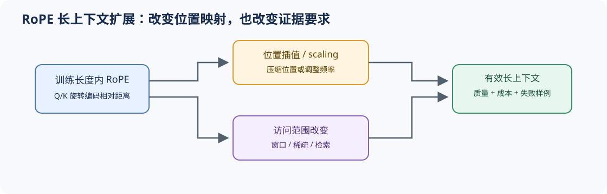

# 05 RoPE 与长上下文位置机制（RoPE and Long-Context Positioning）

## 学习问题

只看查询与键的内容分数，并没有直接写入词元索引和距离。位置机制让顺序参与计算；超过训练长度后，还需要检查模型怎样处理此前少见的位置关系。旋转位置编码（RoPE）、位置向量与相对位置偏置采用不同做法，长度扩展的条件也不同。

## 核心机制

### 顺序信息如何进入注意力分数

绝对位置可以将位置向量加入输入，相对位置偏置则直接按距离调整注意力分数。RoPE 旋转查询（Q）与键（K）的特征，使旋转引入的位置项由相对距离决定。改变位置或频率映射虽然能调整长距离下的角度变化，也可能改变训练时形成的位置关系，需要重新验证质量。

### 旋转频率与距离共同决定角度

RoPE 按实现规定的配对方式，把特征分成二维旋转子空间；配对不一定是存储中相邻的两维。设第 $i$ 对特征的旋转频率为 $\theta_i$，位置 $p$ 对应角度 $p\theta_i$。例如位置 2 的查询与位置 5 的键，旋转带来的相对角度对应 $3\theta_i$；绝对位置都平移时，这个位置差不变。

同一距离下，低频子空间的角度变化较慢，高频子空间变化较快。缩放位置或调整频率会改变不同距离下的分辨方式，但某组频率是否保留任务所需信息，仍要通过长度阶梯上的质量观察。

长度扩展不能只比较配置中的最大长度。至少要区分训练长度内、刚越过训练长度和目标最大长度三个区间，并固定相同文本、分词器和访问模式；否则位置机制、稀疏注意力和 KV 容量变化会混在同一个结果中。

| 路径 | 改变什么 | 主要收益 | 主要风险 |
|:---|:---|:---|:---|
| 绝对位置编码 | 输入位置向量 | 实现直观 | 固定表难以外推 |
| 相对位置偏置 | 注意力分数 | 直接表达距离 | 形式与实现路径较多 |
| RoPE | Q/K 各维旋转角 | 与注意力计算紧密结合 | 超出训练长度后频率行为变化 |
| 插值 / 缩放 | 位置或频率映射 | 扩大可用上下文 | 短程分辨率和长程质量需重新验证 |

## 选择条件与验证证据

长上下文判断至少需要长度阶梯、训练长度内外标记、检索或推理质量、预填充成本和 KV/状态容量。仅验证模型“能够接收”长输入，不能证明它仍能可靠利用远处信息。

先在 [Part 02 · 03 RoPE](../../02_PyTorch_Algorithms/03_RoPE_Tutorial.md)验证旋转与频率维度，再由 [Part 02 · 44 局部与稀疏注意力](../../02_PyTorch_Algorithms/44_Local_Sliding_and_Sparse_Attention.md)隔离访问范围变量。[Part 02 · 78 注意力访问模式](../../02_PyTorch_Algorithms/78_Attention_Access_Pattern_Benchmark.md)比较访问范围，[Part 02 · 77 长序列记忆架构](../../02_PyTorch_Algorithms/77_Long_Sequence_Memory_Architecture_Benchmark.md)比较记忆接口；真实长度扩展结论还需固定模型的位置设置与质量评测。

## 相关阅读

- [RoFormer](https://arxiv.org/abs/2104.09864)
- [ALiBi](https://arxiv.org/abs/2108.12409)
- [LongRoPE](https://arxiv.org/abs/2402.13753)
