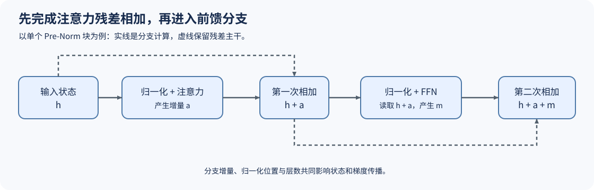

# 06 Transformer 块与残差主干（Block and Residual Stream）

## 学习问题

一个块的输入输出形状相同，为什么堆叠很多层后数值仍可能变得不稳定？残差连接把注意力与前馈网络的输出加到已有隐状态上；每次相加的增量、归一化位置与层数共同影响状态和梯度的传播。

## 核心机制

### 子层怎样修改已有隐状态

如果每个子层都直接覆盖隐状态，深层模型难以保留已有信息，也更容易出现梯度衰减或放大。残差流让子层学习增量更新，前置归一化则在分支读取主干前控制尺度。

### 一个前置归一化块包含两次残差更新

设进入第 $l$ 个块的隐状态为 $h_l$，$l$ 是块编号，$\mathrm{Norm}$ 表示该分支前的归一化，$\mathrm{Attn}$ 和 $\mathrm{MLP}$ 分别表示注意力与逐词元前馈。先得到注意力增量 $a_l$，再用已经更新的状态计算前馈增量 $m_l$：

$$
a_l=\mathrm{Attn}(\mathrm{Norm}(h_l)),\qquad
m_l=\mathrm{MLP}(\mathrm{Norm}(h_l+a_l)),\qquad
h_{l+1}=h_l+a_l+m_l.
$$

第二个分支读取的是 $h_l+a_l$，不是原始 $h_l$。三者形状能够相加，只说明接口匹配；增量相对主干的大小还会随深度变化。表中的范数衡量张量整体大小，均方根（RMS）衡量元素平方均值的平方根，用于比较各层的数值尺度。

残差缩放、分支初始化和额外归一化都在控制增量写入速度。比较块变体时应固定深度、隐藏维度、参数预算和训练批次，再观察稳定性；只跑单个块无法暴露深度累积问题。

| 阶段 | 主干状态变化 | 应观察的量 | 关键约束 |
|:---|:---|:---|:---|
| 注意力更新 | `h ← h + a` | `‖a‖ / ‖h‖`、注意力输出范围 | 上下文访问、位置机制、注意力表示 |
| MLP 更新 | `h ← h + m` | `‖m‖ / ‖h+a‖`、门控激活范围 | 通道扩张、门控激活、稠密 FFN 或 MoE |
| 多层堆叠 | 重复两次增量更新 | 层间激活 RMS、梯度范数、非有限值 | 残差缩放、深度、初始化和数值精度 |

## 选择条件与验证证据

Transformer 块变体要同时检查结构合法性、参数量/FLOPs、激活与梯度尺度、训练稳定性和目标任务质量。残差缩放或额外归一化只有在相同训练口径下，才能形成较强的稳定性证据。

组件到 Transformer 块的映射见 [Part 00 · 13](../../00_Prerequisites/13_Transformer_Block_Dataflow_and_Residual_Stream.md)，两次残差更新和配置审计分别进入 [Part 02 · 05](../../02_PyTorch_Algorithms/05_LLaMA3_Block_Tutorial.md)与 [Part 02 · 08](../../02_PyTorch_Algorithms/08_Architecture_Tricks.md)；多层稳定性证据由 [Part 02 · 60](../../02_PyTorch_Algorithms/60_Decoder_Block_Stability_Benchmark.md)承接。

## 相关阅读

- [On Layer Normalization in the Transformer Architecture](https://arxiv.org/abs/2002.04745)
- [DeepNet](https://arxiv.org/abs/2203.00555)
- [LLaMA](https://arxiv.org/abs/2302.13971)
