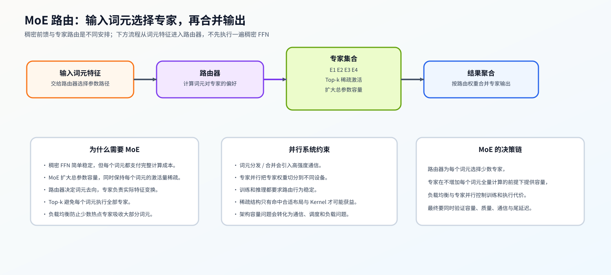

# 09 MoE 与稀疏容量（MoE and Sparse Capacity）

## 学习问题

给每个词元都使用更宽的前馈网络，会同时增加参数量和计算。混合专家（Mixture of Experts，MoE）改为保留多套前馈参数，由路由器为词元选择其中一部分专家，再合并它们的输出。总参数容量与每个词元实际使用的参数量因此分开，路由和执行也增加了新成本。

## 核心机制

### 总参数量与单词元计算怎样分开

稠密 FFN 让所有词元使用同一组参数，模型越宽，每个词元的成本越高。MoE 通过稀疏激活增加总参数，但能否获得收益取决于路由质量、专家容量和系统执行是否匹配。

### 选择、容量与结果合并

Top-$k$ 表示每个词元选择 $k$ 个专家。对含 $T$ 个词元、$E$ 个专家的批次，共产生 $Tk$ 次词元—专家分配，理想均匀分配时每个专家得到 $Tk/E$ 次；实际路由不一定均匀。若采用容量因子 $c$，一种常见规则将单专家可接收数量设为 $\lceil cTk/E\rceil$。

例如 $T=8,E=4,k=2,c=1$ 时，均匀分配对应每专家四次；若某专家收到七次，就有三次超过这条容量规则，系统需要按策略丢弃、改派或采用其他处理。提高容量能减少这类溢出，但也可能增加预留空间。分发把词元送到选中的专家，合并再按路由权重把专家输出放回原词元位置，并不是缓存资源回收。

共享专家为词元提供公共计算分支；细粒度专家把单个专家做小，改变组合空间；均衡机制则调整路由分布，避免少数专家长期过载。使用额外均衡损失还是其他调节方式，会影响主任务与负载的取舍。专家分布到不同设备后，还要交换各自负责的词元；All-to-All 指参与者向其他参与者发送并接收各自数据的通信方式，不是全部数据简单复制到每张卡。

| 环节 | 机制问题 | 失败表现 |
|:---|:---|:---|
| 路由器 / Top-k | 哪些专家接收当前词元 | 路由塌缩、专家长期闲置 |
| 专家容量 / 容量溢出 | 单个专家最多接收多少词元 | 词元丢弃、回退或排队 |
| 分发 / 合并 | 词元如何发送并回收结果 | All-to-All 暴露、重排开销 |
| 负载均衡目标 | 如何约束专家利用率 | 辅助损失干扰主任务或约束不足 |

## 选择条件与验证证据

评估 MoE 至少记录 Top-k、专家数、容量因子、容量溢出、专家负载分布、分发字节数、通信暴露时间与任务质量。仅报告总参数量或理论激活参数，无法判断真实吞吐和稳定性。

总参数与激活计算先由 [Part 01 · 22](../../01_Hardware_Math_and_Systems/22_MoE_Parameter_and_Compute.md)建立账本，路由、容量和负载分布由 [Part 02 · 06](../../02_PyTorch_Algorithms/06_MoE_Router.md)和 [Part 02 · 07](../../02_PyTorch_Algorithms/07_MoE_Load_Balancing_Loss.md)验证；分发、合并与真实多卡证据分别进入 [Part 02 · 46](../../02_PyTorch_Algorithms/46_MoE_Expert_Parallel.md)和 [Part 02 · 80](../../02_PyTorch_Algorithms/80_MoE_Expert_Parallel_Benchmark.md)。

## 相关阅读

- [Sparsely-Gated Mixture-of-Experts](https://arxiv.org/abs/1701.06538)
- [Switch Transformers](https://arxiv.org/abs/2101.03961)
- [DeepSeek-V3 Technical Report](https://arxiv.org/abs/2412.19437)
