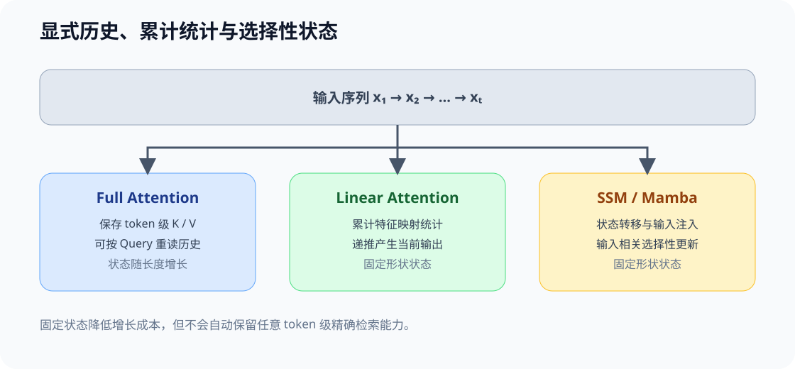

# 10 线性注意力、SSM 与混合记忆（Linear Attention, SSM, and Hybrid Memory）

## 学习问题

生成越长，显式键值（KV）历史通常越大。另一类结构把此前信息写入递推状态，新输入到来时更新它，再从中产生输出。状态空间模型（SSM）用状态转移与输入注入完成这类计算；线性注意力也可采用递推形式，但其状态来源和读取公式不同。

固定形状状态节省的是逐词元历史保存，却可能改变信息保留与检索方式。比较时既要看状态大小，也要看模型能否保留任务需要的远程信息，以及哪些层仍需显式注意力。

## 核心机制

### 历史怎样从逐项保存变为递推更新

标准注意力为每个历史位置保留 K/V，并在当前位置用查询向量检索它们。这个设计擅长内容寻址和任意位置交互，但状态会随序列长度增长，训练阶段还会面对大规模词元间计算。

令 $s_t$ 表示处理到第 $t$ 个位置后的状态，$x_t$ 是当前输入。最简单的累加规则 $s_t=s_{t-1}+x_t$ 会让输入序列 $[1,2]$ 与 $[2,1]$ 都留下状态 3：保存空间小了，顺序却无法由最终和恢复。更复杂的递推可以保留顺序和内容关系，效果取决于更新规则与状态容量，不能仅凭“固定状态”判断质量。

### 显式历史、受限访问与递推状态

| 记忆接口 | 保存什么 | 当前词元如何利用历史 | 主要优势 | 主要代价 |
|:---|:---|:---|:---|:---|
| 显式 KV 历史 | 每个历史词元的 K/V | 查询向量对历史 K/V 做内容相关检索 | 任意位置访问直观，适合复杂检索关系 | 状态随长度增长；注意力计算和访存压力高 |
| 局部 / 稀疏访问 | 部分历史 K/V 或选中的块 | 只读取窗口、块或检索到的历史 | 降低访问范围和理论连接数 | 可能遗漏窗口外或未选中的信息 |
| 线性注意力 / SSM 状态 | 固定形状的累计或选择性状态 | 递推更新 `s_t`，再由 `s_t` 产生输出 | 状态不随序列线性增长，适合长序列扫描 | 难以完全复现任意历史词元的随机检索 |

### 从线性注意力到选择性状态空间

线性注意力与 SSM 的共同点是避免显式构造全部词元两两关系，但状态来源不同：

- 线性注意力通常把历史 K/V 聚合为可递推的统计量，使查询向量能通过特征映射读取该聚合状态；
- SSM 用状态转移和输入注入更新内部状态，选择性机制再让不同输入以不同方式影响状态；
- 两者都把“保存全部历史”改写为“维护一个状态”，却不保证与全注意力完全等价。

这里固定的是单层、单序列的推理状态形状，不代表训练峰值也与长度无关：反向传播若要保存各步中间量，仍会增加长度相关存储。扫描指沿序列组合状态更新，能否并行取决于具体规则；训练路径与逐步解码还可能采用不同实现。

## 选择条件与验证证据

### 真实模型对照协议

标准注意力、SSM 和混合模型往往使用不同训练数据、规模、分词器、训练长度与实现路径，因此比较前要先声明对照类型；跨模型结果只能作为观察性证据。

| 对照组 | 记忆接口 | 可以回答的问题 | 不能直接推出的结论 |
| --- | --- | --- | --- |
| 显式 KV 注意力 | 每个历史词元的 K/V | 长度增长时状态、预填充与解码怎样变化 | 它一定比递推状态质量更好或更差 |
| 线性注意力 / SSM | 固定形状的累积或选择性状态 | 状态不随词元线性增长时，成本和长依赖质量怎样取舍 | 与另一模型的差异完全由记忆接口造成 |
| 混合架构 | 注意力层与递推层分工 | 哪些层保留全局读取、哪些层改为递推，端到端收益是否值得 | 混合比例可以从单项指标直接推导 |

| 比较设计 | 前提 | 可形成的结论 | 结果标签 |
| --- | --- | --- | --- |
| 同家族变体（`same_family_variant`） | 模型规模、数据、训练长度和实现大致可比，只改变或明确隔离记忆接口 | 可讨论候选结构在该家族中的相对取舍 | 近似结构对照 |
| 跨模型观察（`cross_model_observational`） | 使用不同公开模型快照 | 可用于部署选型与假设生成 | 观察性证据，不做单因素归因 |

真实对照至少使用短、中、长三个长度档；每档固定提示词模板、批次、生成长度、数据类型、执行后端与硬件。先记录提示词位于训练长度以内还是以外，再同时报告质量、状态和服务成本。

记录中同时保留模型与分词器版本、状态形状与层分布、任务质量及失败样例，再比较预填充、解码词元间耗时（TPOT）、吞吐和峰值显存。输出更快却丢失远程信息的候选，与质量相当但状态更小的候选，不能只用同一个速度排名。固定输入、结果和证据状态见[实验资产表](./experiment_assets.md)。

### 混合架构：把不同记忆职责放进不同层

纯注意力、纯递推与混合架构不能只按单项性能排名；三类结构承担的记忆职责不同：

| 设计 | 适合承担的职责 | 需要继续验证的风险 |
|:---|:---|:---|
| 全注意力主干 | 内容相关的全局检索、复杂上下文交互 | 长上下文状态和访存成本 |
| 局部 / 稀疏注意力 | 近邻模式或受控的远程访问 | 访问策略是否遗漏关键信息 |
| SSM / 递推层 | 低成本长序列状态更新、流式扫描 | 固定状态是否保留任务需要的信息 |
| 注意力 + SSM 混合 | 让部分层保留全局检索，部分层承担状态递推 | 层排列、接口切换和质量收益是否值得复杂度 |

显式 KV、注意力头与潜在表示决定保存什么；位置和访问范围决定仍保存词元历史时能够读取什么；递推与混合记忆则改变历史本身的保存方式。

机制验证从 [Part 02 · 45](../../02_PyTorch_Algorithms/45_Linear_Attention_and_Recurrent_State.md)的递推状态账本进入 [ARCH-HYBRID-MEMORY](../../02_PyTorch_Algorithms/ARCH-HYBRID-MEMORY_Attention_SSM_Hybrid.md)的层级组合；[Part 02 · 77](../../02_PyTorch_Algorithms/77_Long_Sequence_Memory_Architecture_Benchmark.md)补充长度阶梯上的质量与成本，[Part 02 · 61](../../02_PyTorch_Algorithms/61_Model_Architecture_Exploration.md)只汇总结构与证据等级。

## 相关阅读

- [Mamba: Linear-Time Sequence Modeling with Selective State Spaces](https://arxiv.org/abs/2312.00752)：选择性状态空间模型的代表入口。
- [Transformers are SSMs: Generalized Models and Efficient Algorithms Through Structured State Space Duality](https://arxiv.org/abs/2405.21060)：从结构对偶理解注意力与状态空间模型。
- [Part 02 · 45 线性注意力与递推状态](../../02_PyTorch_Algorithms/45_Linear_Attention_and_Recurrent_State.md)：先运行状态账本，再回到本页比较架构含义。
