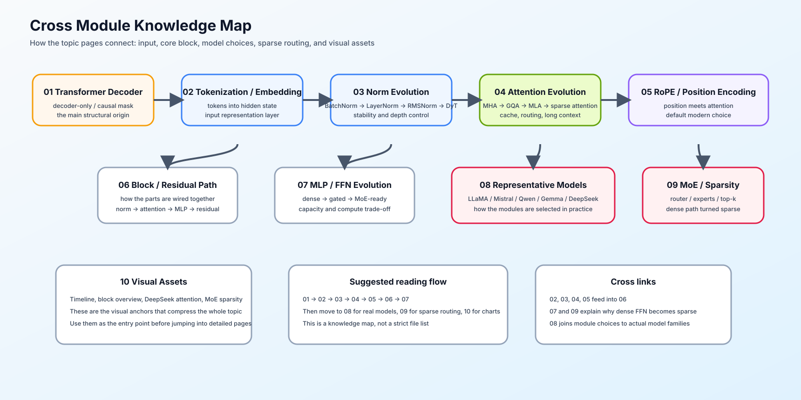

# 架构问题排查手册

使用本表前，先固定模型、分词器、权重、配置和执行后端的版本，再区分模型声明、模块实例化与真实运行路径。至少保留结构字段、张量形状、目标工作负载、失败样例和成本证据。

从“现象或目标”列选择最接近的一行，先采集最小证据；证据不足时保留为结构假设，不用模型名称或经验补全未知字段。

| 现象或目标 | 先检查什么 | 最小证据 | 机制入口 | 验证或转交入口 |
|:---|:---|:---|:---|:---|
| 配置声明与模块树不一致 | 模型提交版本、远程代码、权重键和实际模块 | 固定版本的配置、模块树、权重形状和加载日志 | [08 代表模型与结构审计](./08_representative_models.md) | [Part 02 · 08 配置与结构审计](../../02_PyTorch_Algorithms/08_Architecture_Tricks.md) / [Part 02 · 61 模型架构探索](../../02_PyTorch_Algorithms/61_Model_Architecture_Exploration.md) |
| 输入或词表变化被误判为主干架构变化 | 分词器、词表、嵌入和权重绑定 | 分词器版本、词表大小、嵌入形状和共享关系 | [02 分词与输入表示](./02_tokenization_embedding.md) | [Part 02 · 61 模型架构探索](../../02_PyTorch_Algorithms/61_Model_Architecture_Exploration.md) |
| KV 容量高于估算 | KV 注意力头、单头维度、潜在维度、层数和数据类型 | 逐层表示账本、真实缓存分配和执行路径 | [04 注意力表示演进](./04_attention_evolution.md) | [Part 02 · ARCH-MLA](../../02_PyTorch_Algorithms/ARCH-MLA_Multihead_Latent_Attention.md) / [Part 02 · 71 MLA / KV 结构基准](../../02_PyTorch_Algorithms/71_MLA_KV_Cache_Architecture_Benchmark.md) |
| 长度增加后质量骤降 | RoPE 参数、训练长度、目标长度和可见范围 | 长度阶梯质量、掩码或窗口配置和失败样例 | [05 RoPE 与长上下文位置机制](./05_rope_position_encoding.md) | [Part 02 · 44 局部与稀疏注意力](../../02_PyTorch_Algorithms/44_Local_Sliding_and_Sparse_Attention.md) / [Part 02 · 78 注意力访问模式](../../02_PyTorch_Algorithms/78_Attention_Access_Pattern_Benchmark.md) |
| 深层模型训练不稳定 | 归一化位置、残差顺序、中间维度和门控路径 | 模块顺序、激活与梯度统计、失败步 | [03 归一化演进](./03_norm_evolution.md) / [07 MLP / FFN 演进](./07_mlp_ffn_evolution.md) | [Part 02 · 60 Transformer 块稳定性](../../02_PyTorch_Algorithms/60_Decoder_Block_Stability_Benchmark.md) |
| MoE 吞吐、专家负载或容量异常 | Top-k、专家容量、容量溢出、分发与跨卡交换 | 逐专家负载、丢弃量、All-to-All 载荷和暴露通信 | [09 MoE 与稀疏容量](./09_moe_sparsity_evolution.md) | [Part 02 · 80 MoE 专家并行](../../02_PyTorch_Algorithms/80_MoE_Expert_Parallel_Benchmark.md) / [通信与并行](../communication_parallelism/intro.md) |
| 混合模型的状态成本或长序列收益不清 | 注意力 / SSM 层分布、递推状态形状和显式检索层 | 分层状态账本、长度阶梯质量、延迟和峰值显存 | [10 线性注意力、SSM 与混合记忆](./10_linear_attention_ssm_and_hybrid.md) | [Part 02 · 77 长序列记忆架构](../../02_PyTorch_Algorithms/77_Long_Sequence_Memory_Architecture_Benchmark.md) |
| 模型卡声称新结构，但实际收益不明 | 声明、实例化和运行三层证据是否一致 | 配置来源、模块树、真实路径、配对质量与成本 | [08 代表模型与结构审计](./08_representative_models.md) | [Part 02 · 61 模型架构探索](../../02_PyTorch_Algorithms/61_Model_Architecture_Exploration.md) / [性能优化](../performance_optimization/intro.md) |
