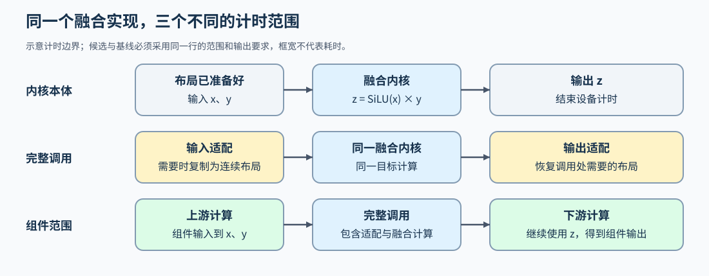

# 01 优化对象与比较基线（Optimization Targets and Baselines）

## 学习问题

同样计算 `x + y`，为什么手写 Triton 实现不一定比 PyTorch 快？GPU 内核（kernel）是提交到设备上并行执行的计算程序；换一种内核实现，并不意味着读取的数据更少，也不意味着提交它的成本更低。

从向量加法开始，先让两种实现处理同一输入，核对输出和向量末尾不足一块的部分，再比较耗时。这样可以逐步分清计算是否正确、测量是否可比，以及快慢究竟来自哪里。

## 从向量加法的输出和耗时开始

[Part 03 · 01 向量加法](../../03_Triton_Kernels/01_Triton_Vector_Addition.md)先用长度 1023、1024、1025 等输入核对尾块，再通过独立微基准对照 PyTorch 和 Triton 调用。可选计时的输入已在 GPU 上准备好，比较包含输出分配与内核调用，不包含主机到设备的输入搬运；首次编译的准备成本也不能由这两个耗时字段单独读出。

当前微基准先调用候选并核对输出，再用 `triton.testing.do_bench` 预热和重复测量两条路径。这里要做的是读清计时范围并比较同一工作，不是先搜索块大小或线程配置；当前结果也不是完整Python主机墙钟耗时。准备成本与更系统的多轮配对在后续比较中另行展开。

数值核对使用预先确定的容差，即允许的绝对误差或相对误差范围；它随计算和精度要求确定，不默认所有实现逐位相同。得到两种耗时后，再计算同范围的比值。若候选较慢，可继续从任务提交、内存访问、输出分配和测量波动寻找原因，而不是先认定手写内核应当更快。

## 比较激活内核，还是完整的激活与乘法

加法只有一步，再考虑两步计算 $z=\operatorname{SiLU}(x)\odot y$。这里 $x,y$ 是同形状输入，$\odot$ 表示逐元素乘法；SiLU 是逐元素激活，单个值 $t$ 的输出为 $t/(1+e^{-t})$。先激活再相乘，会产生一个激活中间张量；融合则有机会让中间值算出后直接被使用。

单独测激活内核，得到的是激活计算的时间；测完整的激活与乘法，还要包含中间张量读写和两次调用的成本。两者即使使用相同输入，也不能直接比较。新实现需要的额外转置或复制，同样属于完整调用的一部分。

展开算式的参考实现便于检查中间值与误差；性能基线则说明实际采用逐算子调用，还是编译后的计算。数值参考与性能基线可以不同，但融合前后都要从相同的 $x,y$ 得到完整的 $z$，并满足共同的输出容差。输入长度或数据类型改变时，两种实现也共同处理新输入。

## 加速比与耗时降幅怎样计算

设同一计时范围内，基线耗时为 $T_b$，候选耗时为 $T_c$，且两者均为正数。加速比是 $S=T_b/T_c$；耗时相对降幅则是 $d=1-T_c/T_b$。例如同一调用从 10 ms 降到 8 ms，加速比为 $1.25$，耗时下降 $20\%$，不能把 $1.25-1$ 直接称为耗时降幅。

先说明这些时间是单次观测、均值还是中位数，再解释比值。若每轮交替运行基线与候选，也可以先计算各轮比值，再汇总配对结果；这种统计与分别取两组中位数后相除不同。

## 计算、搬运和提交分别怎样形成开销

逐元素激活与乘法之间的中间张量，增加了一次写回和一次读取；融合可以尝试省去这部分搬运。矩阵乘法中的情况不同：加载的输入子块如果参与更多乘加，就能提高数据复用。小输入下，这些计算可能很快结束，主机提交和任务启动反而占据较大比例。

执行轨迹可以帮助区分这些情况：时间主要落在内核内部，还是落在调用间隙？前者继续分析计算和访存，后者再看任务提交。带宽、计算吞吐和启动次数用于解释耗时，最终仍比较相同范围内的总时间。

## 为什么局部变快可能只带来很小的整体改善

设某算子占原始总时间的比例为 $f$，替换后该算子的速度是原来的 $s$ 倍。假定其余阶段耗时不变，也没有新增布局转换、同步或重叠变化，总体加速比为：

$$
S=\frac{1}{(1-f)+f/s}.
$$

例如，假设原始总时间为 100 个时间单位，其中该算子占 10 个；该算子速度变为原来的 2 倍后，只用 5 个，总时间仍需 95 个。此时 $f=0.1$、$s=2$，总体加速比约为 $1.053$。这是按上述假设计算的示例；若替换还增加了复制或改变了执行重叠，这些时间也要计入。

## 从基线选择第一项改动

回到激活与乘法的例子，最直接的改动是尝试减少中间张量读写与一次任务提交。如果编译已经做到了这两点，后续再分析生成内核的访存；如果时间主要落在许多短任务的调用间隙，再考虑图重放。下一步通过[图编译与融合](./02_graph_compilation_and_fusion.md)观察这段计算如何合并。
