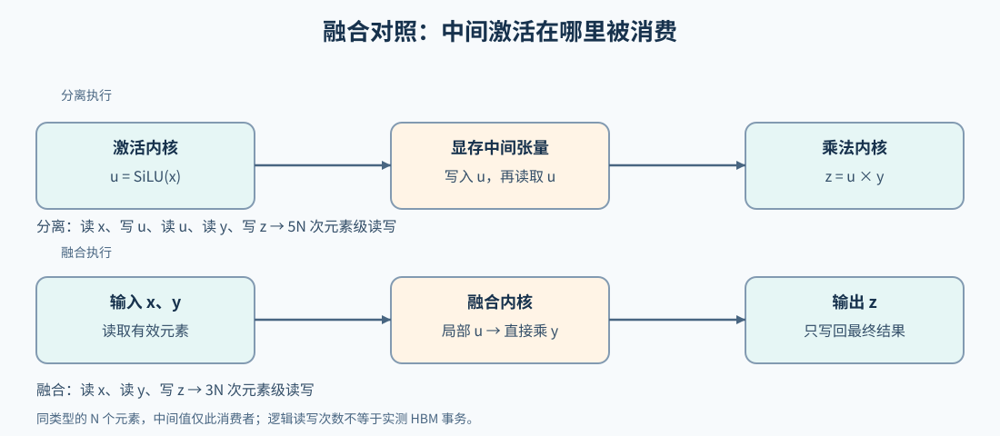

# 02 图编译、融合与执行候选（Graph Compilation and Fusion）

## 学习问题

一段“先做激活，再逐元素相乘”的计算，在 Python 中是两步，在 GPU 上却可能只用一个内核完成。理解编译优化，可以从这两步之间的中间张量开始：它为什么需要写回，又在什么情况下可以省去？

以 $u=\operatorname{SiLU}(x)$、$z=u\odot y$ 为例，$x,y$ 是同形状输入，$\odot$ 表示逐元素乘法。SiLU 将每个值 $t$ 变成 $t/(1+e^{-t})$，产生的中间值 $u$ 再被乘法读取。它是否还有其他用途，决定了融合后能否省去单独写回。

## 两次调用之间，中间张量经历了什么

分离执行时，激活内核读取 $x$ 并写出 $u$；乘法内核再读取 $u,y$，写出 $z$。若四个张量都含 $N$ 个元素，这两次调用合计产生 $5N$ 次元素级读写。融合后，内核可以读取 $x,y$，在局部计算中得到 $u$ 并立即相乘，最后只写出 $z$，合计为 $3N$ 次读写。这里计算的是逻辑读写量，实际显存事务还受缓存和访问方式影响。

省掉的正是 $u$ 的一次写入与一次读取。如果另一条分支也使用 $u$，融合内核就要继续为它写出中间值，或者让那条分支重新计算激活。这时减少一次调用，未必还能省去同样多的搬运。编译器通过依赖图识别这些额外使用者，再决定保留、重算还是省去中间张量。

## 从激活与乘法的依赖图到 GPU 内核

图中最初只需要表达“激活产生 $u$，乘法使用 $u,y$”。这些节点说明计算含义，却没有决定由多少线程执行，也没有指定中间值放在哪里。编译器获取依赖后，才能考虑把两步组成一个计算区域。

接下来，要将这个区域转换为后端能够处理的运算。例如，目标表示若不直接支持某个高层激活操作，就需要用其支持的运算表达相同计算，并处理类型与数值要求。将操作改写为目标表示允许的形式，属于合法化（legalization）；逐步转换成更具体的操作和实现，属于下沉（lowering）。两者在实际编译过程中可能交错进行。

运算以什么顺序执行、数据怎样分工，涉及调度（scheduling）；这里安排的是计算与数据访问，不是服务端的请求排队。以 Triton 为例，一个程序实例负责一片逻辑数据区域。若每个实例处理 4 个元素，长度为 10 的输入就分成三段，最后一段只有 2 个有效元素。生成的内核计算各段地址，读取 $x,y$，完成激活与乘法后写出结果；尾段屏蔽越界位置，中间值则有机会留在寄存器中。这是用于说明分块的简化安排，具体映射由编译器和目标设备决定。

编译版本通常有适用条件，例如形状、步长、类型或某些参数取值。运行前的守卫（guard）检查这些条件；输入变化仍满足条件时可以复用，超出条件时可能重新编译。图中断则是另一类情况：当前计算无法继续被捕获，允许分段的模式会尝试分别执行可编译区域，要求整图捕获的模式可能直接报错。因此，融合未发生时先看计算在哪里被拆开；融合已发生时，再分析生成内核的成本。

## 融合为什么仍可能更慢

对简单的激活与乘法，融合让 $u$ 算出后立即参与乘法，缩短其存活时间；若继续合入更多操作，一个程序却可能需要同时保存更多输入和部分结果。寄存器是线程保存局部值的片上存储，需求上升后，可同时驻留的线程块可能减少；放不下的值还可能转存到局部内存，形成寄存器溢出访问。此时虽然省去了显式中间张量，内核本身却可能更慢。

| 进一步改动 | 希望省去的工作 | 可能增加的工作 |
|:---|:---|:---|
| 激活与乘法合并 | 中间值写回、读取与任务启动 | 寄存器和并行度变化 |
| 共享输入的阶段组合 | 重复读取 | 更长存活期与更大工作集 |
| 布局统一 | 转置或复制 | 其他消费者是否需要重新转换 |
| 按形状特化 | 通用路径的分支或边界成本 | 编译次数、缓存规模和覆盖范围 |

## 手写内核的比较对象

如果编译后激活与乘法已经合并，手写内核就应与这条融合实现比较，而不是只与分离调用比较。若主要时间仍在融合内核内部，可以继续分析访存与分块；若两步仍然分开，则先查图中断、输入条件或后端支持，弄清未融合的原因。融合还可能改变中间舍入与运算顺序，数值核对使用预先确定的容差，不默认逐位相同。

把这个例子放回 PyTorch，可以比较三条路径：eager 按算子逐次调用；`torch.compile` 接收这段计算，由所选编译后端生成实现；手写 Triton 则显式描述分块计算。Inductor 是这里使用的编译后端，并非所有 `torch.compile` 调用的统称。[Part 03 · 03 SwiGLU 的三路径基准](../../03_Triton_Kernels/03_Triton_Fused_SwiGLU.md)在共同容差下对照这三种实现，分别记录准备成本、逐轮耗时和设备活动；若要追踪捕获与改写过程，可先读[Part 01 · 09 图编译](../../01_Hardware_Math_and_Systems/09_AI_Compilers_and_Graph_Optimization.md)。

三条路径处理固定形状时，比较的是该输入上的结果和成本。若编译路径准备更久、重复调用更快，是否值得还取决于后续调用次数；首次调用的差额也可能包含初始化，不能全归为编译。输入变化后能否复用编译版本，再回到守卫条件检查。

进一步用[测量与性能归因](./05_measurement_profiling_and_autotuning.md)分析准备与稳态成本；需要改变内核内部的地址、分块或协作时，再进入[计算内核语义与访存](./03_kernel_semantics_and_memory.md)。
