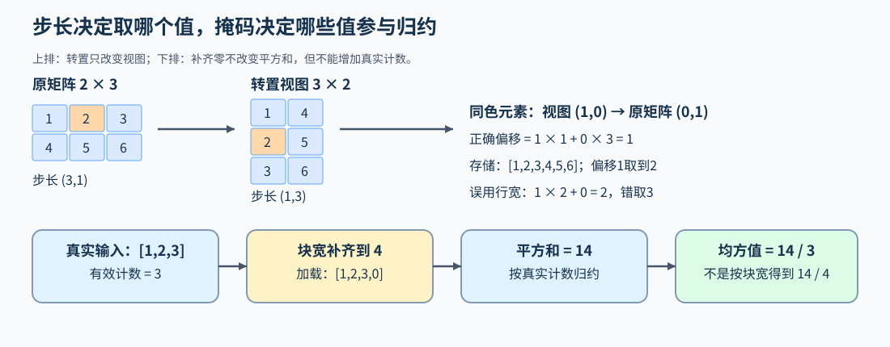

# 03 计算内核语义与访存（Kernel Semantics and Memory Access）

## 学习问题

转置视图与它的连续副本形状相同，寻址步长却可以不同；一行数据补齐后，即使没有越界，也可能算错平均值。内核既要找到正确元素，也要让补齐位置按原来的数学定义参与或退出计算。

先用转置矩阵追踪坐标与地址，再用三元素均方值追踪有效计数，最后比较逐元素融合与行归约多了哪些存储和协作要求。归约指沿一个维度把多个值合成一个或少量结果，例如把一行元素求和。

## 逻辑坐标怎样变成实际地址

设二维张量的行、列索引为 $i,j$，两个步长为 $s_0,s_1$，步长以元素数为单位。相对该视图首元素的地址偏移为：

$$
\mathrm{offset}(i,j)=i\cdot s_0+j\cdot s_1.
$$

连续的 $2\times3$ 矩阵通常具有步长 $(3,1)$；它的转置视图形状为 $3\times2$，步长变成 $(1,3)$。图中视图坐标 $(1,0)$ 应取原存储偏移1的值2；若误用“行索引乘逻辑行宽”，会算出偏移2，错取值3。内核因此应显式使用步长，或者在输入要求中限定连续布局；若选择复制为连续张量，性能比较还要计入复制成本。

## 从数据块到线程访问

坐标描述要处理的数据，线程分工决定由谁访问。Triton用程序实例（Program）处理一片逻辑数据区域，称为数据块（tile）；编译器再把块中的运算分给线程。例如长度10、块宽4时，可分为三块，最后一块只有两个有效元素；块宽4描述数据量，不规定使用四个线程。CUDA的线程块（Block）则组织线程及其块内共享资源，要与数据块区分。

在NVIDIA GPU上，32个线程组成一个线程束（Warp）。合并访存关注同一条访存指令中这些线程的地址能否由较少的成组访问服务，硬件执行这类访问时会形成内存事务。向量化则让单条指令处理多个元素；即使每个线程使用向量读取，线程之间的地址仍可能分散。

设32个活跃线程各读取一个四字节元素，首地址按32字节对齐，以32字节扇区（sector）统计覆盖。同样请求128字节，连续地址只覆盖4个扇区；若相邻线程相隔8个元素，就各占一个扇区，共32个。扇区是这里的地址覆盖单位，不等于每次都从显存重新读取同样多的数据；缓存和实际指令还会影响物理流量与耗时。下面再加一项起点错位对照，区分步长和对齐的影响。

| 访问安排 | 各线程起始字节偏移 | 覆盖的32字节扇区数 |
| --- | --- | ---: |
| 连续、起点对齐 | 0、4、…、124 | 4 |
| 连续、起点偏移一个元素 | 4、8、…、128 | 5 |
| 步长8个元素、起点对齐 | 0、32、…、992 | 32 |

## 掩码怎样同时保护访存和数学范围

向量尾块需要阻止无效位置读取和写回；归约还要保证补齐值不会改变有效结果。例如，真实一行是 $[1,2,3]$，逻辑块宽为 4，第四列加载为零后得到 $[1,2,3,0]$。平方和仍是 $1+4+9=14$，但均方值应为 $14/3$；若除以块宽 4，就错误地得到 $3.5$。保护访问地址与保持归约定义，是两个都要完成的步骤。

掩码（mask）按位置决定是否访问或参与计算。不同归约需要不同的中性值，也就是加入后不改变结果的值：求和可补零，求最大值可排除无效项或补负无穷。Softmax把每个分数的指数除以整行指数和，无效位置必须在计算这个分母之前排除。例如三个有效得分都为零，正确权重各为三分之一；若第四个补齐位置也以零参与，四个位置就各占四分之一，只屏蔽最后一次写回无法恢复前三个权重。每个有效查询还需至少保留一个键，才能按这里的定义完成归一化。

| 边界对象 | 需要保持的条件 | 容易遗漏的错误 |
|:---|:---|:---|
| 输入与输出地址 | 真实坐标内才访问 | 只保护读取，写回仍越界 |
| 归约范围 | 补齐项不影响有效结果 | 补齐位置进入最大值、求和或计数 |

## 逐元素融合与行归约改变了什么

逐元素融合可以让一个中间值算完即被下一步使用。例如前一页的SiLU激活与逐元素乘法，某个位置的输出只依赖同位置输入，中间激活有机会直接留在线程的局部计算中，省去一次写回与读取。行归约则让多个位置共同决定结果：RMSNorm先求一行的均方值，再用同一个缩放量处理该行；Softmax的所有有效分数共享最大值与指数和。为了省去这些中间量的完整写回，一个程序需要同时处理或逐步汇合一行的数据，地址正确之外还多了归约范围和累加状态的要求。

寄存器保存线程正在使用的局部值，共享内存供同一线程块的线程交换数据，缓存则可能复用近期的全局访问。它们有各自的容量与访问规则，不能把全部片上容量当作一个可互换的预算。输入存储类型也不必与累加类型相同：两字节输入可以先转为FP32计算平方和，减轻累积舍入；这不会恢复输入转换前已丢失的精度。要保留的局部值变多时，还需检查寄存器和共享内存用量，而不是仅根据少一次写回判断速度。

## 从一个Program归约到多个Program合并

行内归约先让一个Program处理一行。把一条较长向量分给多个Program时，每个Program只能得到自己那一段的部分和，还需要合并这些结果。以十个数 `[1,2,…,10]`、每段四项为例，三个Program分别得到10、26、19，再相加得到55。

[Part03·22 两阶段归约](../../03_Triton_Kernels/22_Triton_Two_Stage_Reduction.md)让第一阶段各写一个独占槽位，第二阶段读取全部部分和，输出总和。第二阶段需等待第一阶段写完；本例在同一CUDA流中按依赖顺序提交两个内核。这样增加了一次提交和临时缓冲读写，换来输入范围的并行拆分。先完成RMSNorm的行内归约，再进入这一扩展，分别核对输入尾块、部分和数量和阶段顺序。

## 共享数据的就绪与复用

一个程序独立负责完整输出区域时，先核对覆盖、边界和唯一写入者；多个线程共同形成结果时，还要明确局部结果怎样交换。一个线程写入共享内存后，其他线程要等数据就绪再读取；下一轮覆盖同一缓冲区前，还要等本轮读取结束。前者避免读到旧值，后者避免读到被提前覆盖的新值。原子操作让某个共享位置的一次特定更新不可分割地完成，可避免并发更新互相覆盖，但不代替这两种等待。

以一行求和为例，每个Warp先合并本组线程持有的值，再通过共享内存汇合多个Warp的局部和。共享内存按存储体（bank）组织访问；在每线程读取一个32位字的例子中，不同字落入同一存储体可能需要分次服务，多个线程读同一个字则可广播。跨Warp合并和地址安排是不同的优化问题，前者看同步与合并顺序，后者看各次指令的存储体映射。

实现当前计算时，按问题进入[Part03·02 二维布局](../../03_Triton_Kernels/02_Triton_Layouts_and_Memory_Access.md)、[Part03·03 SwiGLU融合](../../03_Triton_Kernels/03_Triton_Fused_SwiGLU.md)，或[Part03·04 RMSNorm](../../03_Triton_Kernels/04_Triton_Fused_RMSNorm.md)／[Part03·07 Softmax](../../03_Triton_Kernels/07_Triton_Fused_Softmax.md)归约练习。需要直接控制线程地址与协作时，再选Part04的[合并访存](../../04_CUDA_and_System_Optimization/02_CUDA_Global_Memory_Coalescing.md)、[Warp协作](../../04_CUDA_and_System_Optimization/03_Warp_Level_Primitives.md)或[存储体映射](../../04_CUDA_and_System_Optimization/04_Bank_Conflict_Deep_Dive.md)对照。

处理矩阵子块复用与跨块注意力时，继续读[矩阵计算与推理状态的数据路径](./04_attention_and_inference_data_paths.md)，其中在GEMM分块之后展开输出块的循环分工。通过数值核对后需要判断快慢，再进入[测量与性能归因](./05_measurement_profiling_and_autotuning.md)，比较配置或任务分配的成本。
