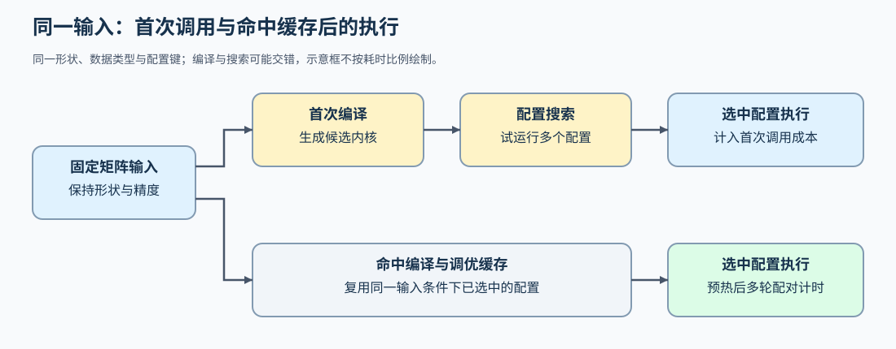
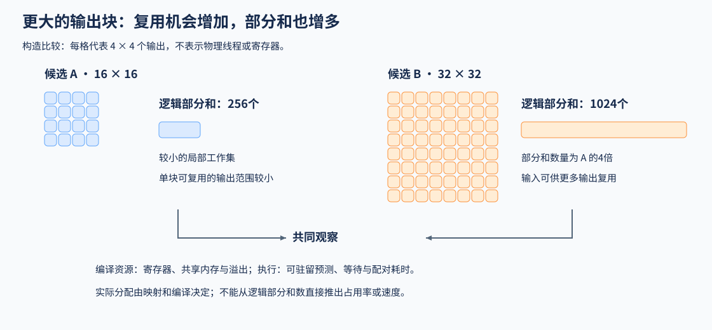

# 05 测量归因与自动调优（Measurement, Profiling and Autotuning）

## 学习问题

矩阵乘法换了更大的分块，第一次运行反而变慢，后面几次却更快。这个现象可能同时包含新配置的编译时间和计算加速；只比较两次调用的总时间，会把不同原因混在一起。

以下用同一组矩阵比较两个候选：A 使用 $16\times16$ 输出块，B 使用 $32\times32$ 输出块。先看 B 多保存了哪些数据，再分开首次准备与后续执行。自动调优按给定输入测量候选配置并选择较快者；执行轨迹则帮助解释这个选择为什么有效。

## 更大的分块省了读取，也增加了什么

矩阵乘法中，一个输出块可以复用加载的输入子块。从 A 换成 B，程序负责的输出从 256 个增加到 1024 个，逻辑上需要同时保存的累积结果增至四倍；实际寄存器分配还取决于线程映射和编译。寄存器保存线程的局部值，容量不足时，部分值会转存到局部内存，这称为寄存器溢出。B 可能减少相邻程序重复读取的数据，也可能因溢出访问增加读写，抵消复用收益。

若同口径观测到重复读取减少且耗时下降，数据复用改善可以作为加速原因之一；若耗时上升，同时出现更多寄存器溢出访问，则需要考虑寄存器压力。源码里推导的逻辑读取量不等于设备实际流量，仅凭分块大小或一次计时，无法区分这些原因。

下图每格代表4×4个输出，用相同格尺度比较两种tile。条形只表示逻辑部分和数量；实际寄存器分配与溢出需要编译资源及执行观测。

## 每块资源怎样限制同时驻留的任务

SM（流式多处理器）是 GPU 执行线程块并提供片上资源的硬件单元；NVIDIA 的一个 Warp 包含 32 个线程。同一个 SM 上可以驻留多个 Warp，当部分 Warp 等待数据时，调度器有机会执行其他已就绪 Warp。能同时容纳多少线程块，要共同满足线程、Warp、寄存器和共享内存等限制。

若 A 的每块共享内存需求允许同时放下两个块，而 B 的需求翻倍，仅这一项就可能把 B 的驻留上界降为一个块；寄存器或线程限制还可能给出更低的上界。因此，B 即使减少重复加载，也可能减少等待时可切换的 Warp，最终仍要比较两种效果合在一起的耗时。

[Part 04 · 05 资源与驻留](../../04_CUDA_and_System_Optimization/05_CUDA_Block_Resources_and_Residency.md)固定计算和线程配置，只改变动态共享内存预留，用简化上界、CUDA 查询与配对耗时分别检查容量和时间。上界与查询都是可驻留预测；实际平均活跃比例需要另行观测。预测降低而耗时不变，可能说明原有并行度已经足够，不能据此否定容量约束，也不能仅由查询值推出加速。

## 函数相同，实际执行的代码是否相同

先确认候选输出与参考一致。尾块出错时，检查地址步长、有效位置与写回掩码；归约或循环计算出错时，继续检查有效计数、累加器重置和跨块状态。[Part 03 · 17 内存调试](../../03_Triton_Kernels/17_Triton_Memory_Model_and_Debug.md)提供这类错误的定位练习。错误输出对应的耗时不能作为采用该实现的依据。

GEMM 指矩阵乘法。同一个 GEMM 函数采用 A、B 的 tile 尺寸时，可以生成不同代码；线程束数量和编译期常量也会影响生成结果。针对这些条件生成的代码及相关元数据称为特化产物。把输入条件、编译配置和产物对应起来，再核对实际启动的对象，才能知道当前耗时属于哪个版本；Python 函数名相同并不能回答这个问题。

[Part 03 · 18 编译产物与实际执行](../../03_Triton_Kernels/18_Triton_Compilation_Artifacts_and_Execution.md)核对特化产物与 CUDA 调用记录中的内核身份。若关注的是整个 PyTorch 组件有没有被捕获、在哪里图中断，还要查看该组件自己的编译与执行记录。

反过来，同一份二进制也可以用不同网格分配任务。网格（grid）指定一次启动在各维安排多少个 Triton 程序实例（Program）；每个实例可以负责一个或循环处理多个输出块（tile）。若要研究有限 Program 循环处理多个 tile 的代价，可以固定代码和编译资源，只改变网格；记录每个 tile 的实际访问次数与归属，用于检查覆盖。计时时关闭这类记录，并让对照使用相同的测量方式。这样得到的差异更接近任务分配的影响，但还不足以单独证明缓存命中或调度开销是原因。

## 第一次调用与后续调用分别测到了什么

若 B 尚未编译，第一次调用可能先生成其代码；启用自动调优时，还可能分别运行 A、B 等配置再选择较快者。后续输入命中已有编译和调优缓存时，通常直接执行选中的配置。因此，第一次比后续慢，并不能单独说明差额全是编译时间：配置搜索、初始化和缓存状态也可能参与其中。

| 计时范围 | 包含的工作 | 适合比较的目标 |
|:---|:---|:---|
| 首次调用 | 当前调用触发的编译、搜索、初始化与执行 | 启动成本或一次性任务 |
| 准备后的重复调用 | 编译、搜索与预热完成后的被测调用；注明计时器和同步边界 | 当前配置在给定调用范围内的稳态成本 |
| 完整组件 | 调用、布局转换、计算和必要同步 | 集成后的总耗时 |

GPU 操作通常异步提交。若用主机时钟在提交后立即停止计时，设备可能尚未完成计算。主机墙钟配合边界同步，记录的是调用至完成的时间；设备事件记录选定设备窗口内的时间，两者包含的提交、分配与等待并不相同。对多流任务，还要让结束事件或同步覆盖所有被测工作。在内部每个阶段都加同步，则会改变原本的重叠关系。

## 准备成本需要多少次调用摊销

假设候选比基线多花 $\Delta C>0$ 的一次性准备时间，之后每次基线耗时为 $T_b$、候选为 $T_c$。两条路径都执行 $n$ 次相同工作，候选至少持平的条件是 $n(T_b-T_c)\ge\Delta C$。当 $T_b>T_c$ 时，最少调用数为：

$$
n_{\mathrm{break}}=\left\lceil\frac{\Delta C}{T_b-T_c}\right\rceil.
$$

假设选用 B 比 A 额外准备 100 ms，准备后每次从 0.5 ms 降为 0.3 ms，就需要 500 次调用才刚好抵消准备成本。这是构造例子，假定后续一直复用同一准备结果；输入变化导致重新编译或捕获时，要重新计入成本。若 B 稳态并不更快，增加调用次数也无法按此模型摊销正的新增准备成本。

## 一次最快值为什么不足以选配置

两个配置依次运行，可能遇到不同的设备负载、频率或缓存状态。交替测量并保留多轮样本，可以看到差异是否反复出现。第 $i$ 轮的基线、候选耗时分别为 $b_i,c_i>0$ 时，先计算 $s_i=b_i/c_i$，再取配对加速比中位数；若改为分别取两组耗时中位数后相除，应单独注明统计方式。快慢排序随轮次变化时，先解释波动，而不是根据一次最小值选配置。

性能剖析适合查看访存、等待与资源使用，但采集本身也可能影响时间。计时与轨迹采集分开进行，再将同一输入、配置下的观察联系起来。只有调用名称而没有访存或资源观测时，可以确认执行对象，仍不能把耗时差直接归因于缓存命中或寄存器溢出。

## 配置复用与形状分桶

较大矩阵可能更适合 B 的复用方式，小矩阵却可能因尾块填充和输出块数量过少而更适合 A。因此，自动调优选中 B，首先说明它在当前输入和候选集合中的表现，不能直接把这个选择推广到所有矩阵。

逐形状调优能适配更多输入，也增加编译、搜索和缓存成本。按形状分桶则让一组相近输入复用配置，但还要检查桶两端的形状。选择时可结合各类输入的出现频率与启动成本，分别保留它们的耗时，避免平均值遮住某类输入的退化。

[Part 03 · 09 自动调优与基准测量](../../03_Triton_Kernels/09_Triton_Autotune_and_Profiling.md)用三档向量长度记录选中配置及交替配对耗时；该窗口在正确性调用和预热之后测量，不包含完整首次编译与搜索成本。需要比较任务分配时，再用[Part 03 · 06 持久化GEMM](../../03_Triton_Kernels/06_Triton_Persistent_GEMM_and_Tile_Scheduling.md)固定计算、改变Program预算，不从Program更少直接推断更快。

选中的配置放回组件后，布局转换和相邻计算也会计入总时间，具体比较见[组件集成与复测](./07_integration_benchmarking_and_adoption.md)。
