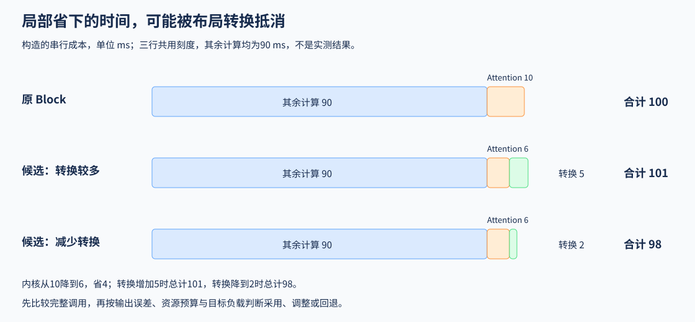

# 07 集成、基准与采用判断（Integration, Benchmarking and Adoption）

## 学习问题

一个 Attention 内核单独运行时更快，换进解码器后却几乎没有收益。新增的布局复制可能抵消加速；即使没有额外复制，注意力原本较小的耗时占比也会限制整个模块的改善。

下面保持权重不变，只替换 Attention 实现，并把它放回解码器块（Block）——由注意力、投影、残差等计算组成的模型组件。先理解[Part 03 · 19 算子接入](../../03_Triton_Kernels/19_Triton_PyTorch_Op_Integration.md)示例的输出、梯度与编译调用，再用[Part 03 · 20 Block 集成](../../03_Triton_Kernels/20_Triton_Llama3_Block_Project.md)比较注意力替换后的完整成本。判断可以是保留、调整或回退，局部加速只是可能的起点。

## 接入投影与残差的形状要求

假设参考注意力接收的张量维度顺序是“批量、头、位置、特征”，新内核却要求另一种布局。调用处需要先调整维度；输出送入投影前，还要恢复投影所需的形状。单独核对内核输出时若跳过了这两次转换，就可能漏掉集成处的维度错误。

完整 Block 的比较使用相同输入、权重、位置编码与掩码。这样，差异才能集中到注意力替换及其相邻转换。残差连接将子层的输入加回输出，若新实现意外修改了原输入，残差相加也会受影响；训练调用则需要继续检查梯度，因为正确的前向输出没有定义反向传播该如何计算。

接入训练时，需要为当前算子提供正确的反向路径，并核对上游梯度如何传到输入和参数；接入编译图还要检查算子接口与编译调用的兼容性。一个简单算子的梯度与整图核对，只验证该示例的接入行为。Attention 前向、量化乘加或 LoRA 路由要用于训练，仍需各自的反向实现与数值检查。

## 布局复制带来的额外耗时

转置视图通常只改变形状和步长；若新内核要求连续存储，调用前就可能新增一次实际复制。这次搬运，以及输出恢复布局的成本，都发生在完整注意力调用中。只测内核本体会漏掉它们。

举一个构造例子：原 Block 共用 100 ms，其中参考注意力完整调用用时 10 ms，其余计算用时 90 ms。新内核本体只用 6 ms，但额外布局转换又花了 5 ms，新注意力调用合计就是 11 ms，整个 Block 变成 101 ms。计算本体确实更快，完整调用却更慢；逐步扩大计时范围，可以定位这 5 ms 是在哪里加入的。

下图将原Block与两种候选的成本按同一刻度展开：其他计算不变，变化来自Attention与新增转换。第三行把转换降到2 ms，总时间成为98 ms；数值均为构造示意。

| 比较范围 | 包含的工作 | 用来解释什么 |
|:---|:---|:---|
| 内核本体 | 已准备好布局的输入到注意力输出 | 分块与计算本身是否更快 |
| 完整注意力调用 | 输入转换、内核、输出转换 | 接口适配是否抵消局部收益 |
| 同权重 Block | 注意力、投影、残差和其他原有计算 | 替换能节省多少组件时间 |
| 多层预填充 | 各层计算及层间数据流动 | 局部变化在目标长度下能否保留 |

## 调用新接口后，设备上执行的还是新内核吗

直接调用、编译调用和模型组件可能经过不同的分派过程。例如某些输入满足新内核要求，另一些输入却触发回退；编译器也可能保留调用，或把周围操作改写成另一组计算。因此，要将设备轨迹中的内核与实际调用对应起来，再解释耗时来自哪里。

如果发现回退，先查触发它的形状、布局或精度条件，并将该组输入按实际执行方式比较。仅有函数名称或配置开关，无法判断设备执行了哪一种实现。

## 内核快了，为什么整个模块几乎没变

继续上面的例子，假设把布局转换从 5 ms 降到 2 ms，注意力完整调用就变成 8 ms。其余计算仍用 90 ms，Block 共需 98 ms，耗时下降 2%。内核本体省下的 4 ms，先被接口转换抵消一部分；剩余收益再放回整个 Block，比例就更小。这里假定其余计算和重叠关系不变，数字用于说明成本组成，不是实测结果。

两种实现使用同一批输入和同一组权重，交替进行多轮测量，可以减少输入差异和设备状态变化的影响。首次编译与准备成本另计；预填充长度变化后再分别比较，避免用一个长输入上的加速掩盖短输入退化。比较同一组件跨长度的表现时也保持权重不变；若每个长度重新生成模型，就只能解释各组内部的配对，不能将组间变化全部归因于长度。

## 哪些输入适合保留新实现

新实现可能只在长序列上有优势，也可能更快但使用更多显存。是否采用，要同时看该长度下的输出误差、完整调用时间和资源预算：收益足够且预算允许时保留新实现；短输入退化时保留原路径；输出错误时先修复计算或接口。如果按长度分派，判断与分派本身也属于完整调用，还要检查分界附近的输入，避免只验证桶中间的形状。

例如，假设在比较前已约定：目标形状下 Block 耗时至少下降 2%，峰值显存不超过 8 GiB，输出满足给定容差。若配对测量支持 100 ms 到 98 ms 的改善，峰值为 7 GiB，且数值和实际执行路径都已核对，就可以在这组条件下保留新实现。若只有 98 ms 的时间、缺少峰值或实际调用记录，则先补测；若输出已经超出容差，则先修计算。缺少观测与已知不满足要求，不能得出同一种结论。

## 容量或成本限制改变了候选方案时

如果目标从前向组件扩展到训练或多设备任务，还要容纳参数、梯度和优化器状态。ZeRO 是将这些训练状态分片给不同参与者的一组方法，各阶段分片的对象不同；卸载则把部分状态移到主机或存储。它们改变的是状态存放和传输方式，不是注意力内核的计算公式。

假设把 2 GiB 数据移到主机后，每次又要传回 GPU；若仅按 16 GiB/s 有效带宽估算，这次单向传输就需 125 ms，还未计入调回分配和等待。因此，减少驻留量后能运行的方案，仍需把搬运加入完整任务时间，才能与不卸载的方案比较。

[Part 04 · 16 ZeRO配置](../../04_CUDA_and_System_Optimization/16_DeepSpeed_Zero_Config.md)检查状态分片和卸载条件的组合；配置可解析只是运行前提，真实状态分片仍需训练验证。[Part 04 · 17 卸载路径](../../04_CUDA_and_System_Optimization/17_Heterogeneous_Training_CPU_Offload_NVMe_Offload.md)分开估算搬运，并对照驻留与CPU往返；进入NVMe时还需计入存储读写。若两套实现都能满足目标负载，先用[Part 04 · 18 实现选型](../../04_CUDA_and_System_Optimization/18_CUDA_vs_Triton_vs_PyTorch.md)比较维护和适用条件，再用[Part 04 · 19 成本选型](../../04_CUDA_and_System_Optimization/19_TCO_and_Hardware_Selection.md)比较总拥有成本（TCO）。成本比较固定业务量、质量、时延和观察期；理论算力和峰值吞吐不能直接充当合格业务产出。

完成同权重Block比较后，需要扩大到多层预填充负载时再进入[Part 05 · 05 独立综合项目](../../05_Integrated_Projects_and_Decisions/05_Operator_Optimization_Delivery/index.md)，重新计入调用次数、输入长度和层间开销。不同出口的运行入口和结果分别见[实验资产表](./experiment_assets.md)。
