# 算子优化问题链：从注意力计算到工作负载复测

假设一个解码器在长输入预填充时变慢，执行轨迹显示 Attention 占用了较多时间。接下来沿着同一个问题比较：现有 PyTorch 路径能否通过编译改善，注意力分块是否减少中间读写，以及替换后的收益能否保留到组件和目标负载中。这里描述判断过程，实际结论由对应环境中的测量给出。

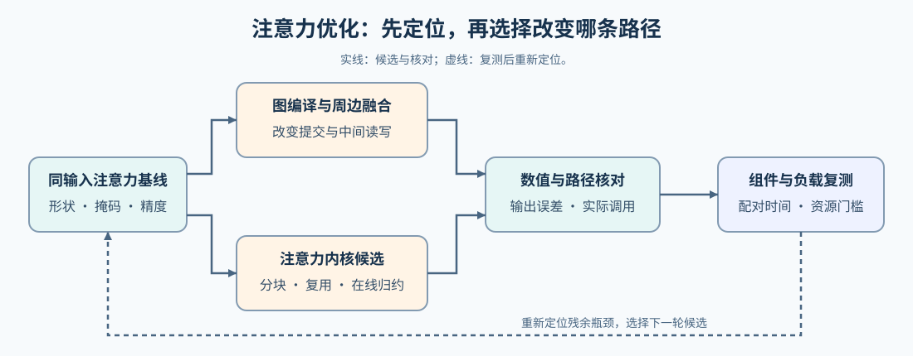

## 先固定正在比较的注意力计算

注意力用查询（Q）与键（K）计算分数，再混合对应的值（V）。保留同一组 Q/K/V、头数、序列长度、数据类型和因果掩码，使用 PyTorch 参考路径核对候选输出，并记录实际调用的后端。教学中的显式矩阵计算便于理解语义；性能基线则采用当前环境中可用且配置明确的执行路径。比较分块方案前，还要覆盖尾块、不同长度和数值误差。索引与边界处理不熟悉时，可先完成[Part 03 · 01 向量加法](../../03_Triton_Kernels/01_Triton_Vector_Addition.md)，再回到注意力计算。

先用较小的计算说明计时边界：$z=\operatorname{SiLU}(x)\odot y$ 对同形状的 $x,y$ 先激活再逐元素相乘，SiLU 将每个值 $t$ 变为 $t/(1+e^{-t})$。内核本体从布局就绪的输入开始，完整调用还要包含适配成本，组件则继续包含上下游计算。注意力替换同样需要区分这些计时范围。

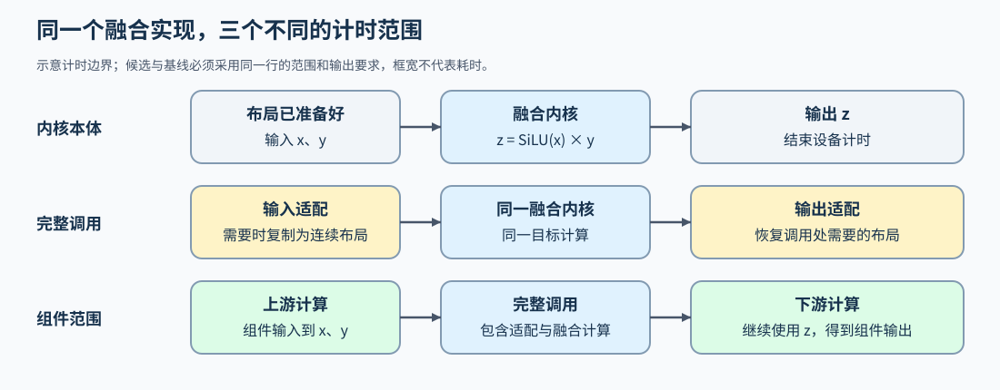

## 先评估编译能改变什么

同一组件中，投影、布局变换和逐元素计算可能产生额外提交与中间张量。先对照逐操作执行与编译候选，核查图是否被完整捕获、哪些操作被融合、哪些依赖仍要求保留写回，再把首次编译与稳态运行分开计时。如果注意力已由高效后端执行，周围操作被融合也不意味着注意力内核发生了变化；如果剩余耗时集中在注意力内部，再进入分块与自定义内核。判断依据见[图编译、融合与执行候选](./02_graph_compilation_and_fusion.md)。

候选明确后，再核对记录里的输入条件、编译产物和设备调用是否对应同一次比较。同一个函数名可能生成多份特化代码；组件中的注意力也可能经分派调用另一后端。把这层对应关系弄清，后面的快慢比较才有明确对象。

## 时间花在矩阵计算还是中间读写

显式注意力会产生随序列长度平方增长的分数或概率矩阵。跟踪这些中间值从哪里读取、在哪里复用、何时写回，才能解释分块方案想节省哪部分搬运。共享内存和寄存器承担存储职责，Tensor Core 承担矩阵计算；逻辑分块最终如何映射到它们，取决于生成代码和设备。发现错误步长、重复读取或边界异常时，可结合[Part 01 · 16 线程协作与共享内存](../../01_Hardware_Math_and_Systems/16_Warp_Block_SharedMemory_Basics.md)和[Part 03 · 17 内存调试](../../03_Triton_Kernels/17_Triton_Memory_Model_and_Debug.md)定位。

两个更小的例子可以分别检查地址与归约范围：转置改变寻址步长，尾块补齐则不能改变真实计数。下图用转置视图和三元素均方值展示这两类错误的来源。

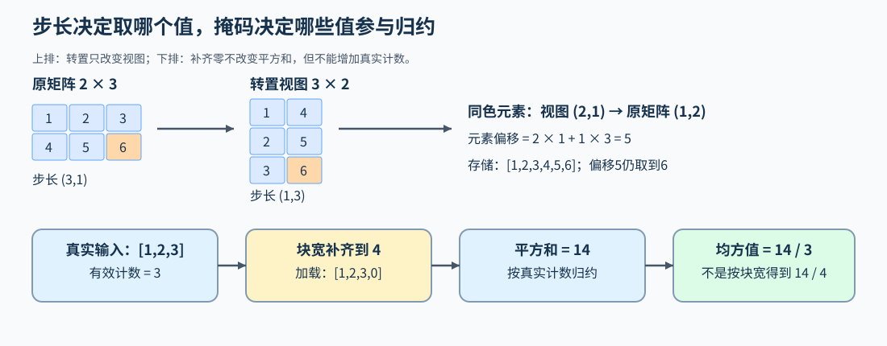

## 省去写回是否值得融合

把注意力的分数计算、归一化和输出累积放进同一内核，可以缩短中间值的生命周期。更简单的对照是 `z = SiLU(x) * y`：分离执行时，激活结果先写回再被乘法读取；融合后，结果可在局部计算中直接消费。若中间结果还被其他分支使用，就要保留该分支所需的数据。融合也可能扩大局部状态、增加寄存器占用，因此要同时检查节省的读写与新增资源压力。

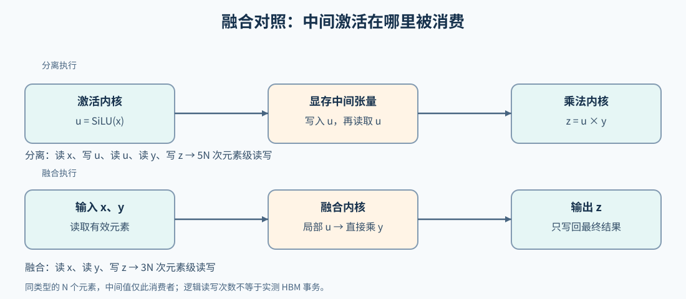

## 分块以后怎样保持注意力结果

先看矩阵复用：M、N为2，K为4，每轮处理两个K位置；A的两行与B的两列共同形成四个输出。下一轮继续向这四个部分和累加，而不是清零重算。

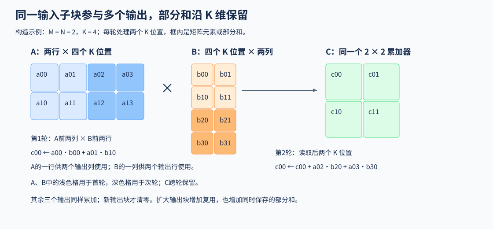

固定一个查询块，分批读取 K/V 时，必须持续更新每行最大值、指数和及输出累积量，并在最大值变化时重新缩放旧贡献。这样才能在不保存完整分数矩阵的情况下得到对应的注意力输出。[Part 03 · 11 FlashAttention](../../03_Triton_Kernels/11_Triton_Flash_Attention.md)用于实现并核对这条路径。若进一步转向逐词元解码，分页寻址和 KV 量化分别改变读取地址与数值恢复，它们需要各自的状态和误差检查，详见[矩阵计算与推理状态的数据路径](./04_attention_and_inference_data_paths.md)。

例如，四个键的分数是 1、2、3、4，每块处理两个键。第二块让行最大值从 2 变为 4，旧指数和与旧加权累积量都要乘以 $e^{-2}$，再加入新块贡献。图中的值向量 $v_1$–$v_4$、指数和 $\ell$ 和加权累积量 $a$ 对应这一构造示例。

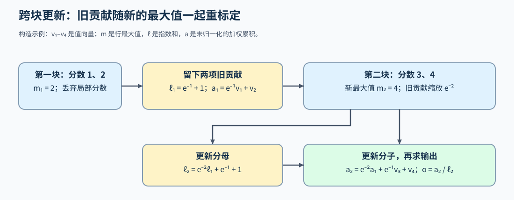

## 剩余瓶颈需要改变哪一层

同一分块在不同设备上的寄存器需求、共享内存占用和指令效率可能不同。若瓶颈仍在内核内部，就结合[测量归因与调优](./05_measurement_profiling_and_autotuning.md)检查线程协作、矩阵指令和数据复用；若输入搬运或大量小任务提交已经成为关键路径，再分别评估传输与计算的依赖、操作提交的复用。

缓冲区复用还要等待引用和在途访问结束。张量已释放而分配器仍预留显存时，要区分可复用空闲块与仍被使用的数据，不能把设备占用没有立刻下降直接判成泄漏。下图按搬运、提交和内存三个对象检查，具体的流与事件、图重放和显存观察见[传输、提交与显存生命周期](./06_cuda_execution_and_runtime_constraints.md)。

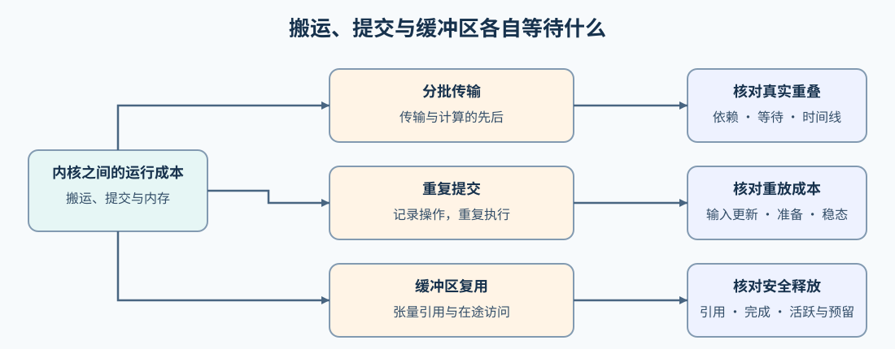

把等待画到时间线上：三批独立输入，每批传输4 ms、计算6 ms。串行共30 ms；具备并发条件时，B、C传输可被前批计算覆盖，双缓冲理想流水共22 ms。图中蓝色为传输、橙色为计算，箭头表示本批依赖；这些是构造时间。

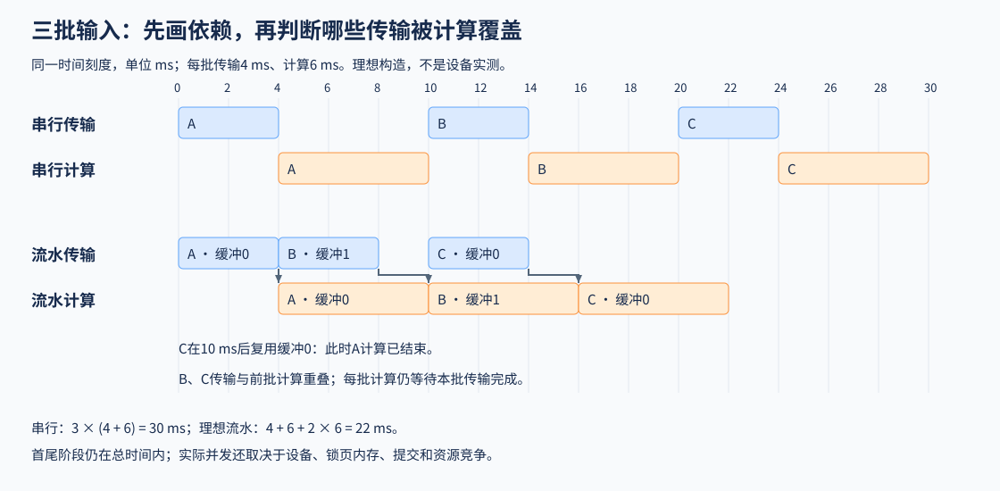

## 配置搜索怎样检验瓶颈假设

序列长度与头维度变化后，合适的分块、线程束数量和流水阶段也可能变化。对每组形状先核对候选正确性，分别记录首次编译与搜索成本、预热后的稳态耗时；[Part 03 · 09 自动调优与基准测量](../../03_Triton_Kernels/09_Triton_Autotune_and_Profiling.md)提供配置搜索与计时练习。配置搜索回答“给定候选中谁更快”，性能轨迹则用于解释原因：例如更大分块是否因资源压力而退化，或内核加速是否被其他阶段抵消。有效但更慢的候选同样能帮助缩小下一轮搜索范围。

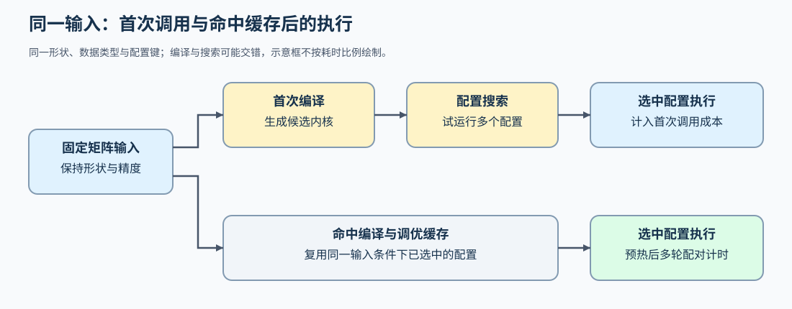

配置搜索还要解释资源取舍。下图每格代表4×4输出：16×16和32×32输出块分别保留256与1024个逻辑部分和，条长不代表实际寄存器分配或耗时。

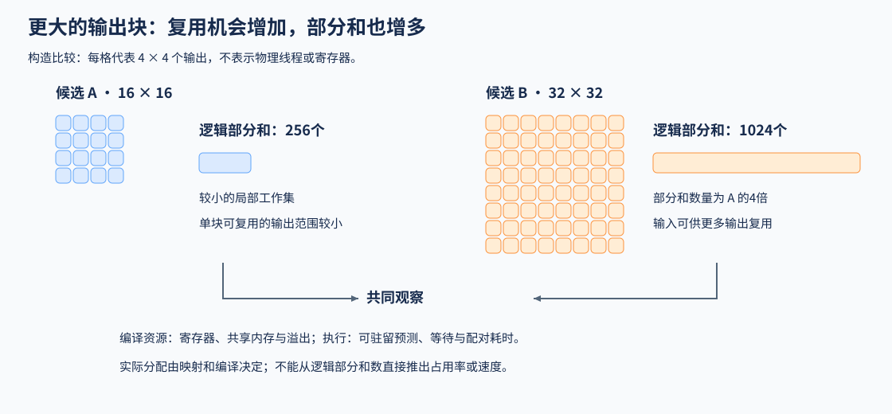

## 替换回组件后完整调用是否改善

若要检查单组件替换的影响，可在[Part 03 · 20 同权重 Block 对照](../../03_Triton_Kernels/20_Triton_Llama3_Block_Project.md)中替换 Attention，重新核对输出并单独测量组件时间。若局部内核更快而 Block 收益很小，应检查它原本占总时间的比例，以及替换引入的布局转换、调用和同步开销。候选更慢时也保留记录，据此调整或拒绝采用。

用构造成本解释这种抵消：原Block为100 ms，其中Attention为10 ms、其余计算为90 ms。候选Attention降到6 ms，但转换增加5 ms，完整时间反而为101 ms；把转换降到2 ms后，才得到98 ms。图中三行采用同一时间刻度。

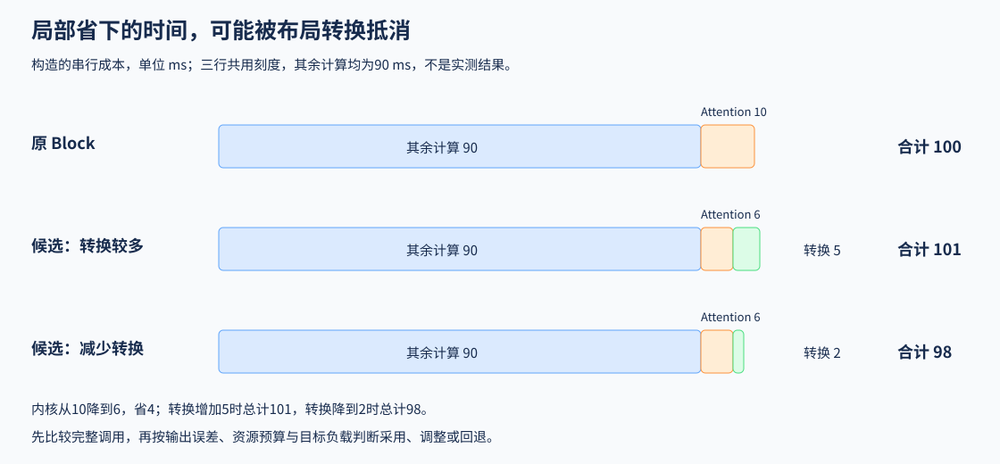

到同权重Block这一层，就可以根据输出、实际调用、完整耗时与资源预算决定保留、调整或回退。即使局部计算更快，接口成本也可能使候选不适合当前组件；更慢的结果同样能说明下一步应改哪里。具体负载与已登记结果见[实验资产表](./experiment_assets.md)。

需要扩大到多层预填充时，可选[Part 05 · 05 独立综合项目](../../05_Integrated_Projects_and_Decisions/05_Operator_Optimization_Delivery/index.md)。它自行生成输入并重新测量两层解码器，Block报告不作为输入。下面的虚线表示可以复用实现代码，不表示已有局部结论自动适用于新负载；训练反向与在线服务也需要各自验证。

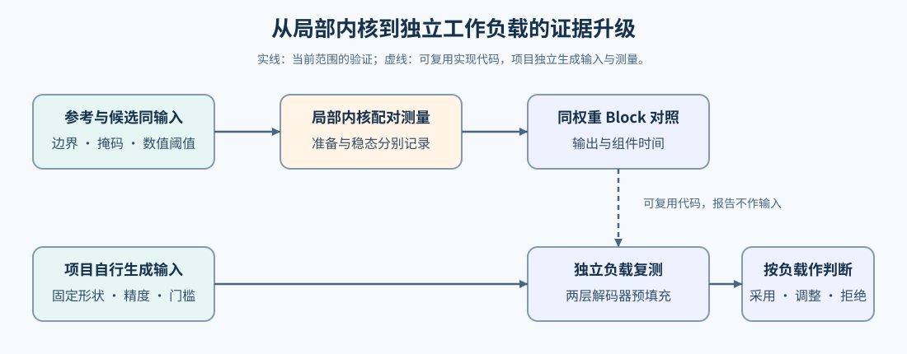
