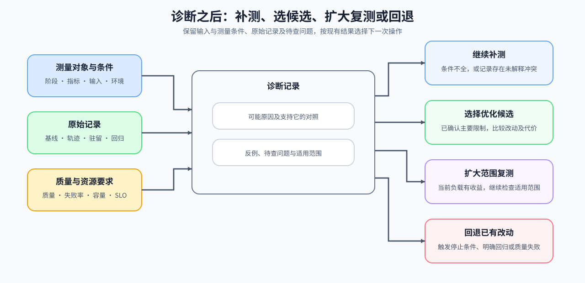

# 07 从归因到行动

一次排查结束时，写清问题发生的阶段、当前支持的原因、仍未解释的现象和下一次操作。首次诊断可以直接进入候选选择；已有改动时，根据对照结果决定扩大复测或回退。

## 根据现有记录选择下一步

先按下表选择行动。括号内保留结果记录使用的状态值；扩大复测表示需要检查更多预先声明的负载条件，不表示候选已获最终采用。

| 下一步行动 | 何时选择 | 具体操作与记录 |
|:---|:---|:---|
| 继续补测（`inspect`） | 输入或计时条件不完整，或记录之间存在未解释的冲突 | 指定缺少的字段、采集方法和待验证原因 |
| 选择优化候选（`optimize`） | 时间线、驻留或资源对照已支持一种主要限制 | 提出要改变的对象、预期减少的量和可能新增的代价 |
| 扩大范围复测（`validate`） | 当前负载下已有目标收益且质量通过，还需检查适用范围 | 对预先声明的长度、批量或并发重新采集匹配基线和候选 |
| 回退已有改动（`revert`） | 已有改动触发停止条件，或出现明确回归、质量失败 | 恢复指定基线或已通过的方案，保存触发条件和失败记录 |

## 一份诊断至少保留什么

把现象、原始记录、原因与行动连在同一份诊断中。尚未验证的解释注明下一项对照，已验证的解释附上对应记录及适用条件。

| 字段组 | 必须保留 | 交给性能优化的作用 |
|:---|:---|:---|
| 测量对象与条件 | 现象、阶段、目标指标、工作负载与环境 | 保持候选复测条件不变 |
| 原始记录 | 基线样本、执行轨迹、对象驻留、性能剖析和结果路径 | 可以复查导致当前判断的记录 |
| 原因与待查问题 | 时间或驻留记录、主要限制、判别对照、反例与未解释现象 | 说明应改变哪个对象，以及什么结果会推翻当前解释 |
| 守护条件 | 正确性、质量、失败率、容量、SLO 与回归阈值 | 阻止局部收益掩盖退化 |
| 下一步行动 | 补测、选择候选、扩大复测或回退，及对应状态值 | 指定操作、进入条件和停止条件 |

## 交付诊断记录

完成上述记录后，进入[性能优化专题](../performance_optimization/intro.md)把主约束转成候选并进行配对复测。单项与组合复测同时检查端到端指标、守护条件与回退方案；多卡归因转入[通信与并行专题](../communication_parallelism/intro.md)补齐真实拓扑与每个进程的记录。
