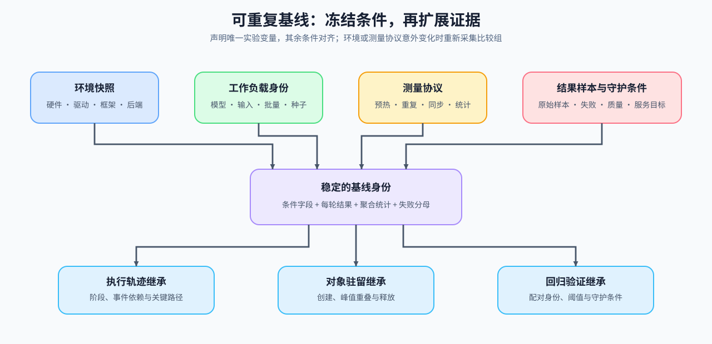
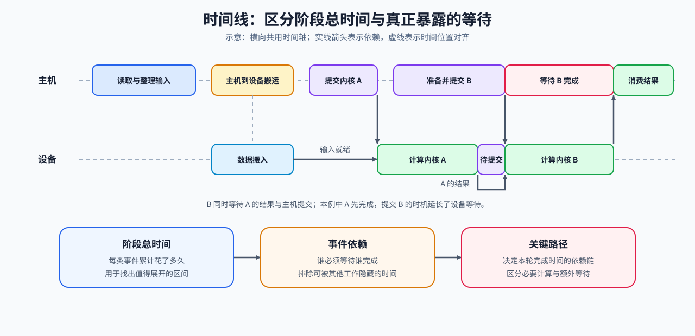
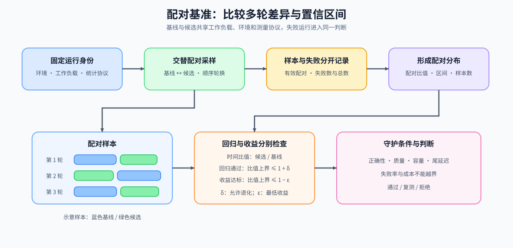

# 性能分析问题链 | Profiling Walkthrough

从一次可重复的训练变慢或请求延迟升高开始，跟踪同一组输入、运行条件和测量范围：先确认运行有效，再采集基线、时间线与驻留记录，用判别对照缩小原因，最后决定补测、尝试候选或回退。

`明确现象与要求 → 固定比较条件 → 定位时间与驻留 → 检查资源约束 → 配对复测 → 记录诊断与行动`

## 先把“变慢”写成可测问题

请求变慢需要说明输入长度、并发、后端以及观察的是 TTFT、TPOT 还是端到端延迟；训练步变慢则需要说明计时是否包含数据读取、同步与参数更新。先排除错误输出或数值异常，并写下质量与失败率要求，再用[测量问题页](./01_why_profiling_matters.md)整理待验证假设。

## 固定后续观察共用的基线

同一段代码的时间会受预热、输入形状、缓存和系统负载影响。[可重复基线](./02_reproducible_baseline.md)保存运行条件、逐次样本和失败原因。精度或后端是研究变量时明确登记，其余条件对齐；初始化、编译和预热是否计入也需要事先说明。

## 沿时间线找出谁在等待谁

计算、内核启动、输入搬运和主机准备可能同时发生。[时间线与关键路径](./03_time_breakdown_and_trace_reading.md)先区分事件持续时间之和、活动覆盖时间和端到端完成时间，再按依赖检查哪个等待真正延长了完成时间。

## 把显存峰值放回对象驻留区间

时间线上的峰值需要由同一时刻仍驻留的对象解释。[显存驻留](./04_memory_timeline_and_residency.md)分别检查活跃分配、分配器保留、临时工作区和长期状态，并将理论账本与对应范围的实测值比较；两项独立最大值之差不能代替同时刻的分配器保留差值。

## 用资源参考和判别实验检查原因

事件热点与显存峰值给出观察位置，[瓶颈归因](./05_bottleneck_attribution.md)再结合计算量、搬运字节和经验参考，选择可以被下一组对照推翻的解释。多卡等待还需确认通信已经就绪、可与哪些计算重叠，以及下一消费点是否真的等待通信完成。

## 用配对样本区分回归与收益

[配对回归](./06_benchmark_design_and_regression_validation.md)同时保留目标指标、质量、尾延迟和失败运行。未超过允许退化范围与达到最低改善是两个判断；局部变快却未缩短端到端时间时，继续检查未改变的关键路径或新的主约束。公式与分母可查[公式索引](./formula_reference.md)。

## 把诊断变成下一次具体行动

证据不足时补测字段，归因明确时选择一个候选，局部对照通过后进入组合复测；质量或资源条件失败时记录原因并回退。[诊断记录](./07_diagnosis_and_action_decision.md)和[判断手册](./casebook.md)帮助写清适用输入、证据位置、未解释现象以及下一步复测条件。

