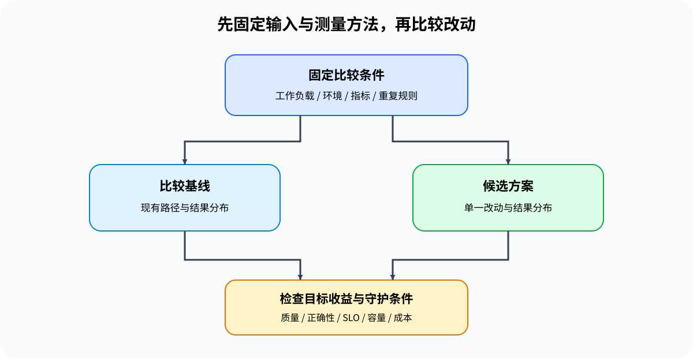

# 01 明确优化目标与比较条件

## 本节导读

面对训练变慢、显存不足或服务尾延迟升高，先找出能复现现象的输入，选定要改善的指标，再规定后续比较保持哪些条件一致。例如，减少显存占用可以允许单步稍慢，但训练吞吐和质量仍需满足事先设定的要求。

本节先建立可重复的基线，也就是后续改动都要与之比较的参照运行：固定输入、目标、测量范围和停止条件。将准备测试的改动称为候选，必须同时满足的正确性、质量和资源要求称为守护条件；服务等级目标（SLO）则给出请求时限或成功率要求。已有诊断时把候选加入比较记录，还不知道原因时先保留现象和原始样本。

## 从问题与已有记录中提取哪些信息

先记录哪种输入会出现问题、完成一次任务需要多久、是否触及资源上限。已有诊断时，继续带入受限阶段、相关对象和支持判断的测量；只有热点名称或一张利用率截图时，先补能区分原因的测量，再选择改动。表中的可能原因与待比较改动，可以在完成后续分析后补齐。

| 信息 | 需要记录什么 | 如何用于候选实验 |
|:---|:---|:---|
| 现象与范围 | 哪种输入、设备和运行阶段出现慢或容量不足 | 选取能够复现问题的基线 |
| 可能原因 | 时间线、对象驻留、资源参考或依赖关系 | 指明改动要减少的工作量或等待 |
| 已检查的解释 | 对照结果、反例和仍无法解释的现象 | 避免重复检验已被排除的原因 |
| 目标与守护指标 | 主目标、正确性、质量、失败率及资源预算 | 预先确定采用与停止条件 |
| 待比较的改动 | 配置差异、预期收益与新增开销 | 一次检验一个作用明确的假设 |

## 证据不足时先补哪种测量

例如，同一训练批次重复运行都需要约100 ms，先保留取批、前向、反向和更新的分段时间。若取批等待占30 ms，应继续观察数据何时就绪，而不是先改矩阵乘法。这是用于说明分析过程的假设例子；后续结论仍需实际重复样本。

先用[测量对象、边界与观测层级](methods/01_why_profiling_matters.md)区分局部调用、完整训练步和请求窗口。时间线按开始、结束与依赖关系排列运行事件；关键路径是决定任务最早完成时刻的依赖链。显存驻留则表示张量已创建且底层存储仍未释放。时间问题再进入[时间线与关键路径](methods/03_time_breakdown_and_trace_reading.md)，峰值问题进入[对象驻留](methods/04_memory_timeline_and_residency.md)；得到受限阶段和相关对象后，再进入[资源约束与候选代价](./02_observability_and_profiling.md)。服务测量还需区分首词元时间（TTFT）、后续每词元平均时间（TPOT）和延迟的第99百分位（P99），它们分别反映不同阶段或分布位置。

| 当前疑问 | 优先方法 | 需要带回的结果 |
|:---|:---|:---|
| 慢在哪个阶段 | 固定输入，分段计时并保留重复样本 | 异常阶段、总时间和波动范围 |
| 等待是否延长了完成时间 | 用 PyTorch Profiler 或 Nsight Systems 采集事件与依赖 | 前驱事件、暴露等待与关键路径 |
| 哪些对象形成峰值 | 显存统计、内存快照及对象创建与释放记录 | 峰值时刻、并存对象和对象大小 |
| 目标计算内核是否生效 | 后端日志、Profiler 算子表；必要时使用 Nsight Compute | 实际内核、输入形状、局部时间及回退路径 |
| 服务尾延迟为何升高 | 分开记录到达、排队、首词元和后续输出时间 | 请求长度分布、TTFT、TPOT、P99 与失败率 |

## 主目标与守护指标怎样配合

同一轮比较先确定一个主目标，其余要求作为守护条件。例如，目标是降低显存时，可预先允许训练步变慢一定比例，但验证损失和有效吞吐仍要达标。有效词元是按任务规则计入工作量的词元；填充位置另行统计，避免把更多填充算成吞吐收益。

| 主目标 | 它反映什么 | 需要同时检查 |
|:---|:---|:---|
| 降低训练单步时间 | 固定训练步骤中前向、反向与更新的完成时间 | 有效批量、有效词元吞吐、训练质量 |
| 提高训练吞吐（Token/s） | 每秒处理的有效词元数 | 数据与监督规则、有效批量、显存和质量 |
| 降低峰值显存 | 测量区间内同时驻留的对象及分配开销 | 单步时间、吞吐、质量；区分已分配量与分配器保留量 |
| 降低 TTFT | 从请求到达到首个输出词元的时间 | 排队、预填充、缓存状态及后续生成速度 |
| 降低 TPOT | 首词元之后，每个输出词元的平均生成时间 | 具体统计定义、生成长度、批量和调度；均值不能描述全部间隔波动 |
| 降低 P99 延迟 | 延迟分布的第 99 百分位 | 请求规模与分布、失败与拒绝、吞吐及服务时限 |
| 减少暴露通信或 I/O | 实际延长关键路径的通信或搬运等待 | 端到端时间、并发争用、缓冲区与正确性 |

## 基线与候选如何保持可比

比较时固定与当前假设无关的条件，把主动改动单独列出。例如检验 BF16 时，数据类型就是受控变量；检验异步复制时，则保持数据类型、输入和模型一致。改变批量或并发后的扩容实验单独登记，与固定负载下的直接收益分开解释。

下表确定比较条件；实际采集前，继续用[可重复基线方法](methods/02_reproducible_baseline.md)展开同步计时、预热、轮次与采集开销。基础练习见[Part 00 · 20 性能证据与实验设计](../../00_Prerequisites/20_Performance_Evidence_and_Experiment_Design.md)。

| 条件 | 固定或明确记录的内容 | 改变后的处理 |
|:---|:---|:---|
| 模型与输入 | 模型和数据版本、样本集合、长度分布、输出上限、有效批量与并发 | 作为主动变量时明确列出；其他变化重新建立对照 |
| 运行环境 | 硬件、软件、后端、数据类型、并行配置及缓存状态 | 核对是否属于预期差异，不能默认为同一条件 |
| 测量方法 | 预热、重复次数、轮内顺序、同步位置、计时区间和显存统计项 | 保持一致，冷启动与稳态分开 |
| 原始记录 | 逐次样本、配对关系、失败与拒绝、质量结果 | 基线与候选分别保存，缺失结果不填零 |
| 判断门槛 | 主目标、质量、资源预算、允许回归及停止条件 | 在看到结果前确定，候选不得临时放宽 |

## 遇到哪些结果应停止或重新比较

失败运行仍计入失败或容量分析，但不作为成功延迟样本。输入变化、测量混杂和候选失效也应分别记录，避免统一丢弃后只保留最快的一组。

| 观察 | 对当前比较的影响 | 处理方式 |
|:---|:---|:---|
| 输入长度、批量或并发意外改变 | 工作量不同，无法归因于原改动 | 恢复固定输入，或另建扩容对照 |
| 首次运行与稳态混合 | 加载、编译或缓存开销与持续执行混杂 | 按运行阶段分开记录 |
| 候选静默回退 | 实际执行的不是目标策略 | 保存路径与警告，修复后再判断目标策略收益 |
| 只有汇总值或单次运行 | 无法重新检查波动和配对关系 | 保留当前记录，补采逐次样本 |
| 正确性或质量超限 | 性能结果不满足采用条件 | 停用候选并保留失败记录 |
| OOM 或请求被拒绝 | 该配置不能完成目标工作负载 | 记录失败阶段、容量与配置，不计算该失败点的加速比 |
