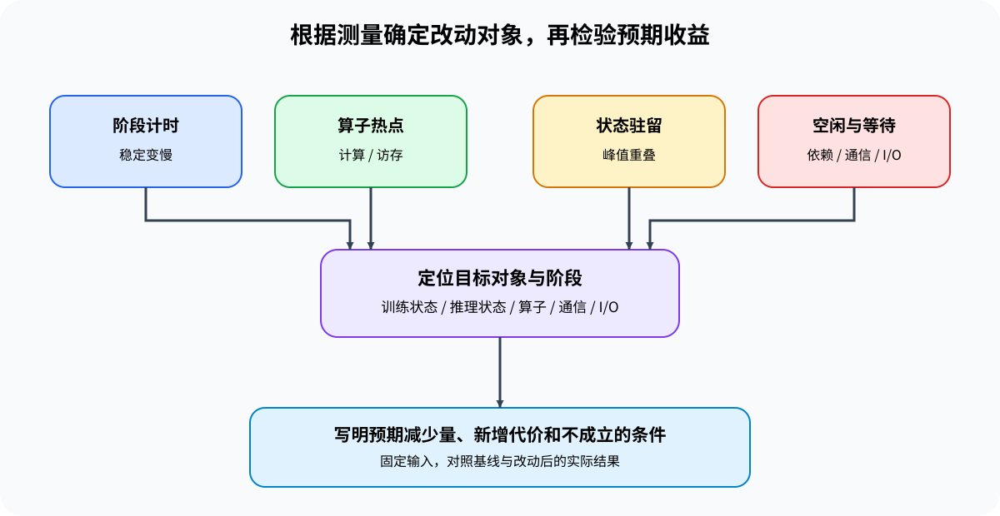

# 02 资源约束与候选代价

## 本节导读

同一种“慢”可能来自计算量、显存读写，也可能来自启动、同步或等待。先把基线中的时间与峰值对应到具体事件和张量，再判断哪项限制最直接影响目标；这里把它称为主要限制。

本节从时间线与驻留记录出发，估算计算、搬运和容量需求，提出“减少什么、新增什么开销”的候选假设。图中的驻留指对象仍占用存储，等待指某项依赖尚未完成、后续工作无法开始。

## 从观察结果走到原因解释

一个阶段耗时最多，只能说明值得继续检查。假设一轮训练需100 ms，其中输入等待30 ms、设备计算70 ms；计算阶段耗时即使降低20%，总时间也只降到86 ms，前提还是二者串行且其他开销不变。如果预取让下一批准备与当前计算重叠，应检查原来的30 ms究竟剩多少，以及主机内存是否增加。这两种改动减少的时间不同，不能仅凭同一张热点排名选择。

时间线中的事件与依赖用[性能分析的时间线方法](methods/03_time_breakdown_and_trace_reading.md)读取；峰值时同时存在的张量用[驻留方法](methods/04_memory_timeline_and_residency.md)核对。随后改变一个能区分原因的条件，例如只调整输入供给而保持设备计算不变；这种对照称为判别实验，结果应支持或排除一个具体解释。

## 当前受哪类资源上界约束

算术强度是浮点运算次数与搬运字节之比。Roofline用计算吞吐和带宽参考，估算给定算术强度下可能达到的吞吐；其计算量、字节量、单位和假设在[资源归因方法](methods/05_bottleneck_attribution.md#用算术强度比较计算与带宽约束)中推导。本地参考值是特定形状与执行条件的测量，不是硬件的严格上界。例如，同样的计算若要多次读取中间张量，可能先受带宽限制；融合减少读写后，计算本身或启动等待又可能成为新的限制。容量问题则要另看峰值时哪些对象共存，不能由算术强度推断。

| 已有证据 | 可提出的资源假设 | 不能直接得出的结论 |
|:---|:---|:---|
| 算术强度低，实测接近相同条件下的带宽参考 | 搬运字节可能限制吞吐 | 降低表示位宽一定加速 |
| 算术强度高，实测接近匹配数据类型与形状的计算参考 | 浮点运算量或计算路径可能限制吞吐 | 更换计算内核一定缩短端到端时间 |
| 实测吞吐远低于匹配条件的资源参考 | 启动、同步、排队、通信或 I/O 可能暴露在关键路径上，也需检查参考是否适用 | 仅凭 Roofline 确认具体等待来源 |
| 峰值由多个对象同时驻留形成 | 容量首先限制可运行规模 | 减少任意一个对象都能降低原峰值 |

## 候选减少了什么工作量

候选记录分别说明作用对象、预期减少量和守护条件。量化先区分权重、激活与 KV：权重大小、临时张量和随请求增长的历史状态分别影响不同阶段，减少一种对象未必改变原来的峰值或关键路径。FP32 与 BF16 对比检验浮点精度变化；低比特量化还需记录缩放、量化配置与实际计算路径。

| 候选动作 | 预期减少量 | 可能新增的代价 | 必须保持的条件 |
|:---|:---|:---|:---|
| 权重量化 | 权重驻留及读取字节 | 缩放元数据、反量化与格式转换 | 独立质量评测、真实加载和目标计算内核 |
| 激活量化 | 激活表示与搬运字节 | 校准或运行时缩放、转换与异常值误差 | 目标形状、质量及实际中间张量类型 |
| KV 量化 | 每词元历史状态及读取字节 | 缩放、反量化与缓存管理 | 长上下文质量、缓存执行路径及服务延迟 |
| 融合相邻算子 | 中间张量读写与启动次数 | 融合工作区、编译和形状限制 | 正确性和目标形状命中 |
| 激活重算 | 跨越峰值的保存张量 | 额外前向计算 | 单步时间和收敛 |
| 增大批量 | 每词元分摊的权重读取 | 激活/KV 容量和单次迭代延迟 | 峰值、P99 或单步预算 |
| 通信—计算重叠 | 暴露通信时间 | 额外缓冲区、调度和资源争用 | 数值一致性和总时间 |

## 什么结果会使候选假设不成立

[Part 02 · PERF-ROOFLINE 资源参考实验](../../02_PyTorch_Algorithms/PERF-ROOFLINE_Arithmetic_Intensity_and_Resource_Ceiling.md)帮助判断可能的资源限制，[Part 02 · PERF-CANDIDATE 候选对照实验](../../02_PyTorch_Algorithms/PERF-CANDIDATE_Constraint_to_Candidate_and_Cost_Transfer.md)检查改动后的时间、字节和输出。“证伪条件”就是预先说明什么结果会推翻预期，例如量化虽减少读取字节，反量化却使完整调用更慢。确定候选后，训练问题进入[训练步骤与状态](./03_training_memory_ledger.md)，推理问题进入[延迟、吞吐与容量](./04_inference_memory_and_kv_cache.md)；两者涉及传输等待时按需查看[计算、通信与I/O](./05_compute_communication_and_io.md)。

| 候选假设 | 支持它的结果 | 证伪它的结果 |
|:---|:---|:---|
| 激活重算能够缓解容量限制 | 跨越原峰值的保存张量减少，峰值下降 | 释放时刻不跨越原峰值，或发生新的工作区峰值 |
| 低精度能够缓解搬运限制 | 目标计算路径读取字节下降，端到端时间同步下降 | 产物变小但执行回退，或反量化抵消收益 |
| 增大批量能够提高利用率 | 吞吐提高且延迟、容量仍在门槛内 | 吞吐进入平台期而延迟继续增加 |
| 重叠能够隐藏通信或搬运 | 总时间下降，暴露等待缩短 | 时间线重叠但总时间不变，或资源争用使计算变慢 |
