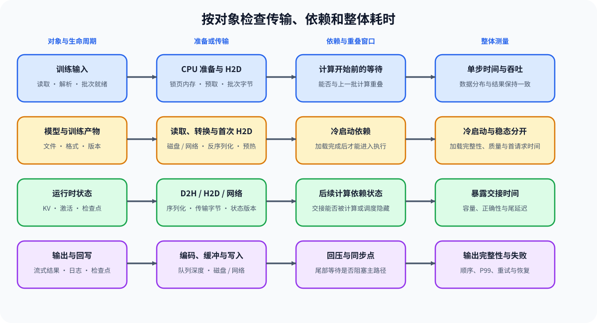

# 05 跨路径：计算、通信与 I/O

## 本节导读

训练等待下一批数据、推理加载模型和多卡交换状态，都要经过搬运与同步。I/O指输入输出读写，集合通信指多个进程共同完成的归约或收集等操作。它们与计算能否重叠，取决于谁先产生数据、谁必须等待数据，而不只取决于有没有异步开关。

训练和推理都可按当前等待进入这一分支。按输入、模型产物、运行时状态与输出回写重建依赖，区分事件本身持续多久和它实际延长完成时间多少；后者称为暴露时间。主机到设备、设备到主机的搬运分别记为H2D、D2H。下图把不同数据的消费条件放在同一条检查路径中。

## 哪些对象和依赖延长完成时间

关键路径是决定任务最早完成时刻的依赖链；前驱是当前事件开始前必须完成的事件。[Part 02 · PERF-TRACE](../../02_PyTorch_Algorithms/PERF-TRACE_Trace_Dependencies_and_Critical_Path.md)用于重建这些关系，[Part 02 · PERF-IO](../../02_PyTorch_Algorithms/PERF-IO_Artifact_State_and_Output_IO_Critical_Path.md)比较分阶段开销与流水线总时间。测量包含加载、计算还是输出回写，应先确定再比较。缓冲队列满后上游必须等待，称为回压。

| 对象 | 关键依赖 | 可能暴露的等待 | 需要保持的条件 |
|:---|:---|:---|:---|
| 输入 | 读取 → CPU 预处理 → 组批 → H2D → 计算 | 取批、内存锁页或同步复制 | 数据分布、样本顺序及组批规则 |
| 模型产物 | 读取 → 反序列化 → 转换 → 首次 H2D → 预热 | 冷启动、格式转换和首次编译 | 版本、格式和加载完整性 |
| 运行时状态 | 创建/更新 → 序列化 → 传输 → 消费 | KV、激活、检查点或权重刷新 | 状态版本、容量和数值一致性 |
| 输出 | 生成 → 缓冲 → 网络/存储回写 | 流式输出、日志、检查点和回压 | 顺序、完整性和失败恢复 |
| 多卡计算 | 局部计算 → 集合通信 → 后续计算 | AllReduce、AllGather、All-to-All 或空闲 | 拓扑、负载和正确性 |

## 什么时候重叠能够缩短关键路径

用一个假设的批次流水线说明：准备与搬运每批4 ms，计算每批6 ms，处理3批时串行总共需要30 ms。如果下一批准备可与当前计算完全重叠，且两者无资源争用，理想总时间为4 + 3×6 = 22 ms。准备与搬运的累计工作仍为12 ms，只是其中8 ms被其他计算覆盖；首次填充与最后排空仍在测量范围内。

实际重叠需要满足依赖已就绪、资源能够并发、调度与缓冲开销可接受三个条件。时间线上相交的区间只是起点，还要看总时间是否按预期下降。通信中的AllReduce、AllGather和All-to-All分别完成全局归约、分片收集和进程间分发；SM是GPU执行线程块的计算单元，通信与计算也可能争用其资源。

| 候选 | 可重叠的阶段 | 有效证据 | 常见失效原因 |
|:---|:---|:---|:---|
| 输入预取 | CPU 准备下一批与当前批计算 | 取批等待和单步总时间同时下降 | CPU、存储或主机内存成为新限制 |
| 异步 H2D | 下一批搬运与当前批计算 | 暴露 H2D 缩短且计算没有变慢 | 缺少锁页内存、同步依赖或带宽争用 |
| 通信—计算重叠 | 梯度桶通信与其他反向计算 | 暴露通信和单步时间下降 | 分桶不匹配、依赖未满足或 SM 争用 |
| 状态交接流水线 | 当前阶段计算与下一份状态传输 | 交接等待和端到端延迟下降 | 消费方必须等待完整状态或网络拥塞 |
| 异步输出 | 下一步计算与上一批输出回写 | 尾部等待下降且输出完整 | 队列回压、顺序错误或失败丢失 |

## 通信与 I/O 候选会转移什么代价

状态分片让不同设备保管不同部分，减少单设备驻留，却可能增加计算前的收集与计算后的归约。压缩减少传输字节，也会增加编码、恢复和误差。候选是否值得保留，要回到[单项复测](./06_cost_model_and_production_decision.md)比较完整任务；多卡分片的原理可进一步阅读[通信与并行](../communication_parallelism/intro.md)。

| 候选 | 预期减少 | 可能转移到的新约束 | 复测字段 |
|:---|:---|:---|:---|
| ZeRO / 状态分片 | 单设备参数、梯度或优化器状态 | 聚合、Reduce-Scatter、同步与恢复 | 峰值、单步时间、暴露通信、恢复时间 |
| 张量/专家/上下文并行 | 单设备权重、专家或序列状态 | 高频集合通信、负载不均和临时缓冲区 | 容量、扩展效率、尾延迟、正确性 |
| 产物缓存或转换缓存 | 冷启动读取与转换 | 存储容量、失效和版本一致性 | 冷启动、稳态、命中率和产物身份 |
| 状态压缩 | 传输字节与驻留容量 | 压缩/解压、误差和计算路径 | 暴露传输、质量和总时间 |
| 批量输出或日志 | 写入调用和尾部等待 | 缓冲区容量、回压和失败恢复 | P99、完整性、队列深度和失败记录 |

## 暴露时间是否真正下降

| 必须比较 | 可以确认什么 | 不能替代什么 |
|:---|:---|:---|
| 候选前后的端到端时间 | 用户或训练步骤是否真正变快 | 具体事件为何变化 |
| 事件总时间与暴露时间 | 等待是否被隐藏在其他工作之后 | 正确性、质量和容量检查 |
| 关键路径前驱关系 | 哪个事件延长完成时间 | 不同负载和拓扑下的复测 |
| 资源利用和新增缓冲区 | 重叠是否引入争用或容量代价 | 稳定性和失败恢复 |
| 冷启动与稳态结果 | 加载/编译和持续执行是否被混淆 | 高峰请求或长作业表现 |
