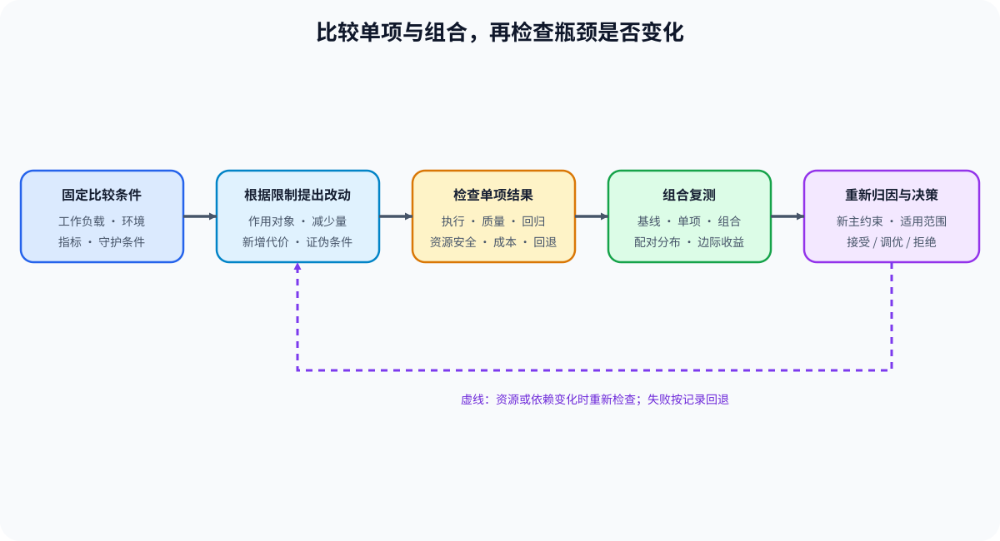

# 07 策略组合与瓶颈转移

## 本节导读

输入预取让下一批提前到达，激活卸载却要把中间张量搬到主机、在反向前再搬回。两项分别有效时，同时启用仍可能争用主机内存和传输带宽，延长原来已缩短的等待。这种相互影响决定组合收益能否保留。

本节在同一工作负载下比较基线、单项与组合，并测量加入另一项后多获得的边际收益。原来的限制减弱后，另一阶段可能转为主要限制，称为瓶颈转移；需要重新检查依赖链和驻留对象。尚未达到收益目标的单项，只要正确性、质量与资源安全通过，也可参与探索性组合，最终采用以组合实测为准。

## 单项候选之间有哪些依赖与冲突

先列出每项改动的作用对象和资源需求，再判断两项能否同时启用。共享带宽或减少相同工作量时，组合收益可能低于单项收益之和；某项释放容量后，另一项也可能获得原先没有的执行空间。表中H2D、D2H分别表示主机到设备、设备到主机的搬运，TPOT表示后续每词元平均时间，P99表示延迟的第99百分位。

| 组合关系 | 示例 | 必须检查 |
|:---|:---|:---|
| 前置依赖 | 量化产物必须先被加载器和执行后端支持，才能测试低精度内核 | 产物版本、加载路径与实际内核 |
| 共享资源 | 输入预取与卸载同时占用主机内存和 PCIe 带宽 | 暴露 H2D/D2H、主机内存和单步时间 |
| 容量协同 | 激活重算释放容量后允许增大批量 | 新批量下的吞吐、峰值和单步时间 |
| 执行冲突 | 算子融合改变中间张量，可能破坏原来的重叠窗口 | 新时间线、工作区和同步位置 |
| 服务冲突 | 更大批次提高吞吐，但拉长 TPOT 或 P99 | 请求分布、队列、吞吐和尾延迟 |
| 量化与缓存或调度组合 | 压缩后的权重或 KV 改变可用容量，批处理和缓存策略随之调整 | 先固定请求、并发和调度测量单项与组合，再单独扫描容量；复查目标内核、长上下文质量和尾延迟 |
| 分布式冲突 | 状态分片降低单卡容量，却增加集合通信 | 容量、暴露通信、扩展效率和恢复 |

## 组合顺序如何改变资源与关键路径

以假设的时间说明：基线100 ms，单项A为80 ms、B为90 ms，组合A+B为78 ms，且各项都满足同一质量与资源要求。组合相对基线少22 ms，但相对最佳单项只再少2 ms，耗时降幅为(80−78)/80 = 2.5%；若组合需额外内存或维护成本，应判断这点边际收益是否值得，而不是把20%与10%的改善直接相加。这里比较的是同样输入和工作数量，计时差异还需超过可解释的测量波动。

固定负载比较基线、A、B与A+B，再从满足共同质量与资源要求的单项中选择主目标最优者作为参照。若所有单项都无法满足容量或质量门槛，就记录组合是否首次达到要求，不声称它优于一个不存在的可行最佳单项。只有配置改写或执行顺序会改变产物、形状与依赖时，才另测A→B与B→A；独立开关无需人为添加顺序实验。扩大批量或并发后的收益另设容量对照，尾部统计和回退目标继续保留。

| 比较阶段 | 固定内容 | 需要重新测量的内容 |
|:---|:---|:---|
| 基线 | 工作负载、环境、质量门槛和资源预算 | 原始关键路径、峰值和失败状态 |
| 单项候选 A / B | 各自独立配置和执行路径 | 单项收益、代价转移和适用范围 |
| 组合 A+B | 同一次实验中的输入、测量与判断门槛 | 相对可行最佳单项的边际收益、延迟的第95百分位（P95）和资源争用；没有可行单项时记录首次达标 |
| 组合 A → B | 先应用 A，再在新状态下应用 B | B 的边际收益、共享资源和新同步点 |
| 组合 B → A | 反向执行顺序可行时复测 | 顺序是否改变产物、形状或执行路径 |
| 回退方案 | 可恢复的基线或已通过单项候选 | 回退时间、状态一致性和剩余容量 |

## 主约束转移到了哪里

组合后同时检查端到端时间和分阶段变化。原来的带宽限制可能减弱，容量释放也可能使输入供给成为新限制；仅观察某阶段占比升高不能确认它已成为主瓶颈，还需执行轨迹、资源参考或针对该阶段的对照。

| 组合结果 | 需要回答的问题 | 判断动作 |
|:---|:---|:---|
| 总时间下降，原瓶颈占比降低 | 新的最长阶段是什么 | 对新阶段建立资源或依赖假设 |
| 单项有效，组合后收益消失 | 两项是否争用同一资源或重复减少同一工作量 | 保留边际收益更高的一项 |
| 容量提高但吞吐不变 | 输入、计算、通信或调度是否成为新上界 | 停止继续扩容，转查新约束 |
| 平均值改善但 P99 退化 | 队列、长度离散或失败重试是否被放大 | 缩小适用范围或回退组合 |
| 收益只在部分形状成立 | 执行路径或计算内核是否随形状变化 | 明确准入范围并保存回退路径 |

## 组合复测与回退判断

[Part 02 · PERF-COMPOSITION](../../02_PyTorch_Algorithms/PERF-COMPOSITION_Strategy_Interaction_and_Bottleneck_Shift.md)提供局部多层感知机（MLP）组合对照。完整任务还要用自身输入重新比较，并检查质量与回退记录；实验入口与已有结果见[实验资产表](./experiment_assets.md#机制实验)。若组合后出现新等待或新峰值，按[性能分析方法索引](methods/intro.md#方法索引与推荐阅读)选择时间线、驻留或判别实验，修正原来的原因解释。

| 字段组 | 至少记录什么 |
|:---|:---|
| 比较条件 | 模型、版本、硬件、数据类型、执行后端、工作负载、预热、重复和并行配置 |
| 候选配置 | 单项参数、必要的组合顺序、产物版本、执行路径和适用范围 |
| 结果 | 阶段时间、延迟/吞吐、峰值显存、通信/队列等待、I/O、质量和失败 |
| 瓶颈转移 | 组合前后的主约束、关键路径和资源上界 |
| 决策 | `accept / tune / reject`、未验证风险、停止条件和回退方案 |
