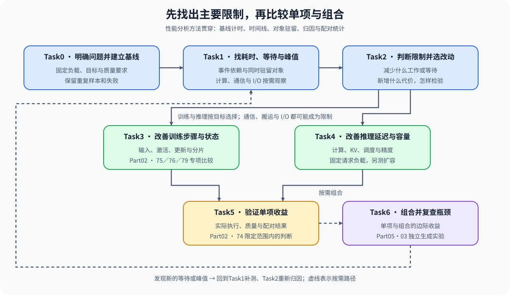
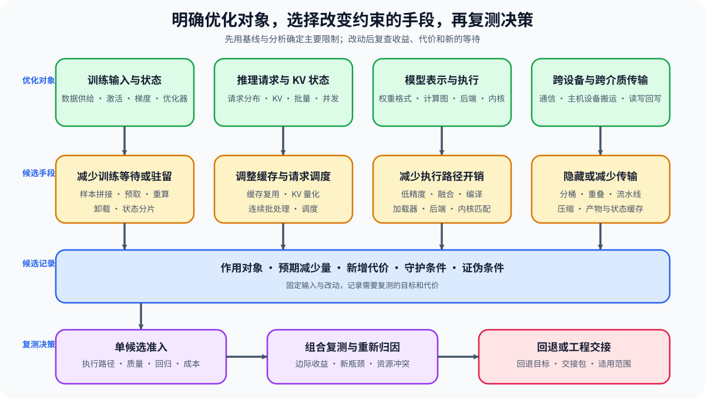

# 性能优化（Performance Optimization）

> 专题类型：主学习路线　学习目标：测量并解释性能问题，比较单项与组合改动的收益、代价和适用范围。

训练步骤慢、请求尾延迟高或显存容量不足时，先固定能复现问题的输入，测量时间、等待和显存峰值，再选择能减轻主要限制的改动。重算、卸载、低精度计算与异步执行会改变计算、驻留或搬运；改动后需要重新观察瓶颈，才能判断局部收益是否传递到完整任务。

本路线的[测量与诊断方法](methods/intro.md)覆盖计时、执行轨迹、对象驻留、归因和配对统计的方法。训练、推理、量化、通信与算子专题解释具体改动的机制；本路线把这些方法用于同一问题的基线、候选和组合比较。

## 学习路线

Part01入口用于按需回补相应的硬件、状态或执行概念，不要求先读完整个Part。首次学习先完成Task0–2的共同基础，再按目标选择Task3训练分支或Task4推理分支，随后进入Task5的单项复测；需要叠加策略时继续Task6。已有可靠基线和诊断时可直接进入对应分支。复测发现新的等待或峰值后，回到Task1补测、Task2重新归因。

连续跟踪一个问题时进入[性能优化问题链](./walkthrough.md)；查找具体测量方法使用[性能分析方法索引](methods/intro.md#方法索引与推荐阅读)，按现象排查使用[性能优化判断手册](./casebook.md)。

| Task / 主题 | 本阶段要回答的问题 | 学习入口与验证出口 | 学习顺序 | 主要正文入口 |
|:---|:---|:---|:---|:---|
| Task0 · 明确性能问题并建立基线 | 什么输入能复现问题，目标指标和比较条件怎样固定？ | 核心：[Part 00 · 20 性能证据与实验设计](../../00_Prerequisites/20_Performance_Evidence_and_Experiment_Design.md)、[Part 00 · 17 性能分析基础](../../00_Prerequisites/17_PyTorch_Profiling_Basics.md)；项目：训练选[Part 02 · 73 训练性能分析](../../02_PyTorch_Algorithms/73_Training_Performance_Analysis.md)，推理服务选[Part 02 · 66 单卡推理测量基线](../../02_PyTorch_Algorithms/66_Inference_Performance_Comparison.md)；扩展：[可重复基线](methods/02_reproducible_baseline.md) | 明确现象与目标 → 固定负载和质量要求 → 预热与重复 → 保存基线 | [专题正文 · 01 明确优化目标与比较条件](./01_performance_problem_and_benchmark.md) |
| Task1 · 找出耗时、等待与显存峰值 | 哪些依赖和同时驻留的对象延长了完成时间或形成峰值？ | 核心：[Part 02 · PERF-TRACE 关键路径](../../02_PyTorch_Algorithms/PERF-TRACE_Trace_Dependencies_and_Critical_Path.md)、[Part 02 · PERF-MEMORY-TIMELINE 显存驻留](../../02_PyTorch_Algorithms/PERF-MEMORY-TIMELINE_Memory_Residency_and_Peak_Overlap.md)；扩展：[Part 01 · 17 CUDA Stream与异步执行](../../01_Hardware_Math_and_Systems/17_CUDA_Stream_and_Asynchrony.md)；按需深入[Part 02 · PERF-INPUT 输入流水线](../../02_PyTorch_Algorithms/PERF-INPUT_Training_Input_Pipeline_Performance.md)、[Part 02 · PERF-IO I/O关键路径](../../02_PyTorch_Algorithms/PERF-IO_Artifact_State_and_Output_IO_Critical_Path.md) | 继承基线 → 按问题选择时间或驻留观察 → 定位暴露等待或峰值对象 | [性能分析正文 · 03 时间线、I/O与关键路径](methods/03_time_breakdown_and_trace_reading.md) |
| Task2 · 判断主要限制并选择改动 | 测量支持哪种限制，候选减少的工作量是否值得新增代价？ | 核心：[Part 02 · PERF-ROOFLINE 资源上界](../../02_PyTorch_Algorithms/PERF-ROOFLINE_Arithmetic_Intensity_and_Resource_Ceiling.md)、[Part 02 · PERF-CANDIDATE 约束到候选](../../02_PyTorch_Algorithms/PERF-CANDIDATE_Constraint_to_Candidate_and_Cost_Transfer.md)；扩展：[Part 01 · 03 GPU架构与内存层级](../../01_Hardware_Math_and_Systems/03_GPU_Architecture_and_Memory.md)、[Part 01 · 13 性能分析与瓶颈定位](../../01_Hardware_Math_and_Systems/13_Profiling_and_Bottleneck_Analysis.md)；归因方法见[性能分析正文 · 05 瓶颈归因](methods/05_bottleneck_attribution.md) | 观察与资源参考 → 判别实验 → 候选作用对象 → 预期减少量与新增代价 | [专题正文 · 02 资源约束与候选代价](./02_observability_and_profiling.md) |
| Task3 · 改善训练步骤与状态开销 | 输入、激活、更新和状态分片的改动，怎样影响完整训练步？ | 核心：[Part 02 · 19 激活检查点](../../02_PyTorch_Algorithms/19_Activation_Checkpointing.md)、[Part 02 · 42 激活卸载](../../02_PyTorch_Algorithms/42_Activation_Offload.md)、[Part 02 · 43 训练内存账本](../../02_PyTorch_Algorithms/43_Unified_Training_Memory_Ledger.md)；项目：按限制选择[Part 02 · 75 AdamW执行路径](../../02_PyTorch_Algorithms/75_Optimizer_Execution_Path_Benchmark.md)、[Part 02 · 76 重算与卸载](../../02_PyTorch_Algorithms/76_Activation_Checkpoint_Offload_Benchmark.md)；多卡条件具备时再进入[Part 02 · 79 训练状态并行](../../02_PyTorch_Algorithms/79_Distributed_Parallel_Benchmark.md)；扩展：[Part 01 · 06 显存计算与ZeRO](../../01_Hardware_Math_and_Systems/06_VRAM_Calculation_and_ZeRO.md) | 选择受限状态或阶段 → 比较单项改动 → 记录训练步、吞吐、峰值与质量 | [专题正文 · 03 训练输入、状态与资源账本](./03_training_memory_ledger.md) |
| Task4 · 改善推理延迟、吞吐与容量 | 请求、KV状态与调度改动，在什么负载下改善服务指标？ | 核心：[Part 02 · INF-ITERATION-BUDGET 迭代成本与批量上界](../../02_PyTorch_Algorithms/INF-ITERATION-BUDGET_Serving_Iteration_Cost_and_Batch_Bounds.md)、[Part 02 · 37 KV Cache生命周期](../../02_PyTorch_Algorithms/37_KV_Cache_Lifecycle_and_Capacity_Control.md)、[Part 02 · INF-CONTINUOUS-BATCHING 连续批处理](../../02_PyTorch_Algorithms/INF-CONTINUOUS-BATCHING_Continuous_Batching.md)；扩展：[Part 01 · 11 KV Cache与显存增长](../../01_Hardware_Math_and_Systems/11_KV_Cache_and_Memory_Growth.md)；机制分支见[推理优化](../inference_optimization/intro.md)、[量化与压缩](../quantization_compression/intro.md) | 固定请求分布 → 选择计算、缓存、调度或精度改动 → 分开比较固定负载与扩容收益 | [专题正文 · 04 推理延迟、吞吐与状态容量](./04_inference_memory_and_kv_cache.md) |
| Task5 · 核对执行路径并验证单项收益 | 实际执行的改动是否达到目标，并守住正确性、质量和资源要求？ | 核心：[Part 02 · PERF-REGRESSION 配对基准与回归阈值](../../02_PyTorch_Algorithms/PERF-REGRESSION_Paired_Benchmark_and_Regression_Thresholds.md)；项目：[Part 02 · 74 候选准入与交接](../../02_PyTorch_Algorithms/74_Profiling_Driven_End_to_End_Optimization.md)；扩展：[Part 01 · 34 异构加速器与运行时约束](../../01_Hardware_Math_and_Systems/34_Heterogeneous_Accelerators_and_Runtime_Constraints.md) | 核对实际执行 → 配对复测 → 区分波动与收益 → 按候选类型检查采用条件 | [专题正文 · 06 单候选执行与准入](./06_cost_model_and_production_decision.md) |
| Task6 · 组合策略并重新检查瓶颈 | 组合相对最佳合格单项增加了什么收益和代价，何时应回退？ | 核心：[Part 02 · PERF-COMPOSITION 策略相互作用与瓶颈转移](../../02_PyTorch_Algorithms/PERF-COMPOSITION_Strategy_Interaction_and_Bottleneck_Shift.md)；项目：[Part 05 · 03 端到端性能优化与回归交付](../../05_Integrated_Projects_and_Decisions/03_Performance_Optimization_Delivery/index.md)；扩展：[Part 01 · 33 TCO与成本模型](../../01_Hardware_Math_and_Systems/33_TCO_and_Cost_Model.md) | 同一基线下测量单项与组合 → 筛选合格参考并比较边际收益 → 重新归因 → 核对成本与回退配置 | [专题正文 · 07 策略组合与瓶颈转移](./07_end_to_end_performance_engineering.md) |

训练和推理分支都可能受计算、通信或I/O限制。[计算、通信与I/O](./05_compute_communication_and_io.md)把事件依赖与重叠条件用于这些改动：先在Task1观察等待，再在Task2提出解释，最后在Task5确认暴露等待和完整任务时间是否一起下降。

下图按作用对象组织候选机制。量化、融合、重算、缓存和重叠分别改变计算、驻留或传输；选中候选后仍需测量完整工作负载，组合后再次检查共享资源与瓶颈。

## 扩展与跨专题入口

按当前缺少的机制或硬件知识回补。量化可用于训练或推理候选；通信与I/O按事件依赖参与分支比较，不要求先完成所有专题。

| 需要补充的机制 | 回补入口 | 回到性能优化时需要带回的证据 |
|:---|:---|:---|
| 低精度表示与计算路径 | [Part 01 · 01 数据类型与精度](../../01_Hardware_Math_and_Systems/01_Data_Types_and_Precision.md) → [Part 01 · 12 Tensor Core 与混合精度](../../01_Hardware_Math_and_Systems/12_TensorCore_and_Mixed_Precision.md) → [Part 01 · 21 量化理论](../../01_Hardware_Math_and_Systems/21_Quantization_Theory_and_INT4_INT8.md) | 表示字节、累加精度、计算内核与回退路径 |
| 量化候选与服务部署 | [量化与压缩](../quantization_compression/intro.md)；产物型候选按 [Part 02 · 82 产物评估](../../02_PyTorch_Algorithms/82_Quantization_Artifact_Evaluation_Project.md) → [Part 02 · 67 推理部署](../../02_PyTorch_Algorithms/67_Quantized_Inference_and_Deployment.md) → [Part 02 · 83 服务配置](../../02_PyTorch_Algorithms/83_Quantized_Serving_Profile_Benchmark.md) 验证 | 量化对象、独立质量结果、实际内核；固定负载收益与扩容收益分开记录，随后进入单候选和组合判断 |
| Attention 访存与推理工作量 | [Part 01 · 04 Attention 显存优化](../../01_Hardware_Math_and_Systems/04_Attention_Memory_Optimization.md) → [Part 01 · 14 FlashAttention 显存模型](../../01_Hardware_Math_and_Systems/14_FlashAttention_Memory_Model.md) | Attention 中间状态、访存量和融合收益条件 |
| 计算内核、融合与片上存储 | [Part 01 · 08 CUDA/Triton 编程模型](../../01_Hardware_Math_and_Systems/08_Programming_Models_CUDA_Triton.md) → [Part 01 · 16 Warp、Block 与 Shared Memory](../../01_Hardware_Math_and_Systems/16_Warp_Block_SharedMemory_Basics.md) → [Part 01 · 19 算子融合](../../01_Hardware_Math_and_Systems/19_Operator_Fusion_Introduction.md) → [Part 01 · 23 Tensor Core 深入](../../01_Hardware_Math_and_Systems/23_TensorCore_Deep_Dive.md) → [Part 01 · 24 SRAM 优化](../../01_Hardware_Math_and_Systems/24_SRAM_Optimization_Techniques.md) | 计算内核正确性、启动次数、访存量、占用率与片上复用 |
| 局部计算或访存瓶颈已经确认 | [算子优化](../operator_optimization/intro.md) | 计算内核语义、图改写、微基准与模型工作负载复测 |
| 动态形状与编译图 | [Part 01 · 09 AI 编译器与计算图优化](../../01_Hardware_Math_and_Systems/09_AI_Compilers_and_Graph_Optimization.md) → [Part 01 · 30 动态 Shape](../../01_Hardware_Math_and_Systems/30_Dynamic_Shape_Handling.md) | 图捕获范围、重编译次数、形状分布和稳态收益 |
| 容错、检查点与恢复成本 | [Part 01 · 28 容错与检查点](../../01_Hardware_Math_and_Systems/28_Fault_Tolerance_and_Checkpointing.md) | 保存频率、恢复时间、写回背压与失败成本 |
| 激活值、梯度或优化器状态占用 | [反向传播与训练机制](../backpropagation_training_mechanism/intro.md) | 状态生命周期、正确性、峰值与训练步时间 |
| 请求、量化、并行与输入数据 | [推理优化](../inference_optimization/intro.md)、[量化与压缩](../quantization_compression/intro.md)、[通信与并行](../communication_parallelism/intro.md)、[数据工程](../data_engineering/intro.md) | 请求分布、质量与容量、通信暴露、样本长度和输入吞吐 |

## 实验与项目出口

运行环境见[实验 Quickstart](./quickstart.md)，输入与结果见[实验资产表](./experiment_assets.md)，术语见[专题术语表](./glossary.md)。

CPU 练习检查工作量计算、状态关系和候选选择规则；单卡实验按各页范围测量时间、峰值或执行事件；项目实验再检查目标工作负载下的质量、尾延迟、成本与回退条件。组合实验可以探索尚未达到收益目标的候选，但正确性、质量和资源安全必须先通过；最终采用仍需达到项目预设门槛。

| 证据阶段 | 要回答的问题 | 主要出口 |
|:---|:---|:---|
| 基线与诊断 | 哪个问题能够复现，测量支持哪种主要限制？ | 基线、时间线或驻留记录；用[诊断记录方法](methods/07_diagnosis_and_action_decision.md)整理判断、反例与待补测项 |
| 局部候选 | 候选是否改变目标对象，正确性与质量是否保持？ | 各机制 Notebook 的 CPU / GPU 结果 |
| 单项复测 | 改动是否实际生效，并达到当前负载的性能与正确性要求？ | 局部计算核对数值与实际调用，训练核对更新与质量，服务负载再检查尾延迟、失败与容量 |
| 组合复测 | 多项候选组合后是否出现收益抵消、瓶颈转移或新回归？ | 固定工作负载下的基线、单项候选与组合候选配对结果 |
| 项目实践 | 当前负载支持接受、调优还是回退？ | [Part 02 · 74](../../02_PyTorch_Algorithms/74_Profiling_Driven_End_to_End_Optimization.md)练习候选审核；[Part 05 · 03](../../05_Integrated_Projects_and_Decisions/03_Performance_Optimization_Delivery/index.md)独立生成负载、基线和组合记录，Part02结果可作背景参考 |
