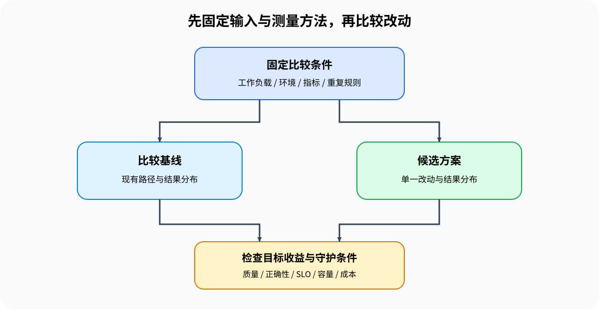
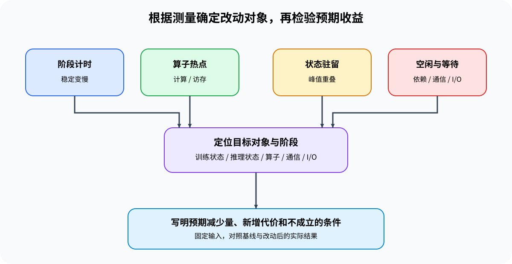
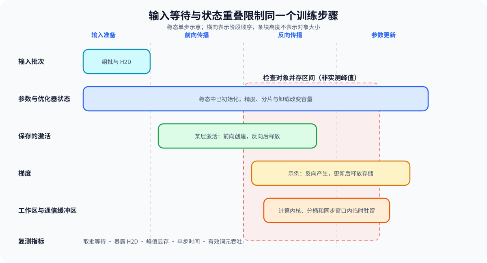
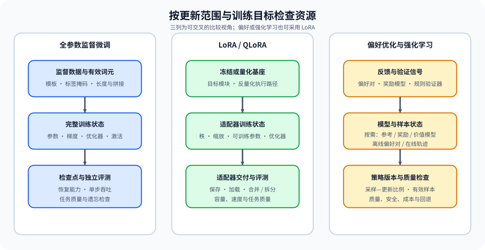
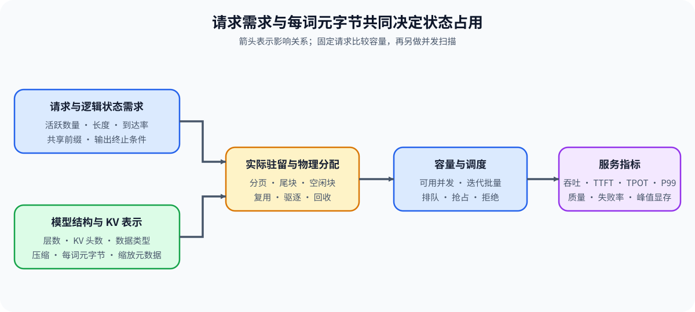
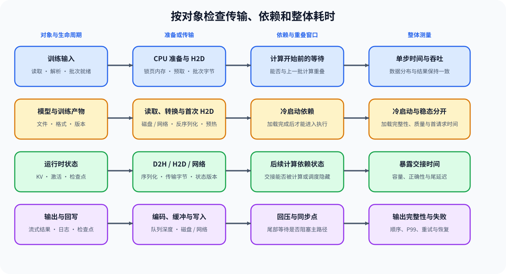
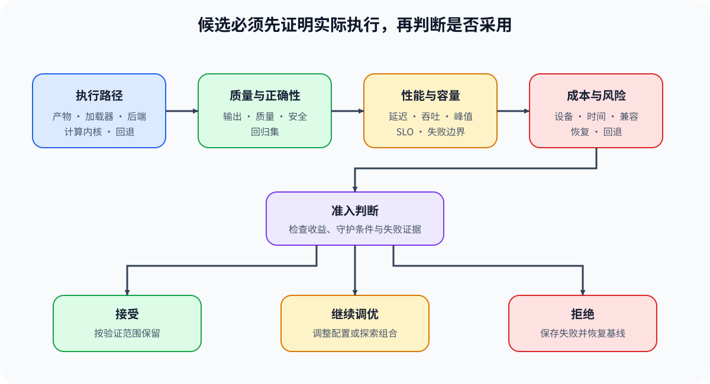
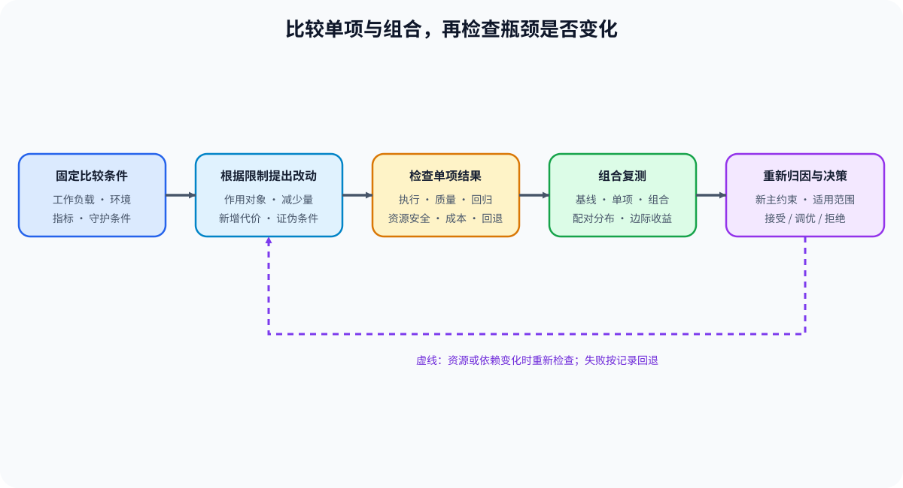

# 性能优化问题链：从现象到候选决策

以一个假设训练任务为例：固定输入与有效批量时，训练步需要100 ms、峰值显存为10 GiB；目标是把峰值降到8 GiB以内，同时耗时不超过115 ms，并保持验证质量。下面沿着这个目标选择改动、比较单项与组合，数字仅用于说明判断过程。推理分支展示相同方法如何用于请求延迟和缓存容量。

## 建立比较基线并提出候选

先按[比较条件](./01_performance_problem_and_benchmark.md)固定能复现问题的输入、环境、测量范围和质量要求，保存基线。随后用[性能分析方法](methods/intro.md#方法索引与推荐阅读)检查时间、等待与同时驻留的对象，形成受限阶段、已排除原因与待比较改动的[诊断记录](methods/07_diagnosis_and_action_decision.md)。已有可靠诊断时可直接接着比较候选；需要扩大批量或并发时另建容量实验，分别解释工作量变化和同负载收益。

用[资源约束与候选代价](./02_observability_and_profiling.md)把测量转为可检验的假设。若这个任务的驻留记录显示，保存激活跨越峰值时刻，可以比较重算：反向前重新计算部分激活，换取更少的保存张量。还要检查新增计算和工作区是否抵消容量收益，不能仅根据模型参数量选择策略。

## 从100 ms与10GiB追查等待和驻留

只知道训练步为100 ms，还不能决定优化哪个阶段。应在同一窗口记录取批、搬运、前向、反向和更新，并沿依赖追查设备为何未开始下一项工作。多个流可以重叠，事件时间之和因此可能超过100 ms；[时间线方法](methods/03_time_breakdown_and_trace_reading.md)区分活动覆盖时间、依赖最长路径与实际完成时间。采集轨迹的开销和独立计时分别保存，不将追踪变慢当作候选变慢。

10 GiB峰值也需要放回同一时刻：参数、激活、梯度和工作区分别多大，哪些存储共享，何时分配或释放？[驻留方法](methods/04_memory_timeline_and_residency.md)按独立存储区间求和；各阶段最大值不能直接相加。将峰值对象与关键路径对应后，再判断重算能否减少跨越峰值的激活，以及新增计算会进入哪一段。

## 根据主要约束选择分支

| 已确认的主要约束 | 需要继续解释的关系 | 正文入口 | 返回主线时带回的证据 |
|:---|:---|:---|:---|
| 输入等待或训练状态峰值 | 输入供给、状态生命周期与单步时间怎样相互影响 | [03 训练输入、状态与资源账本](./03_training_memory_ledger.md) | 取批等待、暴露 H2D、峰值对象、单步时间、吞吐与质量 |
| 推理延迟、吞吐或状态容量 | 前向计算、请求调度与KV分配怎样共同影响服务指标 | [04 推理延迟、吞吐与状态容量](./04_inference_memory_and_kv_cache.md) | 每词元状态、峰值、命中/驱逐、TTFT、TPOT、P99 与质量 |
| 计算、搬运、通信或排队等待 | 哪个事件位于关键路径，依赖是否允许重叠 | [05 计算、通信与 I/O](./05_compute_communication_and_io.md) | 前驱关系、总时间、暴露时间、资源争用和失败状态 |

### 训练输入与状态

训练分支先检查输入批次何时就绪，再观察参数、激活、梯度、优化器状态、工作区和通信缓冲区在什么阶段同时驻留。继续上面的例子，若重算让峰值降到7 GiB、耗时却增到120 ms，它满足容量目标，但超过115 ms的耗时门槛；接下来需要看新增计算是否可减少，或其他阶段是否存在能够缩短的开销。

模型更新范围和训练目标共同决定状态。全参数训练与 LoRA 的可训练参数不同；偏好优化和强化学习又可能引入参考、奖励或价值模型及轨迹生成。LoRA 也可用于这些训练，因此按实际配置核对模型数量、激活和更新状态。

### 推理计算、请求与状态

先从排队、预填充和生成时间判断计算或调度是否受限，再检查状态容量是否限制了可用批量。请求长度和活跃数量决定逻辑状态需求，模型结构与 KV 表示决定每词元字节；两者共同影响实际块分配、可用并发与调度。先在固定请求负载下比较，再扫描新增容量允许的并发，分别记录延迟、吞吐和质量。

### 跨路径：计算、通信与 I/O

按输入、模型产物、运行时状态和输出回写检查传输与后续计算的依赖。预取或双缓冲只有减少了原来暴露的等待，才可能缩短总时间；主机内存、链路争用与输出完整性同时检查。训练更新、请求调度和集合通信的具体机制分别见[训练机制](../backpropagation_training_mechanism/intro.md)、[后训练优化](../post_training_optimization/intro.md)、[推理优化](../inference_optimization/intro.md)和[通信与并行](../communication_parallelism/intro.md)。

## 从单候选准入到组合复测

逐对样本比较的是同轮候选与基线。允许变慢的[回归检查](methods/06_benchmark_design_and_regression_validation.md)通过，不等于已达到8 GiB与115 ms的任务目标；还要按本例主目标单独判断。测量范围、支持原因、反例和未解释现象记入同一份[诊断记录](methods/07_diagnosis_and_action_decision.md)，改动后更新它，而不是另起一条分析路线。

[06 单候选执行与准入](./06_cost_model_and_production_decision.md)先检查候选的实际执行路径，再检查正确性、质量、性能、容量与成本。例子中的重算候选应保留耗时超限这一项；如果质量和资源安全通过，可以再探索与优化器执行改动的组合，检查能否在保留7 GiB附近峰值的同时，把总时间降到115 ms以内。正确性或质量失败时则先修复或停用，速度收益无法抵消这些失败。

[策略组合与瓶颈转移](./07_end_to_end_performance_engineering.md)在同次实验中比较基线、单项和组合，测量组合增加的收益。对例子中的容量目标，应重点比较都能达到8 GiB门槛的配置；更快但仍占用10 GiB的方案保留为诊断对照，不作为可采用方案。若目标改成固定负载加速，则比较组合与同样满足质量和资源条件的最快单项。随后检查新的限制，并保留可恢复的单项或基线。

