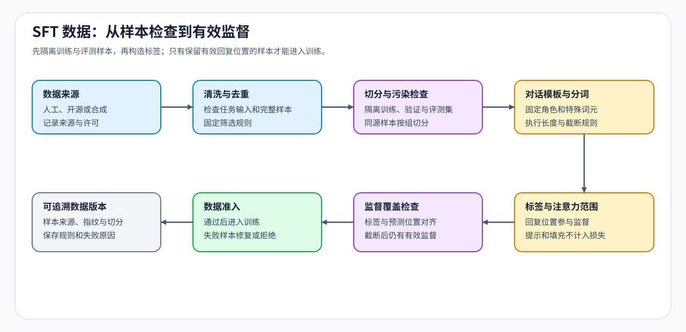

# 01 · SFT 数据、监督位置与长样本处理

监督微调（SFT）用示范回答训练模型在给定输入下生成期望内容。一条指令—回答样本可以完整地送进模型，却只对回答部分计算训练损失：提示保留为上下文，是否要求模型预测提示，则由监督目标决定。模板、标签和截断会共同决定这条样本实际上教给模型什么。

## 从对话到预测位置

以“问题：1+1 等于几？回答：2”为例，对话模板先标明用户和助手角色，分词器再把整段对话转成模型使用的词元。标签记录各位置要预测的目标词元。用 $[p_1,p_2,a_1,a_2,\mathrm{EOS},\mathrm{PAD}]$ 表示一条简化序列：$p_1,p_2$ 表示提示部分，$a_1,a_2$ 表示回答，EOS 是回答结束标记，PAD 是批处理填充。这些记号只说明位置关系，不对应实际分词结果。

在自回归训练中，每个位置预测下一个词元。因此，第一个回答词元由提示末尾位置的输出预测；第二个回答词元由第一个回答位置的输出预测。若采用“仅回答监督，并包含结束标记”的方案，这条样本提供三个目标位置。

注意力掩码控制哪些位置可被关注，标签掩码决定哪些预测进入损失。忽略提示的损失，并不意味着遮住提示；否则回答失去问题上下文。标签与输出还要按“预测下一个词元”对齐，错移一位就会训练不同的目标。

| 序列部分 | 是否作为可用上下文 | 是否作为本例的预测目标 |
|:---|:---|:---|
| 提示词元与角色标记 | 是，按因果顺序提供上下文 | 否 |
| 两个回答词元 | 是，已出现的词元可供后续位置使用 | 是 |
| 回答结束标记 | 是，按模板处理 | 是 |
| 为批处理补入的填充 | 由填充与注意力规则排除 | 否 |

## 损失分母与截断后的监督量

模型为下一个词元给出概率，目标词元的负对数概率用于衡量这一次预测的损失：目标概率越低，损失越大。仅回答监督的平均损失，是有效回答位置的损失之和除以有效目标数。本例的分母为 3，而不是整段输入长度。若截断删去了大部分回答，提示仍可能很长，但可用于训练的目标已经很少；回答被全部截掉时，样本就没有有效监督。

因此，长样本处理要同时看输入长度和回答保留量。把两条短样本拼接到一个窗口可以减少填充，但原本相互独立的样本还需要相应的注意力边界；目标标签也要保留各自的回答范围。延长窗口、截断和拼接改变的是不同部分，不能只用“窗口装满了”衡量训练数据利用率。

## 重复、错误答案与数据配比

如果同一个问题换了模板后同时进入训练集和评测集，模型可能凭记忆取得高分。这里的指纹是按固定规则处理文本后计算的内容标识：只对任务输入计算，可检查规范化内容相同的同题重叠；对完整样本计算，则用于检查整条记录重复。改写或近重复还需要相似度或人工复核。保留来源与版本，才能追查重复是来自采集、转换还是合成。

重复样本还会改变训练权重：某类简单问题出现得更多，即使采样程序对每条记录等权，这类问题也会获得更多更新。增加困难或领域样本可能改善覆盖，但错误答案也会被作为监督学习。合成数据同样要检查答案、任务可完成性和多样性，并与评测数据隔离；去重并不能替代答案验证。

## 从样本检查到训练

样本来源与隔离见[Part 02 · 32 数据与泄漏审计](../../02_PyTorch_Algorithms/32_Data_Engineering_for_SFT.md)，监督位置与损失见[Part 02 · 13 SFT 训练循环](../../02_PyTorch_Algorithms/13_SFT_Training_Loop.md)；截断和拼接可结合[Part 02 · 30 长上下文微调](../../02_PyTorch_Algorithms/30_Long_Context_Fine_Tuning.md)比较。需要补充示范时，再使用[Part 02 · PT-SYNTHETIC-DATA 合成指令生成与验证](../../02_PyTorch_Algorithms/PT-SYNTHETIC-DATA_Instruction_Generation_and_Verifier_Admission.md)。确定有效监督后，继续选择[参数更新范围](./02_lora_peft_design.md)，两者在训练控制中汇合。
