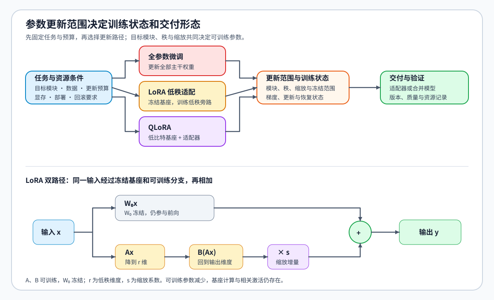

# 02 · LoRA、PEFT 与训练对象

用同一批示范训练模型，可以更新全部权重，也可以只训练少量选定或新增参数，后者称为参数高效微调（PEFT）。低秩适配（LoRA）是其中一种方法：冻结原模型作为基座，把权重增量表示为两个较小矩阵的乘积。这些与基座分开保存的低秩参数及其配置构成本页的适配器；它们改变可训练参数量，也改变训练后需要保存和加载的内容。

## 线性层增加一条低秩分支

设冻结的线性层权重为 $W_0\in\mathbb R^{d_{out}\times d_{in}}$，输入向量为 $x\in\mathbb R^{d_{in}}$。LoRA 学习两个矩阵 $A\in\mathbb R^{r\times d_{in}}$ 和 $B\in\mathbb R^{d_{out}\times r}$，其中低秩维度 $r$ 通常远小于输入、输出维度。用缩放系数 $s$ 调整增量后，输出向量 $y\in\mathbb R^{d_{out}}$ 为：

$$
y=W_0x+sB(Ax).
$$

输入同时经过原线性层和低秩分支，两路结果相加。训练时， $W_0$ 冻结，梯度更新 $A,B$；标准 LoRA 常用 $s=\alpha/r$， $\alpha$ 是缩放参数。全参数微调可以改变原权重的所有元素，LoRA 则将增量限制为这种低秩形式。

例如，输入与输出维度都是 1024、秩为 8 时，原权重有 $1024^2=1{,}048{,}576$ 个参数，两个 LoRA 矩阵合计只有 $8(1024+1024)=16{,}384$ 个。这个例子只计算单个线性层、忽略偏置；它说明了优化器需要维护的可训练参数为何减少。冻结基座仍要参与前向，训练也仍需要相关激活，即前向产生、反向计算可能需要的中间结果，所以可训练参数减少到原来的六十四分之一，并不意味着峰值显存同比例下降。

## 模块范围、秩与缩放分别改变什么

只在线性投影中的少数模块加入 LoRA，限制了增量可以作用的位置；扩大目标模块范围，会让更多计算获得可学习的增量。提高秩则扩大每个目标模块可表达的低秩增量空间，同时增加参数与优化器状态。缩放决定这条分支对输出的影响大小，和秩不是同一个变量。

固定秩比较不同模块范围时，参数总量通常也会变化。若目标是比较相同预算的分配方式，就需要把参数总量对齐，再比较“较少模块、较高秩”和“较多模块、较低秩”。rsLoRA、DoRA 等变体又改变缩放或参数化方式，比较它们时也要分清改变的是哪一项。

## 基座量化与适配器更新

QLoRA 将基座量化与 LoRA 结合：用低比特形式保存冻结基座，运算时按实现转换到相应计算数据类型，适配器仍承担可训练增量。它主要减少基座权重的驻留量，量化误差、激活和实际运行方式则继续影响质量与显存。因此，LoRA 与 QLoRA 的对照应尽量保持适配器、数据和有效更新预算一致，让基座表示成为主要差别。

| 方法 | 基座权重 | 可训练部分 | 保存与加载时的区别 |
|:---|:---|:---|:---|
| 全参数微调 | 参与更新 | 原模型权重 | 保存更新后的模型 |
| LoRA | 冻结 | 选定模块的低秩增量 | 适配器需匹配基座；满足条件时可合并 |
| QLoRA | 以低比特形式冻结 | 适配器增量 | 还需匹配量化配置与加载方式 |

## 保存后怎样还原这次适配

单独保存 $A,B$ 时，重新加载还需要原基座以及目标模块、秩和缩放配置。若将增量合并为 $W'=W_0+sBA$，推理时可以使用合并后的权重；低比特基座的合并与再量化则要按支持的实现处理，并重新核对输出。

计算与参数量见[Part 02 · 14 LoRA](../../02_PyTorch_Algorithms/14_LoRA_Tutorial.md)，基座表示和参数化差异分别见[Part 02 · 26 QLoRA](../../02_PyTorch_Algorithms/26_QLoRA_and_4bit_Quantization.md)与[Part 02 · 31 LoRA 变体](../../02_PyTorch_Algorithms/31_LoRA_Variants_Theory.md)。确定更新哪些参数后，将参数方案与[监督目标](./01_sft_data_and_loss.md)一起带入[训练控制](./03_training_control.md)，核对损失怎样形成实际更新。
