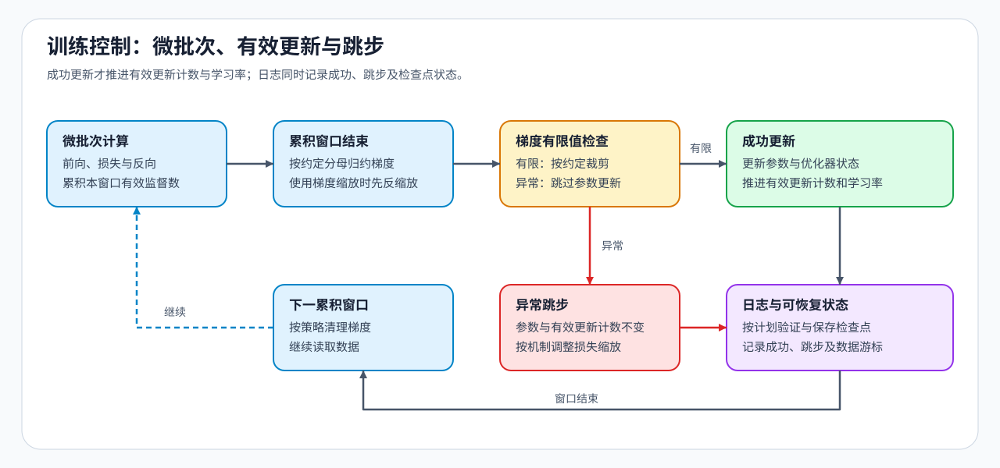

# 03 · 训练控制与低资源 SFT

监督目标已经确定哪些词元参与损失，参数方案也已确定更新哪些权重，接下来要把两者组织成实际训练。显存只能放下一个小批次时，可以多次反向计算，再执行一次参数更新。但“运行了四个微批次”和“成功更新了四次”是两回事：梯度累积、损失分母与数值溢出，会改变一次训练实际推进了多少。

## 多个微批次形成一次更新

微批次是一次前向与反向处理的样本批；累计窗口是两次参数更新边界之间合并梯度的范围。在一个窗口内，每个微批次计算损失，再把梯度累加到参数上。窗口结束后才进行一次优化器更新，并清除梯度。若每个窗口含四个微批次，成功完成一个窗口通常只对应一次参数更新，而不是四次；有效批量表示这次更新合并了多少样本，还取决于微批次大小与参与数据并行的设备数量。

回答长度不同，又会使各微批次的有效监督词元数不同。损失归约指将这些位置的损失按约定求和或取平均。假设两个微批次分别有 2 个和 6 个有效目标，平均损失分别是 1 和 3。按词元等权归约时，整个窗口的平均损失为：

$$
L=\frac{2\times1+6\times3}{2+6}=2.5.
$$

这里的 $L$ 表示窗口内 8 个目标的平均损失。直接平均两个微批次损失则得到 2，它让短微批次获得了过高权重。梯度累计也应与选定的归约一致；单纯“每个微批次损失除以累计次数”，只有在相应权重相等时才对应目标平均。

## 数值检查与成功更新计数

混合精度让不同计算与状态使用不同数值类型，以降低部分存储和计算成本，同时保留必要的数值精度。FP16 是一种16位浮点格式；采用梯度缩放时，先放大损失以降低小梯度下溢的风险，反向后再反缩放，恢复梯度尺度。若按约定裁剪梯度范数，也应在恢复尺度后进行。检查发现无穷或非数值等非有限值时，优化器可能跳过本次更新：窗口虽然已处理过数据，参数却没有按计划改变。

按成功更新步设计的学习率调度、验证与保存，应跟随这个计数，而不是仅随微批次数推进。若发生跳步，训练记录要能区分已处理的数据与已提交的更新。恢复训练时也需要还原两者，否则可能跳过样本、重复训练，或把学习率推进到错误位置。

## 低资源方法作用于不同部分

激活是前向计算产生、反向计算可能需要的中间结果。梯度累积主要通过减小单个微批次，降低该次前向与反向的激活峰值；它仍保留需要累积的参数梯度。LoRA 减少可训练参数和对应优化器状态，QLoRA 进一步减少冻结基座的权重驻留量，混合精度则改变部分计算与存储类型。

这些方法可以组合，但减少的是不同部分。例如，基座权重已能放下、长序列激活却占满显存时，仅减小 LoRA 秩未必能解决问题；减小微批次，或用激活检查点少存部分中间结果、反向时重新计算，更直接地作用于激活。比较组合方案时，还要保持监督量与更新预算可比。

## 训练工具怎样组织这些步骤

工具负责执行和管理上述过程，训练目标仍由标签、归约与更新安排决定。选择自定义循环或现成训练器时，重点是能否表达需要的监督与恢复行为。

| 工具 | 在训练中的作用 | 与其他工具的关系 |
|:---|:---|:---|
| Transformers Trainer | 组织训练、验证、保存与恢复 | 封装常用训练循环 |
| Accelerate | 辅助自定义循环进行混合精度与多设备执行 | 保留更多循环控制 |
| TRL | 提供 SFT、偏好与奖励优化等训练器 | 按目标组织后训练过程 |
| PEFT | 注入、训练与保存适配器 | 管理参数更新范围，而非替代完整循环 |
| LLaMA-Factory / Axolotl 等 | 用配置编排数据、训练方法和执行后端 | 使用时仍需理解展开后的训练安排 |
| Unsloth | 在支持的模型与硬件上提供低显存训练实现 | 与所选模型、精度和适配器配置共同决定实际开销 |

累计窗口与有效更新的原理见[反向传播专题](../backpropagation_training_mechanism/03_loss_reduction_gradient_accumulation_effective_update.md)，可结合[Part 02 · 11 梯度累积](../../02_PyTorch_Algorithms/11_Gradient_Accumulation.md)和[Part 02 · 12 优化器与学习率调度](../../02_PyTorch_Algorithms/12_Optimizer_Updates_and_Learning_Rate_Scheduling.md)练习。确定更新怎样推进后，继续在[SFT 基线与交付](./04_end_to_end_experiment.md)检查保存的参数和训练进度能否还原。
