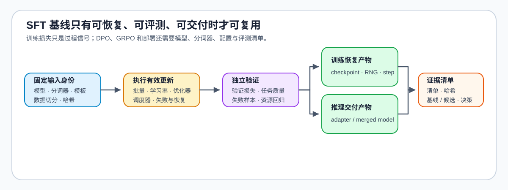

# 04 · SFT 基线、升级条件与训练交付

训练结束时内存中的模型可以正常回答，保存后重新加载却可能因模板变化或基座不匹配而表现不同；继续训练时，遗漏优化器状态又可能改变后续更新。完成一轮 SFT，需要分别确认任务表现、推理加载和训练恢复。

## 保存推理模型与恢复训练的区别

用于推理时，模型需要还原权重、分词器、特殊词元、模板与生成设置；适配器还依赖对应基座。重新加载后，用同一组输入、固定的解码设置与随机条件比较输出，可以发现漏载参数或模板变化造成的差异。

继续训练还需要保存一个检查点，即与某个训练进度对应的参数和恢复状态。以 Adam 类优化器为例，一阶、二阶矩记录历史梯度及其平方的滑动统计；若重新初始化这些统计，即使读入相同权重，下一步更新也可能不同。数据游标记录样本读取进度，随机状态记录当前随机数生成器的位置，两者共同影响接下来读到什么、使用什么随机结果。单独保留最初随机种子不能代替中途状态。

最容易验证的是在一次累积窗口结束、梯度清空后保存：连续运行路径与恢复路径使用同一后续批次，逐步比较学习率、损失、参数和优化器状态。若在窗口中间保存，还需恢复已累积梯度、窗口内进度及本窗口的损失分母；只恢复模型和优化器会丢失部分更新。使用FP16梯度缩放时也保存缩放器状态。数据采样、随机状态和确定性执行条件齐备后，才进一步检查训练轨迹是否一致；允许的数值容差随执行环境声明。

| 使用方式 | 需要还原的主要内容 | 要比较的行为 |
|:---|:---|:---|
| 重新加载推理 | 模型或适配器、匹配基座、分词器、模板与生成设置 | 同输入下的生成行为 |
| 从检查点继续训练 | 上述训练所需参数，加优化器、调度器、成功更新步、数据进度与随机状态 | 后续批次与更新是否符合恢复安排 |

## SFT 何时完成，何时升级

SFT 通过示范学习任务接口、输出格式、指令遵循与答案内容。如果同类错误仍能通过更好的示范和覆盖得到改善，继续 SFT 往往比立即增加奖励系统更直接。已有指令模型若已满足这些要求，可先复测，再决定直接采用还是作为偏好或奖励优化的起点。

另一类问题是“能生成合理答案，却不稳定地选择更合适的行为”。同提示下的优选与非优选回答可以用于离线偏好训练；需要当前策略尝试新解法、且结果可以评分时，则可以考虑在线更新。反馈能否区分回答，以及评分是否与真实任务一致，决定了这种升级有没有可学习的方向。

| 主要剩余问题 | 可比较的下一步 | 选择依据 |
|:---|:---|:---|
| 目标任务和能力保持已满足要求 | 进入独立评测与采用判断 | 确认预设质量、安全及资源条件，无须为升级而继续训练 |
| 格式或基本任务行为不稳定 | 补充示范并继续 SFT | 观察独立任务是否随示范改善 |
| 已有可复查的回答对 | DPO 等离线偏好优化 | 同提示下的排序能表达目标偏好 |
| 单条回答有可靠正负标签 | KTO 等二元反馈方法 | 标签含义明确且无需强行配对 |
| 需要探索当前策略的新行为 | PPO、GRPO、RLOO 等在线方法 | 奖励能区分任务表现，并配合所选方法构造优势 |
| 规则奖励大量同分或与成功率背离 | 调整采样、验证器或任务难度 | 先恢复反馈区分度与任务含义 |
| 外部事实或领域知识缺失 | 比较检索增强生成（RAG）、数据补充或持续预训练 | 区分检索可解决的问题与参数内知识缺口 |

## 开始在线训练前，先跑通什么

已有合适指令模型时，先固定版本并复测即可建立起点；是否再做 SFT，取决于示范能否解决当前失败。SFT 损失趋于平稳本身不能判断下一步该用什么：还要看独立任务结果，以及手头的反馈是否适合继续训练。进入在线分支前，先用少量样本跑通采样、评分和一次更新，确认数据与计算能衔接，再逐步增加预算。

以算术题为例，验证器需要区分答错、输出无法解析和评分程序超时。可以抽查一批正确与错误回答，核对分数含义，再检查当前模型采样是否产生可比较的回答。全部同分时，先查看任务难度、采样范围和评分逻辑；评分失败的回答保留失败状态，重试或按声明规则排除。这样的检查提供试跑依据，训练后的能力收益仍通过独立评测判断。

| 试跑前后检查什么 | 保留的具体记录 |
|:---|:---|
| 起点和问题是否明确 | 基线版本、固定解码设置、独立任务结果与重复失败样例 |
| 评分是否完成且符合任务含义 | 验证器或奖励模型版本、成功评分数／尝试数、失败原因、分数与任务结果的抽查 |
| 一次采样到更新是否接通 | 生成策略版本、动作或回答掩码、行为概率、所用奖励和一次更新记录 |
| 算法所需计算是否齐备 | PPO 的价值估计、优势和结束时的回报处理；GRPO／RLOO 的同提示分组、同分和评分失败处理 |
| 能否控制试跑代价并恢复 | 生成长度、轨迹数量与时间预算，显存和耗时记录，可重新加载的检查点；工具任务另查权限与环境重置 |

具体门槛按任务与预算约定：计算是否正确、评分是否可信、是否值得扩大训练，是依次回答的三个问题。[Part 02 · 33](../../02_PyTorch_Algorithms/33_Fine_Tuning_Readiness.md)检查阶段选择和必要输入记录，上表进一步检查这些输入能否支持真实执行。轨迹复用和中断处理见[08 轨迹生命周期](./08_trajectory_lifecycle_and_environment_interaction.md)，多进程等待与资源安排见[09 执行系统](./09_rl_execution_system_and_efficiency.md)。

## 基线用于后续哪些比较

可重新加载、可以评测的 SFT 模型，为后续方法提供共同起点。将其冻结，还可以作为参考策略来源：这里的策略是模型在给定上下文下生成下一词元的概率分布，参考策略在当前一轮训练中保持固定，用于衡量更新后的模型偏离了多少。后续候选与共同起点在相同任务上比较，才能区分增加了偏好、奖励或探索后实际改变的能力。

阶段选择见[Part 02 · 33 后训练准入](../../02_PyTorch_Algorithms/33_Fine_Tuning_Readiness.md)，有效更新见[Part 02 · 15 SFT 有效更新与训练闭环](../../02_PyTorch_Algorithms/15_End_to_End_Fine_Tuning_Experiment.md)。需要继续训练时，分别进入[离线偏好](./05_dpo_and_preference_optimization.md)或[在线奖励更新](./06_rlhf_and_ppo_system_cost.md)；基线与训练候选都使用[独立评测](./10_evaluation_and_adoption_decision.md)判断任务收益与采用条件。
