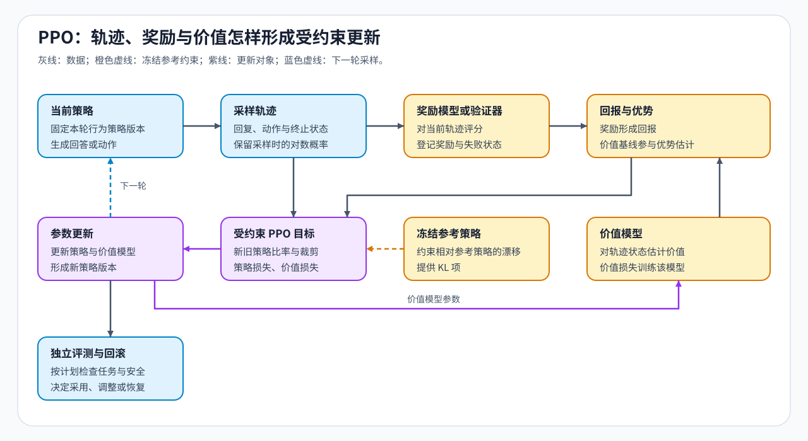

# 06 · 奖励信号、PPO 与 RLHF

模型对当前问题生成新回答后，奖励可以告诉训练过程“这次结果好不好”。但同样一个分数，对容易的问题和困难的问题未必代表同样的进步。近端策略优化（PPO）将奖励与价值估计联系起来，构造相对预期的优势，再用它调整回答中动作的概率。

策略是模型在给定上下文下生成下一词元的概率分布。纯文本生成时，一个动作就是选择下一个词元，之前的提示与已生成内容构成当前状态；这些状态、动作及其反馈组成一次采样轨迹。

## 回答分数与动作上的奖励

任务反馈可以来自人类偏好训练出的奖励模型，也可以来自测试、规则或环境。来源决定了分数的含义：格式规则能判断格式，代码测试能判断已覆盖测试是否通过，奖励模型则学习其标注数据中的偏好。

回答级奖励通常要落到轨迹中的位置上。例如，只在回答结束时给任务奖励，前面的词元虽然没有即时任务分数，仍可通过后续回报获得更新信号。回报是从当前动作开始累计的奖励，采用折扣时会降低较远奖励的权重。过程奖励则在相应动作处提供反馈。超时或无法判定表示反馈没有正常完成，应与已确认的任务失败分开处理。

多个分量相加时，总分可能掩盖冲突：格式分增加、答案正确性下降，仍可能使总分提高。保留各分量，才能解释模型究竟改善了什么。

## 从奖励到价值与优势

价值模型估计当前状态下的预期回报，优势则衡量实际结果相对这一预期的好坏。先看一个简化的终局位置：假设此处之后真实终止、没有额外奖励项，任务奖励为 1，价值估计为 0.4，那么该位置的回报为 1，优势可以取 $1-0.4=0.6$。若任务奖励是 0，同样的价值估计会给出 $-0.4$ 的优势。

多词元、多步轨迹还要处理奖励的传播与终止边界。广义优势估计（GAE）先比较“当前奖励加折扣后的下一状态价值”与“当前状态价值”，其差值称为时序差分残差；再将当前及后续残差衰减加权，得到优势估计。真实终止后不再计入后续价值；因时间上限而截断、任务却未终止时，是否用末状态价值补足回报，应按采集协议处理。

## 一次 PPO 更新中的三种概率角色

生成回答的模型称为行为策略。以下以行为策略就是比率分母所用旧策略的配置为例：采样时保存动作的旧对数概率，更新时由当前策略在同一动作和上下文上重新计算概率，两者形成策略比率。优势决定提高还是降低该动作的倾向。旧概率和已构造优势在这轮更新中按固定数据使用，参考策略则另行提供偏离约束。

| 对象 | 在这轮计算中的作用 | 是否随当前策略更新而改变 |
|:---|:---|:---|
| 行为策略留下的旧概率 | 描述动作生成时的概率，作为比率分母 | 保存值固定 |
| 当前策略概率 | 形成比率与可训练目标 | 改变 |
| 冻结参考策略概率 | 衡量相对参考分布的偏移 | 参考模型固定 |
| 价值估计 | 构造优势，并拟合回报目标 | 价值模型通过自己的目标更新 |

例如，取裁剪范围为 0.2，某动作优势为正。比率从 1 增至 1.1 时，裁剪目标仍会鼓励这方向的变化；增至 1.5 时，目标会与按 1.2 裁剪后的增益比较，限制继续增大比率所带来的目标收益。裁剪作用在目标上，并非保证所有动作概率比率始终处于区间内。

KL 散度衡量概率分布的偏离，参考 KL 约束将这种偏离纳入训练目标。它比较当前策略与冻结参考策略，而 PPO 比率比较当前策略与旧策略，两者的比较对象不同。轨迹上已采样词元的对数概率差可参与相应估计，但不是逐位置完整词表 KL 的精确值。若奖励把错误答案排在正确答案之前，更新信号仍会偏向错误答案；KL 约束也不会替代奖励排序检查。

## 为什么在线更新需要协调多个模型角色

采样要保存回复、动作位置与行为概率；打分要运行奖励模型或验证器；价值估计和策略更新又需要相应模型与训练状态。即使这些工作分阶段执行，也可能因模型驻留、轨迹缓存和权重同步争用资源。旧概率可以保存为数据，不需要为此始终额外驻留一份完整旧模型。

基于人类反馈的强化学习（RLHF）描述利用人类反馈的训练路线，PPO 是可采用的更新方法之一。已有偏好对能够覆盖目标行为时，离线方法可以省去持续采样与打分；需要探索当前模型的新行为时，在线方法则增加了这部分计算与状态管理。各角色的峰值是否同时出现，取决于实际调度，不能把独立峰值直接相加。

回报与优势见[Part 02 · PT-REWARD-SIGNAL](../../02_PyTorch_Algorithms/PT-REWARD-SIGNAL_Reward_Model_Value_and_Advantage.md)，使用学习型评分时再进入[Part 02 · PT-REWARD-MODEL 奖励模型与校准](../../02_PyTorch_Algorithms/PT-REWARD-MODEL_Reward_Model_Training_and_Calibration.md)，概率角色与裁剪见[Part 02 · 16 PPO](../../02_PyTorch_Algorithms/16_RLHF_PPO_Memory.md)。需要用同一提示的回答组构造基线时，继续比较[GRPO 与 RLOO](./07_grpo_and_groupwise_alignment.md)；确定更新方法后，再进入[轨迹生命周期](./08_trajectory_lifecycle_and_environment_interaction.md)。
