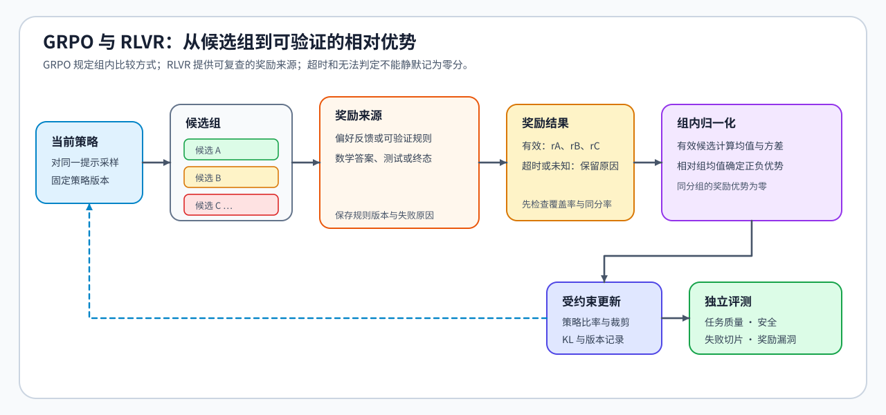

# 07 · GRPO、RLOO 与组内奖励

同一问题生成三条回答，奖励分别是 0、1、3。除了逐条看分数，还可以比较每条回答相对同组其他回答的表现。组相对策略优化（GRPO）与留一法策略优化（RLOO）都利用这种关系构造优势，也就是相对比较基线的更新信号，但选择的基线和缩放方式不同。

## 同一组奖励的两种基线

设组内有 $K>1$ 条可评分回答，第 $i$ 条奖励为 $r_i$，组均值为 $\mu=K^{-1}\sum_{j=1}^K r_j$。对上面的三条回答，$K=3$、$\mu=4/3$。GRPO 先将奖励中心化，得到：

$$
(r_1-\mu,r_2-\mu,r_3-\mu)=(-4/3,-1/3,5/3).
$$

这说明第一、第二条低于组内平均，第三条高于平均。标准差描述奖励围绕均值的分散程度；采用标准差缩放时，再用它调整优势的尺度。本专题的 GRPO 练习使用总体标准差，并以正数 $\varepsilon$ 为分母下限，即除以 $\max(\sigma_g,\varepsilon)$，其中 $\sigma_g$ 是组内标准差；其他配置是否缩放、采用何种标准差及数值保护，应分别核对。

RLOO 对当前回答使用“排除自己后的其他奖励均值”。记留一基线为 $b_i$、优势为 $A_i$，则：

$$
b_i=\frac{\sum_{j\ne i}r_j}{K-1},\qquad A_i=r_i-b_i.
$$

三条回答的留一基线分别为 2、1.5、0.5，优势为 $(-2,-0.5,2.5)$。它们与未缩放的组内中心化奖励同号，但幅度不同：这里相差 $K/(K-1)=1.5$ 倍。目标中的缩放、裁剪和归约进一步影响更新，不能仅因优势同号就把两种算法视为相同。

## 回答优势怎样进入策略目标

策略比率比较当前策略与旧策略对同一动作或回答给出的概率。本专题的 GRPO 目标把一个回答的优势用于其多个有效动作词元，各位置分别计算词元级比率；RLOO 练习则先汇总整条回答的对数概率，再形成序列级比率。组内优势回答“这条回答相对其他回答怎样”，比率粒度决定“在什么范围上计算策略变化”，两者需要分开理解。

组基线省去了独立价值模型的训练，但仍需要生成多个回答、计算奖励，并按所选目标组织裁剪和参考约束。裁剪改变目标对概率变化的激励，不保证更新后的所有比率都落在裁剪区间内。

若三条奖励全部相同，中心化奖励与留一优势都为零，此组没有奖励差异可供学习。目标中其他项，例如参考约束，仍可能产生梯度。增加组大小也只有在生成了可评分、能区分的回答时，才可能改善这类信号。

## 可验证奖励与更新算法

PPO、GRPO 与 RLOO 是更新方法；可验证奖励强化学习（RLVR）描述反馈来自规则、测试或可检查的环境结果。使用代码测试给分，可以与不同更新方法组合；它不等于选定了 GRPO。

验证器可执行，也可能遗漏真实任务要求。例如所有回答只因满足格式就获得相同高分，组内无法区分正确性；隐藏边界测试缺失时，模型还可能学到只通过已有测试的模式。超时与无法判定应保留独立状态，避免混入已确认的错误答案。

## 奖励差异不足时发生了什么

| 组内现象 | 对更新信号的影响 | 可用的对照 |
|:---|:---|:---|
| 全部同分 | 奖励优势为零 | 对照采样多样性与验证器区分度 |
| 只有格式分变化 | 更新主要反映格式偏好 | 分开观察格式与正确性奖励 |
| 高分集中于异常短回答 | 可能偏好长度代理 | 比较长度相近回答的任务成功率 |
| 奖励上升、独立成功率下降 | 评分与任务目标可能背离 | 复核分歧样本与规则覆盖 |

组内计算与目标粒度见[Part 02 · 18 GRPO](../../02_PyTorch_Algorithms/18_GRPO_Loss_Tutorial.md)和[Part 02 · PT-RLOO](../../02_PyTorch_Algorithms/PT-RLOO_Leave_One_Out_Policy_Optimization.md)，奖励归约见[公式索引](./formula_reference.md)。确定更新目标后，还需管理生成版本和消费状态，继续在[轨迹生命周期](./08_trajectory_lifecycle_and_environment_interaction.md)检查一条回答何时可以用于更新。
