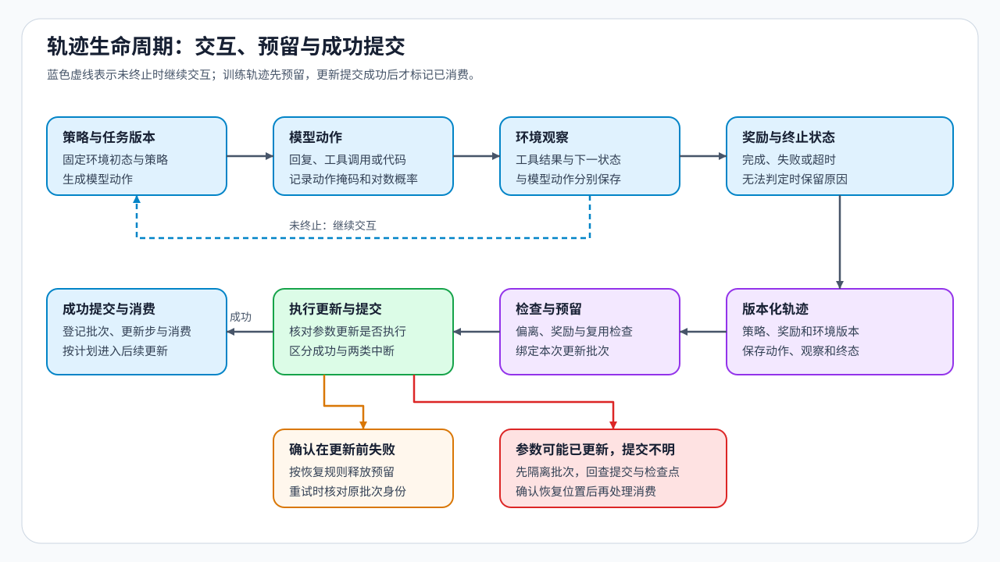

# 08 · 轨迹生命周期与环境交互

模型调用计算工具，读到结果后给出答案。把初始任务、模型动作、工具观察、奖励及终止状态按顺序保存，就得到一条交互轨迹；采样轨迹也常称为 rollout。训练时要分清哪些词元由策略选择，系统恢复时还要知道这条轨迹是否已经参与更新。

## 一次工具调用留下了什么

以“计算一个数值并回答”为例，模型先生成工具名称和参数，环境执行后返回数值，模型再据此生成最终回答。工具结果可以影响后续回答，但它本身不是模型采样出的动作。动作掩码是逐位置标记，用来选择哪些模型动作进入策略损失；工具观察作为后续上下文保留，与控制可见范围的注意力掩码分开处理。

任务奖励还要区分错误来自哪里：参数正确但工具服务超时，与模型调用了错误工具，不是同一种失败。环境版本、终止原因和原始奖励分量可以帮助还原这个区别；成功、已确认失败、超时和无法判定应分别保存。

| 轨迹中的内容 | 在例子中的含义 | 后续用途 |
|:---|:---|:---|
| 初始任务与环境 | 问题、可用工具及环境版本 | 还原相同起点 |
| 模型动作 | 工具调用参数、最终回答 | 计算相应动作位置的策略目标 |
| 环境观察 | 工具返回的数值或异常 | 构成下一步上下文 |
| 奖励与终止 | 答案是否正确、工具是否正常完成 | 构造回报并区分反馈失败 |
| 轨迹身份与消费状态 | 生成策略版本、绑定批次及提交状态 | 判断能否接纳、恢复或重试 |

## 生成时的策略与更新时的策略

学习器是执行参数更新的角色。假设轨迹由版本 10 生成，到达学习器时模型已更新到版本 12。轨迹里的动作仍来自版本 10，版本号不能随着队列移动而改成 12。采样时保存的行为概率，与更新时当前模型对相同动作和上下文重新计算的概率，描述了不同分布；比较时还要核对分词器、有效动作位置与采样设置。

版本差有助于发现积压，但两个版本的行为可能变化很小，也可能变化很大。因此，轨迹是否仍可用于目标更新，还要结合动作概率偏离、奖励是否完成及算法允许范围判断。固定离线偏好对不要求当前模型重生成回答；在线循环则持续产生这类带生成身份的新轨迹。

## 评分重试保留哪一次生成

轨迹已经生成、评分程序却超时时，先保留回答与行为概率，将评分状态记为待重试；已确认答错得到的0分则是完成的评分。对原回答重试评分时，采样事件、生成策略和组标识保持不变，增加评分尝试编号、评分程序版本和失败原因，并确定最终采用哪份结果。若改为重新生成回答，新记录使用新的采样事件标识。

以[上一页的 A、B、C 组](./07_grpo_and_groupwise_alignment.md)为例，B 补回1分后，组内各回答的基线与优势都要重算，再组成尚未提交的更新批次。生命周期练习把 `reward_ready` 作为调用方确认评分已完成的事件：待评分记录保持 `generated`，确认后才推进到 `rewarded`。状态表检查事件顺序；评分服务是否真的成功、结果是否可信，由调用方在发出该事件前核对。评分重试与更新提交重试分别记录，避免把同一回答的评分重试计成再次生成或再次更新。

## 预留、提交与失败重试

接纳一条轨迹后，可以先把它预留给指定更新批次，避免另一个工作进程同时取走。优化器成功更新并完成相应提交后，再标记消费完成。若在更新前失败，通常可以按恢复规则释放预留；若参数更新可能已执行、消费标记却未完成，则需要回查提交记录和检查点，不能直接重新更新。

这种状态区分针对训练计划之外的重复提交。PPO 在同一轮内按已声明计划重复使用小批次，并不因此成为错误消费。恢复需要同时知道“本轮计划使用几次”和“哪些更新已经完成”。

机制练习将这两类失败分开：`abort`表示已确认更新尚未执行，返回可预留状态；`commit_uncertain`表示提交情况待核查，进入`quarantined`并暂停预留。隔离记录随后由检查点和提交日志决定如何恢复，内存状态表本身不会替系统判断优化器究竟执行过没有。

## 多步奖励沿哪些动作传播

一次工具结果可能影响后面多步回答，终局成功奖励也可能需要向更早动作归因，即确定哪些先前动作应获得更新信号。回报沿有效动作与环境转移累计。任务真正结束属于终止，外部采集上限使记录提前停止属于截断；若时间限制本身定义了任务终点，则按终止处理，末状态价值的计算见[奖励信号页的 GAE 练习](../../02_PyTorch_Algorithms/PT-REWARD-SIGNAL_Reward_Model_Value_and_Advantage.md#mechanism-practice)。工具超时还需保留失败原因：任务协议可以将其定义为环境结果，而评分程序超时表示尚未取得该结果的评分。动作与观察保留不同来源，才能确定损失位置与归因边界。

相同环境交互可以用于不同训练目标：SFT 模仿经过验证的动作序列，DPO 比较同初始状态下的轨迹偏好，PPO 用价值估计构造多步优势，GRPO 比较同任务的候选轨迹组。算法改变的是更新信号，工具执行本身仍需独立处理。

版本与消费状态见[Part 02 · PT-ROLLOUT-LIFECYCLE 轨迹新鲜度](../../02_PyTorch_Algorithms/PT-ROLLOUT-LIFECYCLE_Rollout_and_Policy_Freshness.md)，动作与归因见[Part 02 · PT-AGENTIC-RL 环境轨迹与奖励归因](../../02_PyTorch_Algorithms/PT-AGENTIC-RL_Environment_Trajectory_and_Credit_Assignment.md)。确定一条轨迹怎样进入更新后，继续在[在线执行系统](./09_rl_execution_system_and_efficiency.md)观察多个工作进程的排队、权重同步与恢复。
