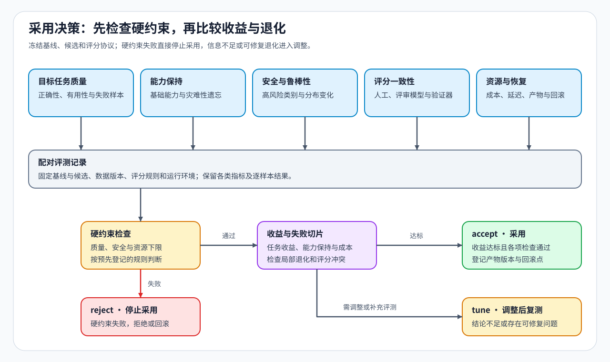

# 10 · 独立评测、能力回归与采用决策

偏好损失与奖励反映模型在训练目标上的表现，独立评测则用未参与该候选训练的任务和固定评分方式比较回答。它要同时检查目标任务改善、能力回归和运行成本；这里的能力回归指原有任务表现出现退化。

## 总分提高时，哪些错误可能被平均掉

假设一个示意评测集含 100 个任务，其中 20 个需要工具调用。基线在工具任务中答对 15 个，其他任务中答对 60 个，总共 75 个；候选分别答对 10 个和 70 个，总共 80 个。总体成功率从 75% 提高到 80%，工具任务却从 75% 降到 50%。

这类平均值需要按任务、长度、语言或安全类别继续拆开，逐组检查失败；这些子集就是后文的失败切片。安全与拒答还要同时观察：拒答更多可能减少不安全回答，也可能误拒正常任务。延迟、显存与失败率则描述模型在实际运行中的另一部分代价。

## 相同任务、解码与评分方式

基线是固定的比较起点，候选是待判断的模型或适配器。两者应回答同一组冻结任务，即固定题目及其版本，并采用相同的解码与评分设置。若一边采样更多次、另一边只生成一次，或评分规则中途变化，成功率差异就混入了评测方法差异。重复运行还可以观察差异是否稳定；一次分数上升不能自动排除采样波动。

开发数据用于调整训练与参数，验证集按预先约定的方式用于筛选，最终留出集在候选冻结后使用。训练、在线反馈和反复调参若持续接触最终测试题，留出集就逐渐失去独立性。来源、去重与去污染因此要覆盖新增反馈，而不仅是最初训练数据。

模型评审器使用另一个模型按约定准则判分，规则验证器则检查已编码的答案条件、测试或环境结果。它们与人工抽检发生分歧时，应回到具体回答：是评分理解了不同要求，还是规则漏掉了答案错误？评审模型、评分提示和回答展示顺序也应固定，才能解释分歧来自哪里。

## 能力提升与学生压缩使用不同参照

能力提升实验要求达到事先设定的增益。学生蒸馏用教师的回答或概率分布监督学生；用于压缩时，可能允许一定质量损失，以换取更小产物或更低部署成本。质量容差和最低资源收益需要在看到结果前确定，成本则按目标设备、后端和批量测量。

比较不同蒸馏方法时，学生从相同参数起点开始，数据或轨迹来源、教师反馈与训练剂量分别控制。学生相对教师的任务质量差距用于衡量能力保持，与训练前学生的比较用于衡量训练收益；额外训练量带来的变化也需要单独区分。

| 训练目标 | 主要比较对象 | 需要解释的变化 |
|:---|:---|:---|
| SFT 任务适配 | 更新前模型与监督训练后模型 | 目标任务改善与原有能力保持 |
| 偏好或在线奖励优化 | 共同起点与各训练候选 | 训练反馈是否转化为真实任务收益 |
| 独立学生蒸馏 | 共同训练前学生与蒸馏学生；另与冻结教师比较 | 学生训练收益、相对教师的质量差距与部署成本 |

## 从评测结果决定保留、调整或拒绝

复测已有模型时，先判断它是否达到任务、能力保持、安全与资源要求；若已满足目标，可以保留现有方案。比较新增训练候选时，再按下表检查预设收益与硬约束。结论针对已测任务和运行条件，推理重载、故障恢复或跨后端用途还需相应验证。

| 决策 | 成立条件 | 后续处理 |
|:---|:---|:---|
| 保留（accept） | 达到预设能力增益，或在质量容差内达到压缩收益；安全、能力保持与资源要求通过 | 保存候选身份、适用范围与可用回滚点 |
| 调整（tune） | 存在可修复问题，或缺少可以补齐的评测证据，尚不能采用 | 围绕具体失败组调整数据、奖励或配置，补齐所缺检查后按相同协议复测 |
| 拒绝（reject） | 比较无效、未达到必须满足的质量要求，或触发安全、资源硬约束 | 保留原基线，记录拒绝原因 |

具体实验入口、已登记结果及产物见[实验资产表](./experiment_assets.md)，计算约定见[公式索引](./formula_reference.md)。训练是否正确完成参数更新，可回查[反向传播专题的正确性说明](../backpropagation_training_mechanism/06_correctness_and_performance_evidence.md)。
