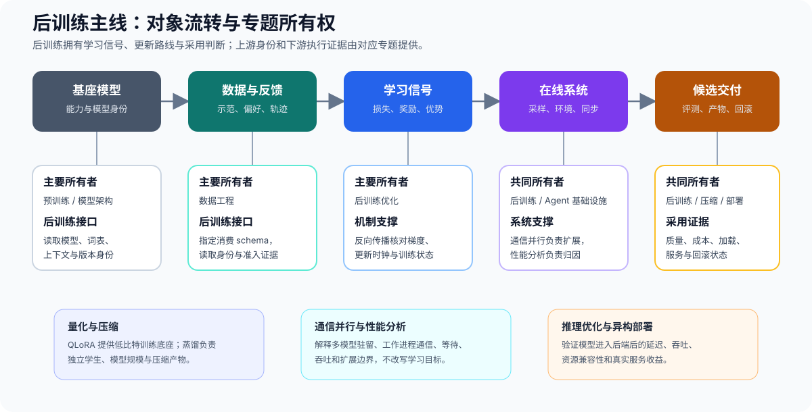

# 后训练优化（Post-Training Optimization）

> 专题类型：主学习路线　能力出口：选择训练信号与更新方法，并判断模型是否值得采用

后训练利用监督数据、偏好反馈、可验证奖励或教师反馈改变模型行为。学习者从已有失败和数据条件出发，选择监督、偏好、在线奖励或独立学生训练，并用独立评测检查能力收益、资源代价和回滚条件。

## 学习路线

首次学习按下表选择分支；连续理解数据、更新与评测的关系时阅读[后训练问题链](./walkthrough.md)，排查已有结果时使用[判断手册](./casebook.md)。术语和公式分别查询[术语表](./glossary.md)与[公式索引](./formula_reference.md)。

| Task / 主题 | 本阶段要回答的问题 | 学习与验证页面 | 学习顺序 | 主要正文 |
|:---|:---|:---|:---|:---|
| Task0 · 目标诊断与阶段准入 | 哪些稳定失败需要参数更新，应该从哪个训练阶段开始？ | 核心：[后训练问题链 · 阶段选择](./walkthrough.md#一先判断是否需要改变模型参数) → [Part 02 · 33 后训练准入与阶段选择](../../02_PyTorch_Algorithms/33_Fine_Tuning_Readiness.md) | 稳定失败证据 → 提示 / RAG / 工具基线 → 参数内部剩余失败 → SFT 基线状态与反馈形态 → 后训练阶段 | [04 SFT 完成与阶段升级](./04_end_to_end_experiment.md#sft-何时完成何时升级) |
| Task1 · 数据准备、监督目标与最小 SFT 基线 | 样本怎样通过检查并形成有效监督与最小 SFT 基线？ | 核心：[Part 02 · 32 SFT 数据契约与泄漏审计](../../02_PyTorch_Algorithms/32_Data_Engineering_for_SFT.md)；扩展：[Part 02 · PT-SYNTHETIC-DATA 合成指令生成与验证准入](../../02_PyTorch_Algorithms/PT-SYNTHETIC-DATA_Instruction_Generation_and_Verifier_Admission.md) → [Part 02 · 13 SFT 监督边界与损失](../../02_PyTorch_Algorithms/13_SFT_Training_Loop.md) → [Part 02 · 15 SFT 有效更新与训练闭环](../../02_PyTorch_Algorithms/15_End_to_End_Fine_Tuning_Experiment.md)；项目：[Part 02 · 64 数据准入](../../02_PyTorch_Algorithms/64_SFT_Data_Quality_Project.md) → [Part 02 · 62 训练交付](../../02_PyTorch_Algorithms/62_Instruction_Fine_Tuning_Project.md)；扩展：[Part 02 · 30 长上下文微调](../../02_PyTorch_Algorithms/30_Long_Context_Fine_Tuning.md) | 数据缺口与任务蓝图 → 合成候选、验证与准入 → 最终切分审计 → 模板、标签边界与损失 → 有效更新与配对评估 → 可恢复 SFT 基线 | [01 SFT 数据、监督与长上下文契约](./01_sft_data_and_loss.md) |
| Task2 · 更新范围与参数高效适配 | 任务和显存预算固定后，应更新哪些参数？ | 核心：[Part 02 · 14 LoRA](../../02_PyTorch_Algorithms/14_LoRA_Tutorial.md) → [Part 02 · 31 LoRA 变体](../../02_PyTorch_Algorithms/31_LoRA_Variants_Theory.md)；项目：[Part 02 · 63 LoRA 选型](../../02_PyTorch_Algorithms/63_LoRA_Variants_Benchmark.md) / [Part 02 · 65 QLoRA 选型](../../02_PyTorch_Algorithms/65_QLoRA_Selection_Project.md) → [Part 02 · 62 SFT 训练交付](../../02_PyTorch_Algorithms/62_Instruction_Fine_Tuning_Project.md)；扩展：[Part 02 · 26 QLoRA](../../02_PyTorch_Algorithms/26_QLoRA_and_4bit_Quantization.md) | 全参数 / 适配器选择 → 目标模块、秩与缩放 → 固定秩或固定参数预算比较 → 基座显存不足时进入 QLoRA → 可恢复适配器产物 | [02 LoRA / PEFT](./02_lora_peft_design.md) |
| Task3 · 偏好数据与离线策略优化 | 成对偏好或二元反馈怎样形成离线策略更新？ | 核心：[Part 02 · 50 偏好数据与评测](../../02_PyTorch_Algorithms/50_Preference_Data_and_Evaluation.md) → 成对偏好进入 [Part 02 · 17 DPO](../../02_PyTorch_Algorithms/17_DPO_Loss_Tutorial.md)，单条二元反馈进入 [Part 02 · PT-KTO](../../02_PyTorch_Algorithms/PT-KTO_Binary_Feedback_Alignment.md)；项目：[Part 02 · 84 离线 DPO](../../02_PyTorch_Algorithms/84_DPO_Preference_Project.md) | 固定反馈含义 → 成对或非成对数据分支 → 固定参考策略 → 离线更新与独立复测 → 模型或适配器、配置与评测记录 | [05 DPO、KTO 与离线反馈优化](./05_dpo_and_preference_optimization.md) |
| Task4 · 奖励构造与在线策略候选 | 任务反馈怎样变成可靠奖励与在线更新信号？ | 核心：[Part 02 · PT-REWARD-MODEL 奖励模型训练、校准与过度优化](../../02_PyTorch_Algorithms/PT-REWARD-MODEL_Reward_Model_Training_and_Calibration.md) → [Part 02 · PT-REWARD-SIGNAL 奖励、价值与优势](../../02_PyTorch_Algorithms/PT-REWARD-SIGNAL_Reward_Model_Value_and_Advantage.md)，再选择 [Part 02 · 16 PPO](../../02_PyTorch_Algorithms/16_RLHF_PPO_Memory.md)、[Part 02 · 18 GRPO](../../02_PyTorch_Algorithms/18_GRPO_Loss_Tutorial.md) 或 [Part 02 · PT-RLOO](../../02_PyTorch_Algorithms/PT-RLOO_Leave_One_Out_Policy_Optimization.md)；项目：[Part 02 · 85 GRPO / RLVR 候选](../../02_PyTorch_Algorithms/85_GRPO_Groupwise_Alignment_Project.md) | 奖励来源 → 奖励训练与留出校准 → 在线采样 → 价值基线、组均值或留一基线 → 优势 → 受约束更新 → 候选策略与新轨迹 | [06 奖励信号、PPO 与 RLHF](./06_rlhf_and_ppo_system_cost.md) |
| Task5 · 轨迹管理、在线训练执行与恢复 | 轨迹怎样进入正确的更新批次，并在失败后恢复？ | 核心：[Part 02 · PT-ROLLOUT-LIFECYCLE 轨迹与策略新鲜度](../../02_PyTorch_Algorithms/PT-ROLLOUT-LIFECYCLE_Rollout_and_Policy_Freshness.md) → [Part 02 · PT-RL-SYSTEM 采样、训练与奖励系统](../../02_PyTorch_Algorithms/PT-RL-SYSTEM_Rollout_Training_and_Reward_System.md)；扩展：[Part 02 · PT-AGENTIC-RL 环境轨迹与奖励归因](../../02_PyTorch_Algorithms/PT-AGENTIC-RL_Environment_Trajectory_and_Credit_Assignment.md) / [Part 02 · 51 在线 DPO](../../02_PyTorch_Algorithms/51_Online_DPO.md)；项目：[Part 02 · 85 在线奖励候选](../../02_PyTorch_Algorithms/85_GRPO_Groupwise_Alignment_Project.md) → [Part 02 · 86 生命周期与恢复](../../02_PyTorch_Algorithms/86_DPO_Online_Benchmark.md) | 策略版本 → 轨迹身份与环境状态 → 奖励版本 → 新鲜度与消费准入 → 采样 / 奖励 / 训练拓扑 → 权重同步、检查点、恢复与候选交接 | [08 轨迹生命周期与环境交互](./08_trajectory_lifecycle_and_environment_interaction.md) |
| Task6 · 独立评测、能力回归与采用决策 | 候选是否达到预设能力或压缩目标，并满足采用条件？ | 核心：[Part 02 · 50 偏好数据与评测](../../02_PyTorch_Algorithms/50_Preference_Data_and_Evaluation.md) / [Part 02 · 51 在线更新与回滚](../../02_PyTorch_Algorithms/51_Online_DPO.md)；项目：[Part 02 · 62 SFT 基线与交付](../../02_PyTorch_Algorithms/62_Instruction_Fine_Tuning_Project.md)；偏好与奖励候选经 [Part 02 · 86 生命周期交接](../../02_PyTorch_Algorithms/86_DPO_Online_Benchmark.md)进入 [Part 05 · 后训练交付综合项目](../../05_Integrated_Projects_and_Decisions/02_Post_Training_Delivery_Project.md)；扩展：[Part 02 · 88 蒸馏学生交付](../../02_PyTorch_Algorithms/88_Distilled_Student_Delivery_Project.md) | 冻结评测集与评分协议 → 确定各分支基线与候选 → 目标收益与能力保持 → 安全、资源和失败切片 → 产物、回滚与采用判断 | [10 独立评测、能力回归与采用决策](./10_evaluation_and_adoption_decision.md) |

### 监督目标、参数方案与学生分支怎样连接

[监督数据与损失](./01_sft_data_and_loss.md)确定样本和标签，[参数适配](./02_lora_peft_design.md)确定更新范围；两者在[训练控制](./03_training_control.md)中汇合，再形成[可恢复的 SFT 基线](./04_end_to_end_experiment.md)。之后依据反馈选择[离线偏好](./05_dpo_and_preference_optimization.md)、[PPO](./06_rlhf_and_ppo_system_cost.md)或[GRPO / RLOO](./07_grpo_and_groupwise_alignment.md)。持续采样还需检查[轨迹状态](./08_trajectory_lifecycle_and_environment_interaction.md)和[执行系统](./09_rl_execution_system_and_efficiency.md)。

需要迁移教师能力时，从 [Part 02 · DISTILL-OPD](../../02_PyTorch_Algorithms/DISTILL-OPD_On_Policy_Distillation_and_GKD.md)理解固定轨迹与学生在策略轨迹，再进入 [Part 02 · 88 蒸馏学生交付](../../02_PyTorch_Algorithms/88_Distilled_Student_Delivery_Project.md)比较训练路线。该分支从共同学生起点出发，与偏好和奖励分支一样进入[独立评测](./10_evaluation_and_adoption_decision.md)，不要求先完成 DPO 或 GRPO。

## 扩展与跨专题入口

训练目标需要通过反向传播形成参数更新；训练数据、工具环境与部署执行也分别影响样本有效性和最终成本。按当前缺少的输入或观察选择下表入口。

| 需要补齐的内容 | 首选入口 | 带回后训练的观察或产物 |
|:---|:---|:---|
| 损失归约、梯度、有效更新与恢复 | [反向传播与训练机制](../backpropagation_training_mechanism/intro.md) | 有效监督数、参数梯度、更新步、检查点与状态峰值 |
| 来源、清洗、合成验证与切分 | [数据工程](../data_engineering/intro.md) / [后训练数据接口](../data_engineering/05_post_training_data_interfaces.md) | 数据版本、去重与污染检查、样本来源和切分清单 |
| 训练峰值、采样吞吐与阶段等待 | [性能分析](../performance_analysis/intro.md) / [性能优化](../performance_optimization/intro.md) | 时间线、同时驻留的对象、配对测量与资源代价 |
| QLoRA、学生压缩与部署格式 | [量化与压缩](../quantization_compression/intro.md) / [蒸馏与结构压缩](../quantization_compression/07_pruning_distillation_and_structured_sparsity.md) | 低比特执行路径、学生产物、质量保持与部署成本 |
| 多卡状态切分与通信 | [通信与并行](../communication_parallelism/intro.md) | 并行配置、通信等待、状态分片和恢复记录 |
| 工具调用、轨迹回放与沙盒权限 | [Agent 工作负载](../agent/00_agent_workload_and_trace.md) / [轨迹数据](../agent/01_agent_trajectory_data.md) / [沙盒环境](../agent/02_agent_sandbox_environment.md) | 环境版本、模型动作、工具观察、重试和终止记录 |

## 实验与项目出口

按[Quickstart](./quickstart.md)选择和检查环境，再用[实验资产表](./experiment_assets.md)查找固定输入、正式结果和复现顺序。环境隔离关系查询[环境资产索引](../../gpu_environment_assets.md)；实际版本、硬件和运行状态由结果 JSON 记录。

| 验证阶段 | 要回答的问题 | 实验与输出 |
|:---|:---|:---|
| CPU 机制与框架核对 | 数据、目标、适配器和状态计算是否符合定义？ | Step 4 题目与测试；标明 `PT-CPU` 的框架一致性核对 |
| 单卡训练机制 | 真实参数更新、奖励信号、长度处理与资源代价是否符合预期？ | `PT-SFT-CUDA`、`PT-RL-CUDA` 或 `Q-QLORA` 的独立结果 |
| 单卡轨迹与执行系统 | 旧轨迹重评、权重同步和阶段状态能否对应？ | `PT-VERL-CUDA` 的共享机制记录；多工作进程扩展另行验证 |
| 训练项目 | 数据与参数方案能否形成可恢复、可评测的模型？ | Part 02 · 64 → 63 / 65 → 62 → 84 / 85 → 86；输入与交接条件见实验资产表 |
| 独立学生分支 | 固定轨迹或学生在策略蒸馏能否同时满足质量和成本要求？ | DISTILL-OPD → Part 02 · 88；记录学生起点、路线、质量与交付判断 |
| 综合交付 | 已交接的候选是否满足冻结评测与回滚要求？ | [Part 05 · 后训练交付综合项目](../../05_Integrated_Projects_and_Decisions/02_Post_Training_Delivery_Project.md)读取 Part 02 · 86 清单；蒸馏学生采用独立判断，当前项目不直接接收其结果 |
