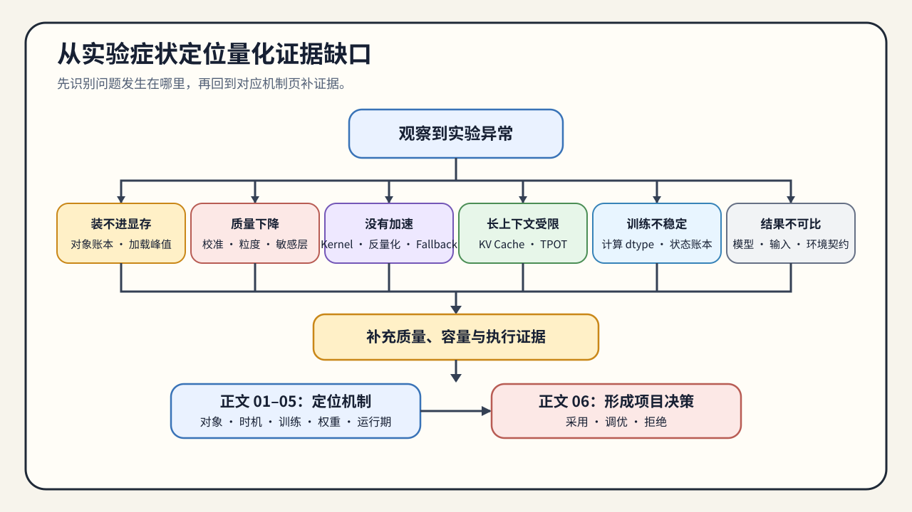

# 量化问题排查手册

先确认异常对象是权重、激活、训练状态还是 KV Cache，再区分数值误差、模型产物、执行路径和目标工作负载。最小证据必须来自同一模型版本、输入协议和运行环境。

| 现象或目标 | 先检查什么 | 最小证据 | 机制入口 | 验证或转交入口 |
|:---|:---|:---|:---|:---|
| 权重文件变小但模型仍装不进显存 | 加载峰值、缩放元数据、临时工作区和其他状态 | 文件大小、常驻/峰值显存、产物清单 | [01 对象与误差](./01_quantization_object_and_error.md) | [04 权重量化](./04_weight_only_compression.md) |
| 量化后任务质量下降 | 校准分布、粒度、异常值和敏感层 | 独立质量结果、误差统计、失败样本 | [02 PTQ 与 QAT](./02_ptq_and_qat_timing.md) | 校准仍不足时进入 [03 低比特训练适配](./03_low_bit_training_adaptation.md) |
| 显存下降但延迟或吞吐没有改善 | 反量化位置、目标计算内核和工作负载瓶颈 | 实际数据类型、执行轨迹、TTFT/TPOT、吞吐 | [05 运行期量化路径](./05_fp8_and_kv_cache_quantization.md) | [06 执行与决策](./06_deployment_and_benchmark_decision.md) |
| 模型产物可加载但运行时回退浮点 | 量化配置、加载器和后端支持矩阵 | 加载日志、实际计算内核、回退原因 | [06 执行与决策](./06_deployment_and_benchmark_decision.md) | [部署与异构](../deployment_heterogeneous/intro.md)检查兼容门槛 |
| 长上下文或高并发仍受限 | KV Cache 数据类型、粒度和高精度残留窗口 | 缓存账本、任务质量、TPOT、并发容量 | [05 运行期量化路径](./05_fp8_and_kv_cache_quantization.md) | [推理优化](../inference_optimization/intro.md)检查缓存和调度 |
| QLoRA 不稳定或资源节省不明显 | 可训练参数、计算数据类型、激活和优化器状态 | 损失/质量、峰值显存、单步耗时、适配器清单 | [03 低比特训练适配](./03_low_bit_training_adaptation.md) | [后训练优化](../post_training_optimization/intro.md)检查训练控制 |
| 不同执行后端的结果无法比较 | 模型/分词器版本、输入词元、量化格式和采样配置 | 固定工作负载、环境版本、原始结果 JSON | [06 执行与决策](./06_deployment_and_benchmark_decision.md) | 重建配对基线后再作采用判断 |
| 剪枝后零值增多但没有速度收益 | 稀疏模式和目标计算内核 | 结构稀疏度、内核路径、质量与端到端性能 | [07 剪枝、蒸馏与结构稀疏](./07_pruning_distillation_and_structured_sparsity.md) | [性能优化](../performance_optimization/intro.md)确认关键路径收益 |

## 容量或速度没有改善时怎样继续查

先分开读取文件大小、加载峰值和生成时峰值。权重文件变小后，缩放参数、临时反量化张量、激活和 KV Cache 仍可能占据主要显存。若长上下文时峰值增长最快，应转查缓存长度与高精度尾部，而不是继续只降低权重位宽。

速度比较保留同一输入下的浮点基线，并分别检查预填充和解码。低比特内核节省的读写可能被反量化、数据布局转换或工作区抵消；发现回退时，记录实际执行路径，再到[06 执行与决策](./06_deployment_and_benchmark_decision.md)判断当前候选是否值得继续调整。

## 先区分方法、数值表示和文件格式

GPTQ、AWQ 描述量化方法，INT4、FP8 描述数值表示，GGUF 描述模型文件格式。同样写着 INT4 的两个候选，也可能需要不同的加载器和计算内核。排查时分别记录这些字段，而不是用一个“量化类型”替代全部配置。

质量下降时，先回查校准集与最终评测集是否隔离，再比较粒度、裁剪范围和敏感层。允许继续训练时，可考虑 QAT；QLoRA 则用于训练低比特基座上的适配器，二者的更新对象与最终产物不同。
