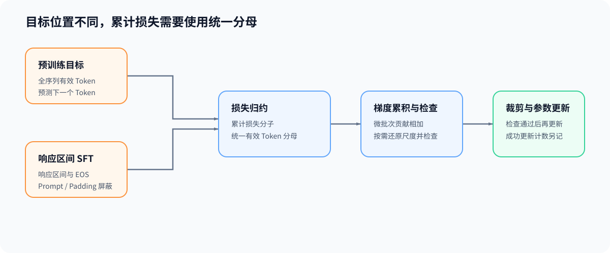

# 03. 损失归约、梯度累积与有效更新 | Loss Reduction, Gradient Accumulation, and Effective Updates

## 学习问题

同样处理两条序列，分别求平均损失再相加，为什么可能与整批训练得到不同梯度？每个预测目标的权重、微批次累积方式和优化器更新时刻，共同决定这一次参数更新代表什么训练目标。

## 核心机制

自回归训练用当前位置的词表分数（logits）预测下一个词元，标签移位让预测与目标对齐。先确定哪些目标位置参与损失，这里也称为监督范围：预训练通常使用文本内所有有效预测位置，仅训练响应区间的监督微调（SFT）则排除提示词目标，补齐或其他不参与训练的位置也要按规则排除。损失掩码标记位置是否有效，`ignore_index` 则让损失函数忽略带有指定编号的目标。

| 对象 | 决定的问题 | 错误后果 |
|:---|:---|:---|
| 标签移位 | 当前 logits 预测哪个 token | 预测目标错位 |
| 损失掩码 | 哪些位置参与监督 | 提示词或无效位置污染梯度 |
| `ignore_index` | 哪些目标不进入聚合 | 填充位置被计入损失 |
| 有效 token 数 | 损失的实际分母 | 不同批次的梯度尺度不可比 |
| 损失归约 | 逐项损失如何汇总 | `mean` 与 `sum` 产生不同梯度尺度 |

### 损失分母如何影响梯度尺度

微批次是一次实际处理的部分数据，累计窗口把多个微批次合成一次逻辑更新。下面按每个有效目标词元等权计算，不另加类别或样本权重。设 $m_{k,i}\in\{0,1\}$ 表示第 $k$ 个微批次中位置 $i$ 是否参与损失，$\ell_{k,i}$ 是该位置的逐项损失，窗口的有效目标总数为 $N=\sum_{k,i}m_{k,i}>0$。损失归约将这些项合成一个标量：

$$
L=\frac{1}{N}\sum_{k,i}m_{k,i}\ell_{k,i}.
$$

例如，两个微批次有 2 个与 6 个有效目标，各自平均损失为 1 与 3，按词元等权得到 $(2\times1+6\times3)/8=2.5$；直接平均两个微批次则得到 2，短微批次获得了更大权重。序列存储长度相同，也可能因损失掩码不同而有不同的 $N$。没有有效目标的窗口不能代入该平均式并继续更新；完整符号约定见[公式索引](./formula_reference.md)。

### 多次反向传播如何形成一次更新

保持参数 $\theta$ 与各逐项损失的定义不变，将上式分批求导再相加，可得到同一目标的梯度：

$$
g=\nabla_\theta L
=\frac{1}{N}\sum_{k,i}m_{k,i}\nabla_\theta\ell_{k,i}.
$$

$g$ 是窗口结束时交给优化器的真实梯度；窗口中的每个微批次只贡献分子的一部分，参数在窗口结束前保持不变。

| 层级 | 含义 | 需要保持的关系 |
|:---|:---|:---|
| 微批次 | 一次前向传播和反向传播实际处理的数据 | 满足设备容量限制 |
| 累计窗口 | 参数梯度持续累积的多个微批次 | 窗口结束前不执行参数更新 |
| 有效批次 | 一次逻辑更新覆盖的全部样本或有效 token | 与基线采用相同统计口径 |
| 优化器更新步 | 使用累计梯度更新参数与内部状态 | 完整窗口通过数值检查后执行；跳步另记 |
| 调度器更新步 | 推进学习率状态 | 按事先选定的时钟；成功更新计数与微批次数分开 |

只有各微批次有效目标数相同，逐批 `mean` 再除以累计次数才对应这里的等权目标。有效目标数不同时，应按各自计数占窗口总数的比例加权，或累加损失分子后使用统一分母。分批计算是否还改变随机行为或批次相关运算，则要在实际实现中另行核对。

### 更新前的梯度处理顺序

混合精度让部分计算使用较低精度，梯度裁剪则限制整体梯度的大小。需要损失缩放时，设正缩放因子为 $s$，则 $\widetilde L=sL$、$\widetilde g=sg$，更新前通过 $g=\widetilde g/s$ 还原梯度。在一个累计窗口内保持缩放一致，完成累积后再还原和检查，避免把不同尺度的梯度混加。

使用带非有限值检查的 `GradScaler` 路径时，发现 NaN 或无穷值可跳过本次优化器步；普通优化器调用并不因此自动获得同样保护。若学习率调度按成功更新计数，应在确认本次更新执行后推进，而不是每处理一个微批次就推进。具体顺序可对照 [PyTorch AMP 累积示例](https://docs.pytorch.org/docs/stable/notes/amp_examples.html)。

它们与梯度累积的依赖关系可整理为：

```text
混合精度前向传播
→ 缩放损失并执行反向传播（FP16 需要时）
→ 累积梯度
→ 还原梯度尺度
→ 有限值 / 溢出检查
→ 梯度裁剪
→ 优化器更新
→ 学习率调度器更新
→ 清理梯度
```

BF16 通常不依赖 `GradScaler`；FP16 更需要缩放保护。无论使用哪种 dtype，梯度裁剪都应作用于即将用于更新的真实梯度，而不是每个微批次的局部片段。



## 验证与下一步

核对两个微批次是否代表同一次逻辑更新时，同时比较目标位置、损失权重、参数梯度与成功更新数。随后在 [04 训练状态生命周期](./04_training_state_lifecycle.md)中，把参数、保存张量和累积梯度放回相应阶段，分析峰值来自哪些同时存在的对象。

## 相关阅读

| 资料 | 用途 |
|:---|:---|
| [Part 00 · 11 优化器与损失函数](../../00_Prerequisites/11_PyTorch_Optimizers_and_Loss.ipynb) | 回看损失归约、优化器和调度器时钟。 |
| [Part 00 · 12 数据接口与训练生命周期](../../00_Prerequisites/12_PyTorch_Minimal_Training_Interface.ipynb) | 回看标签、批次和最小训练循环。 |
| [Part 02 · 13 SFT 监督边界与损失](../../02_PyTorch_Algorithms/13_SFT_Training_Loop.ipynb) | 对照 response-only 监督范围与有效 Token 损失。 |
| [Part 02 · 12 优化器更新与学习率调度](../../02_PyTorch_Algorithms/12_Optimizer_Updates_and_Learning_Rate_Scheduling.ipynb) | 对照优化器和调度器更新次数。 |
| [Part 02 · 11 梯度累积](../../02_PyTorch_Algorithms/11_Gradient_Accumulation.ipynb) | 对照完整批次与累计窗口。 |
| [Part 02 · 09 激活与损失反向](../../02_PyTorch_Algorithms/09_Activation_and_Loss_Backward.ipynb) | 回看交叉熵、标签和局部梯度。 |
| [Part 02 · TRAIN-MIXED-PRECISION-BACKWARD 混合精度反向](../../02_PyTorch_Algorithms/TRAIN-MIXED-PRECISION-BACKWARD_Mixed_Precision_Backward.ipynb) | 对照缩放、有限值检查和跳步语义。 |
| [CrossEntropyLoss](https://docs.pytorch.org/docs/stable/generated/torch.nn.CrossEntropyLoss.html) | 核对 `ignore_index` 与损失归约。 |
| [Automatic Mixed Precision](https://docs.pytorch.org/docs/stable/amp.html) | 核对 `autocast`、`GradScaler` 与梯度尺度还原。 |
| [clip_grad_norm_](https://docs.pytorch.org/docs/stable/generated/torch.nn.utils.clip_grad_norm_.html) | 核对梯度裁剪的输入和调用位置。 |
