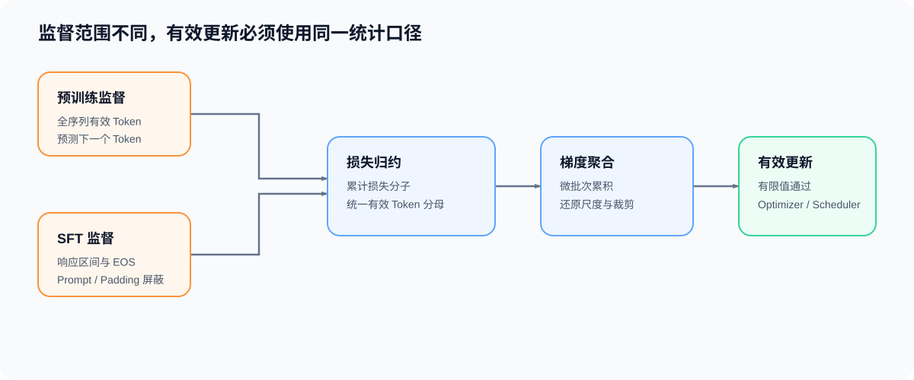

# 03. 监督、梯度尺度与有效更新 | Supervision, Gradient Scaling, and Effective Updates

## 学习问题

本页把数据契约、损失聚合和训练节奏接成一条更新链：哪些 token 参与监督，损失用什么分母聚合，多次反向传播如何形成一次优化器更新步。学习结果是一张监督 token、梯度尺度、有效批次与更新次数的对照表。

## 核心机制

自回归训练使用当前位置的 logits 预测下一个 token，因此标签需要移位；提示词、填充位置或不参与训练的区间需要通过损失掩码或 `ignore_index` 排除。监督边界不正确时，损失即使能够下降，也不能说明模型学到了目标行为。

| 对象 | 决定的问题 | 错误后果 |
|:---|:---|:---|
| 标签移位 | 当前 logits 预测哪个 token | 预测目标错位 |
| 损失掩码 | 哪些位置参与监督 | 提示词或无效位置污染梯度 |
| `ignore_index` | 哪些目标不进入聚合 | 填充位置被计入损失 |
| 有效 token 数 | 损失的实际分母 | 不同批次的梯度尺度不可比 |
| 损失归约 | 逐项损失如何汇总 | `mean` 与 `sum` 产生不同梯度尺度 |

### 损失分母如何影响梯度尺度

设 $m_{k,i}$ 表示第 $k$ 个微批次中位置 $i$ 是否参与监督，$\ell_{k,i}$ 是该位置的逐 Token 损失，累计窗口的有效 Token 总数为 $N=\sum_{k,i}m_{k,i}$。统一归约后的损失为：

$$
L=\frac{1}{N}\sum_{k,i}m_{k,i}\ell_{k,i}.
$$

固定样本数并不保证固定 $N$。变长序列、不同填充比例或不同响应长度会改变有效 Token 数，因此需要明确是按样本、按微批次，还是按整个累计窗口聚合。完整符号约定见[公式索引](./formula_reference.md)。

### 多次反向传播如何形成一次更新

对参数 $\theta$ 求导后，累计窗口应形成与同一有效 Token 集合完整批次相同的梯度：

$$
g=\nabla_\theta L
=\frac{1}{N}\sum_{k,i}m_{k,i}\nabla_\theta\ell_{k,i}.
$$

$g$ 是窗口结束时交给优化器的真实梯度；窗口中的每个微批次只贡献分子的一部分，参数在窗口结束前保持不变。

| 层级 | 含义 | 需要保持的关系 |
|:---|:---|:---|
| 微批次 | 一次前向传播和反向传播实际处理的数据 | 满足设备容量限制 |
| 累计窗口 | 参数梯度持续累积的多个微批次 | 窗口结束前不执行参数更新 |
| 有效批次 | 一次逻辑更新覆盖的全部样本或有效 token | 与基线采用相同统计口径 |
| 优化器更新步 | 使用累计梯度更新一次参数 | 每个累计窗口执行一次 |
| 调度器更新步 | 推进学习率状态 | 通常跟随优化器更新步，而非微批次 |

等长微批次且每次使用 `mean` 归约时，常见做法是将每个微批次损失除以累计次数。有效 token 数不一致时，更稳妥的口径是先累计有效 token 的损失总和与计数，再按整个窗口的总有效 token 数归一化。

### 更新前的梯度处理顺序

现代训练还可能加入混合精度与梯度裁剪。设损失缩放因子为 $s$，则 $\widetilde L=sL$、$\widetilde g=sg$，更新前通过 $g=\widetilde g/s$ 还原真实梯度。只有 $g$ 的所有元素均为有限值，参数更新和学习率调度才共同推进；否则本次更新跳过。

它们与梯度累积的依赖关系可整理为：

```text
混合精度前向传播
→ 缩放损失并执行反向传播（FP16 需要时）
→ 累积梯度
→ 还原梯度尺度
→ 有限值 / 溢出检查
→ 梯度裁剪
→ 优化器更新
→ 学习率调度器更新
→ 清理梯度
```

BF16 通常不依赖 `GradScaler`；FP16 更需要缩放保护。无论使用哪种 dtype，梯度裁剪都应作用于即将用于更新的真实梯度，而不是每个微批次的局部片段。



## 验证与下一步

完成本页后，应能为一次训练更新写清：监督区间、有效 token 数、损失归约、累计窗口、优化器更新步和调度器更新步。状态在这些阶段如何驻留，将在 [04 训练状态生命周期](./04_training_state_lifecycle.md)中继续展开。

下一页进入 [04 训练状态生命周期](./04_training_state_lifecycle.md)，将一次有效更新涉及的状态放回时间线。

## 相关阅读

| 资料 | 用途 |
|:---|:---|
| [Part 00 · 11 优化器与损失函数](../../00_Prerequisites/11_PyTorch_Optimizers_and_Loss.ipynb) | 回看损失归约、优化器和调度器时钟。 |
| [Part 00 · 12 数据接口与训练生命周期](../../00_Prerequisites/12_PyTorch_Minimal_Training_Interface.ipynb) | 回看标签、批次和最小训练循环。 |
| [Part 02 · 13 SFT 监督边界与损失](../../02_PyTorch_Algorithms/13_SFT_Training_Loop.ipynb) | 对照 response-only 监督范围与有效 Token 损失。 |
| [Part 02 · 12 优化器更新与学习率调度](../../02_PyTorch_Algorithms/12_Optimizer_Updates_and_Learning_Rate_Scheduling.ipynb) | 对照优化器和调度器更新次数。 |
| [Part 02 · 11 梯度累积](../../02_PyTorch_Algorithms/11_Gradient_Accumulation.ipynb) | 对照完整批次与累计窗口。 |
| [Part 02 · 09 激活与损失反向](../../02_PyTorch_Algorithms/09_Activation_and_Loss_Backward.ipynb) | 回看交叉熵、标签和局部梯度。 |
| [Part 02 · TRAIN-MIXED-PRECISION-BACKWARD 混合精度反向](../../02_PyTorch_Algorithms/TRAIN-MIXED-PRECISION-BACKWARD_Mixed_Precision_Backward.ipynb) | 对照缩放、有限值检查和跳步语义。 |
| [CrossEntropyLoss](https://docs.pytorch.org/docs/stable/generated/torch.nn.CrossEntropyLoss.html) | 核对 `ignore_index` 与损失归约。 |
| [Automatic Mixed Precision](https://docs.pytorch.org/docs/stable/amp.html) | 核对 `autocast`、`GradScaler` 与梯度尺度还原。 |
| [clip_grad_norm_](https://docs.pytorch.org/docs/stable/generated/torch.nn.utils.clip_grad_norm_.html) | 核对梯度裁剪的输入和调用位置。 |
