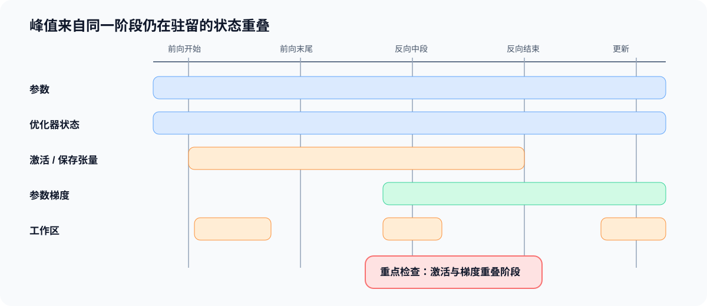

# 04. 训练状态生命周期与峰值账本 | Training-State Lifecycle and Peak Ledger

## 学习问题

本页将静态字节数扩展为训练时间线：每类状态在什么时候产生、需要驻留到什么时候、由谁消费，以及哪些状态会在同一阶段重叠。学习结果是一张生命周期表和一份阶段峰值账本。

## 核心机制

| 状态 | 产生时机 | 主要消费者 | 常见释放或更新时机 |
|:---|:---|:---|:---|
| 参数 | 模型初始化或检查点加载 | 前向传播、反向传播、优化器 | 通常贯穿训练 |
| 缓冲区 | 模块初始化或训练过程 | 前向传播、验证、保存 | 由模块生命周期决定 |
| 激活 | 前向传播 | 对应局部反向过程 | 被消费后释放，或通过重算减少保存 |
| 反向保存张量 | 前向传播中的自动求导节点 | 局部反向过程 | 对应节点完成反向传播后释放 |
| 参数梯度 | 反向传播 | 优化器、梯度同步 | 更新后清零、置空或进入下一累计窗口 |
| 优化器状态 | 首次更新或加载状态 | 优化器更新步 | 通常贯穿训练并持续更新 |
| 工作区 | 算子执行 | 当前内核或库调用 | 算子结束后可复用，但影响瞬时峰值 |
| 通信缓冲区 | 同步或分片通信 | 集体通信 / 点对点通信 | 通信完成后释放或复用 |

静态账本回答“每类对象有多大”，生命周期回答“它们是否同时存在”。训练峰值来自同一时刻仍然驻留的对象之和，而不是所有历史分配的简单相加。

### 一次更新中的状态变化

| 阶段 | 新产生或扩大的状态 | 仍需驻留的状态 | 主要峰值风险 |
|:---|:---|:---|:---|
| 前向传播开始 | 输入与首层激活 | 参数、优化器状态 | 常驻状态已占用基础容量 |
| 前向传播末尾 | 多层激活、反向保存张量、损失 | 参数、优化器状态 | 激活堆叠形成前向峰值 |
| 反向传播中段 | 参数梯度逐步形成 | 未消费的反向保存张量、参数、优化器状态 | 激活与梯度发生重叠 |
| 反向传播结束 | 完整参数梯度 | 参数、优化器状态 | 梯度和常驻状态同时存在 |
| 优化器更新 | 临时更新工作区 | 参数、梯度、优化器状态 | 更新临时量可能形成新峰值 |
| 清理后 | 下一窗口需要保留的状态 | 参数、优化器状态 | 累积训练中梯度可能继续驻留 |

### 从生命周期计算阶段峰值

设第 $i$ 类状态的大小为 $b_i$，$a_i(t)$ 表示它在阶段 $t$ 是否驻留，驻留取 1，否则取 0。阶段驻留量和理论峰值分别为：

$$
M_t=\sum_i a_i(t)b_i,
\qquad
M_{peak}=\max_t M_t.
$$

这项计算需要同时记录对象大小与生命周期，而不能只统计参数量。内存分配器的预留量、碎片、库工作区和系统进程会使 CUDA 实测值偏离理论账本，因此理论账本用于解释来源，GPU 统计用于确认当前工作负载的真实边界。完整符号约定见[公式索引](./formula_reference.md)。

### 策略改变的是哪一段生命周期

| 策略 | 主要改变 | 仍需承担的成本 |
|:---|:---|:---|
| 梯度累积 | 梯度驻留时间与优化器更新频率 | 参数仍完整驻留，累计窗口延长梯度生命周期 |
| 激活检查点 | 激活的保存范围和反向重算 | 参数与优化器状态仍驻留，并增加重算时间 |
| 卸载 | 状态驻留位置和搬运时间 | 状态仍需保存，并增加传输与同步等待 |
| ZeRO | 参数、梯度或优化器状态的单 rank 驻留份额 | 全局状态仍存在，并增加通信与恢复要求 |
| 混合精度 | 部分状态和计算的字节宽度 | 仍需保持主权重、累加精度与有限值检查 |

## 验证与下一步

完成本页后，应能为固定工作负载输出：状态名称、字节数、产生阶段、消费阶段、释放阶段和峰值贡献。多卡状态分片可继续进入 Part01 · 06 与通信并行专题。

下一页进入 [05 激活检查点与卸载](./05_checkpointing_and_offload.md)，比较重算和搬运如何改变生命周期。

## 相关阅读

| 资料 | 用途 |
|:---|:---|
| [Part 00 · 18 显存账本与运行时证据](../../00_Prerequisites/18_Memory_Profiling_and_Optimization.ipynb) | 回看对象生命周期、allocator 与峰值账本。 |
| [Part 01 · 06 显存计算与 ZeRO](../../01_Hardware_Math_and_Systems/06_VRAM_Calculation_and_ZeRO.ipynb) | 将单卡账本扩展到状态切分。 |
| [Part 02 · 10 Attention 反向传播与自定义 Autograd](../../02_PyTorch_Algorithms/10_Attention_Backward_and_Custom_Autograd.ipynb) | 回看长序列 Attention 的保存状态。 |
| [Part 02 · 43 统一训练内存账本](../../02_PyTorch_Algorithms/43_Unified_Training_Memory_Ledger.ipynb) | 练习分阶段驻留和峰值对象对照。 |
