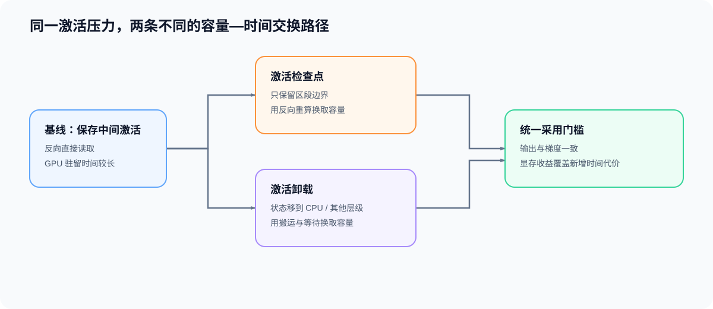
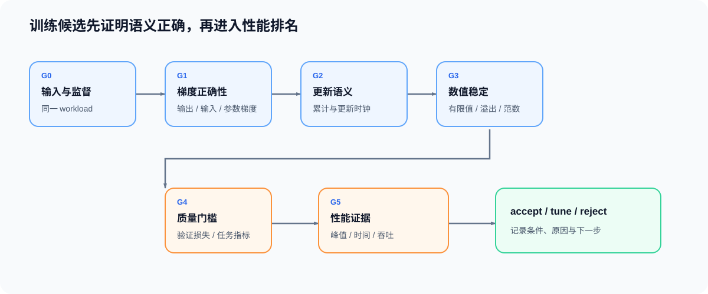

# 反向传播与训练机制问题链

一次训练更新不是“调用一次 `backward()`”那么简单，而是一条连续依赖：

`参数与输入 → 前向状态 → 监督损失 → 局部反向与梯度汇合 → 有效更新 → 状态释放与候选判断`

## 从损失确认训练闭环

参数必须参与前向计算，损失必须依赖这些参数，反向传播才会把监督信号传到 `.grad`，优化器才能改变下一次前向使用的参数。先画出这条依赖，再检查训练/验证模式和参数是否可训练。

[01 训练闭环与计算图](./01_training_loop_and_computation_graph.md) 将全局依赖拆成可以逐项核对的对象与阶段。

## 从局部反向确认梯度来源

反向传播在每个局部算子处将上游梯度与局部导数结合。分支、残差路径和共享参数会让多条贡献在同一输入或参数处相加；局部反向需要的前向状态则必须保存到相应消费者完成计算。

[02 自动求导与 Transformer 反向传播](./02_autograd_and_transformer_backward.md) 解释 VJP、保存张量和 Transformer 局部梯度之间的关系。

## 让监督尺度对应一次有效更新

标签移位、损失掩码和有效 token 数决定梯度代表什么；微批次、梯度累积、损失缩放和调度器时钟决定这份梯度何时真正写入参数。不同长度的微批次不能只按累计次数除损失，必须与有效 token 分母对齐。

[03 监督、梯度尺度与有效更新](./03_supervision_gradient_scale_effective_update.md) 将监督边界接到更新时钟。

## 找到峰值时仍然驻留的状态

静态字节数不能说明运行时峰值。参数、激活、反向保存张量、梯度、优化器状态和工作区只有在同一阶段重叠时才共同形成容量压力。先标出创建、最后消费和释放时刻，再选择策略。

[04 训练状态生命周期](./04_training_state_lifecycle.md) 用阶段账本区分对象大小与峰值贡献。

## 比较重算与搬运的代价

激活检查点通过少保存、多重算降低长期驻留；卸载通过改变驻留位置换取搬运。两者都需要保持输出和梯度一致，且必须把节省的显存与新增的时间放在同一工作负载下比较。

[05 激活检查点与卸载](./05_checkpointing_and_offload.md) 给出两条路径的选择条件。

## 用正确性证据约束性能判断

先检查输入与监督、梯度、更新语义、有限值和质量；这些条件成立后，峰值显存、单步时间和吞吐才可以用于判断候选。性能变好不能抵消错误梯度或质量退化。

[06 正确性、数值稳定与性能证据](./06_correctness_and_performance_evidence.md) 把机制检查转成可复测的候选记录。
