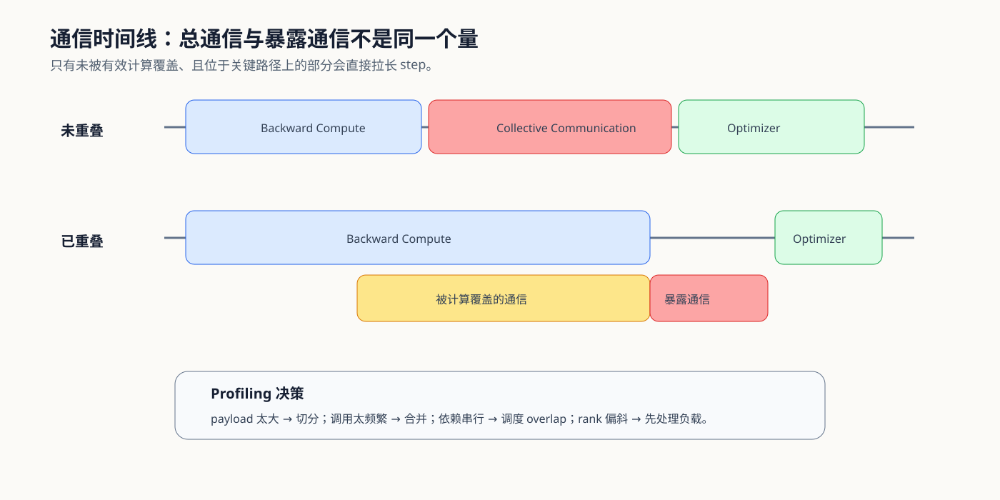

# 06. Communication Profiling and Overlap | 通信剖析与通信—计算重叠

## 学习问题

通信总时长不等于真正拖慢关键路径的通信时间。通信剖析要把集合通信放回计算时间线，区分已被计算覆盖的部分和暴露在 step 或请求关键路径上的部分，再决定减少载荷、降低频率还是调整调度。

## 核心机制

### 用四个量解释通信成本

| 量 | 回答的问题 | 常见来源 |
|:---|:---|:---|
| 集合通信 | 采用什么协同语义 | All-Reduce、Gather、Scatter、All-to-All、P2P |
| 载荷 | 每次交换多少字节 | 梯度 bucket、激活、KV、token dispatch |
| 调用频率 | 一个 step / 请求触发多少次 | bucket 数、层数、micro-batch、路由轮次 |
| 通信—计算重叠 | 有多少通信与有效计算并行 | stream、bucket ready time、双缓冲与调度 |

### 用同一时间口径比较通信与重叠

一次集合通信的时间可以先用启动延迟与载荷传输近似： $T_{comm} \approx \alpha + \beta \cdot bytes$。多次调用还要乘以频率，但这些时间不能直接全部加到 step time 上。真正影响端到端时间的是未被独立计算覆盖的区间。

令 `step_time_ms` 为最慢 rank 的完整步骤时间，`comm_total_ms` 为通信 Kernel 区间之和，`exposed_comm_ms` 为落在关键路径且没有被有效计算覆盖的通信区间，则暴露通信比例为：

$$
\text{comm\_exposed\_ratio} = \frac{\text{exposed\_comm\_ms}}{\text{step\_time\_ms}}
$$

| 字段 | 计算或读取方式 | 能回答的问题 | 不能替代的证据 |
|:---|:---|:---|:---|
| `median_max_rank_ms` | 每次运行先取 max-rank，再跨重复取中位数 | 同步步骤的典型关键路径 | P95 长尾与单 rank 原始值 |
| `p95_max_rank_ms` | 对重复运行的 max-rank 时间取 P95 | 抖动和尾部退化 | 平均有效带宽 |
| `comm_total_ms` | 合并同一 rank 上 NCCL 区间的总持续时间 | 通信工作总量 | 暴露在关键路径上的时间 |
| `exposed_comm_ms` | 从 Trace 依赖和时间区间计算未覆盖部分 | 通信实际延长了多少步骤时间 | 合成 serial/overlap 微基准的节省量 |
| `comm_exposed_ratio` | `exposed_comm_ms / step_time_ms` | 是否应优先优化通信关键路径 | 跨拓扑扩展效率 |

### 从 Trace 定位暴露通信

先在 Trace 中确定依赖关系，再比较最慢 rank 时间。简单相加所有 NCCL Kernel 会重复计算已经与计算重叠的部分，也无法解释某个热点 rank 为什么拖慢全局同步。

| Trace 现象 | 可能原因 | 下一步验证 |
|:---|:---|:---|
| 大量短 collective | bucket 太碎、启动成本占主导 | 合并 bucket，比较调用次数与总时间 |
| 单次长 collective | payload 大或链路带宽不足 | payload sweep、拓扑与有效带宽 |
| 通信与计算串行 | 依赖过紧、stream 或调度未重叠 | 检查 ready time、stream 和执行顺序 |
| rank 间时间差异大 | workload、路由或 stage 不均 | 对比 per-rank load 与 max-rank time |
| 总通信高但 step 未变慢 | 大部分通信已被覆盖 | 记录 exposed communication 而非仅总时长 |

## 选择条件与验证证据

| 目的 | 入口 |
|:---|:---|
| 建立异步执行直觉 | [Part 01 · 17 CUDA Stream](../../01_Hardware_Math_and_Systems/17_CUDA_Stream_and_Asynchrony.ipynb) |
| 学习通信调度 | [Part 01 · 27 通信调度优化](../../01_Hardware_Math_and_Systems/27_Communication_Scheduling_Optimization.ipynb) |
| 实测集合通信矩阵 | [Part 02 · 47 NCCL 通信剖析](../../02_PyTorch_Algorithms/47_Communication_Profiling_with_NCCL.ipynb) |
| 从 Trace 形成缓解策略 | [Part 02 · 48 通信热点](../../02_PyTorch_Algorithms/48_Communication_Hotspots_and_Mitigation.ipynb) |

## 相关阅读

- [PyTorch Profiler](https://pytorch.org/docs/stable/profiler.html)
- [NVIDIA Nsight Systems](https://docs.nvidia.com/nsight-systems/)
