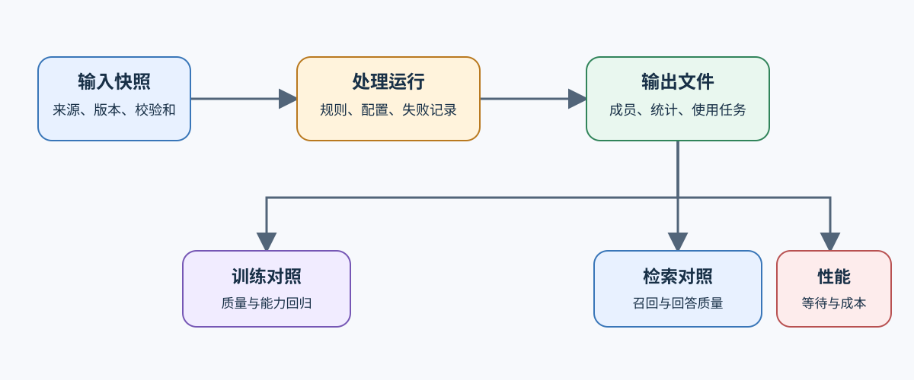
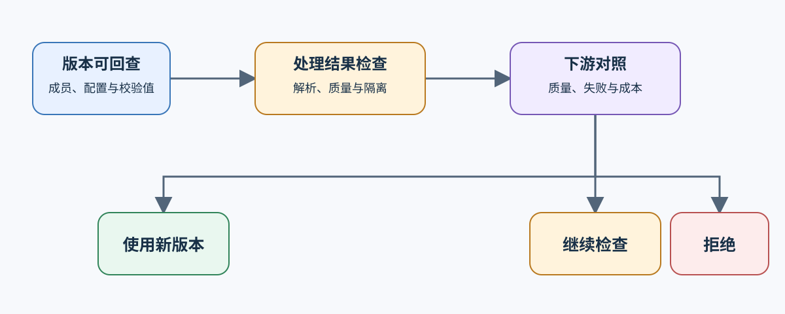

# 06 数据版本、增量处理与下游验证

## 学习问题

一批数据重新处理后，要能回答哪些输入变了、哪些结果复用了，以及训练或检索实际读取了哪一版。数据血缘记录输入、处理规则和输出之间的关系；数据版本则固定某次可用的成员与内容，便于重跑、比较和恢复。

以下用一次文件更新作教学示例：版本v1包含文件01、02、03；准备v2时保留01、更新02、删除03，并新增与01正文重复的04。文件编号只用于说明依赖，下面没有实际执行解析或发布。

## 一次更新需要保存哪些记录

先保存v1的文件成员、内容校验值和处理配置，再为v2记录每项变化。运行编号连接本次输入、配置、输出和日志；重试另记尝试次数，旧日志与旧版本继续保留。输入与输出都按明确的成员清单读取，避免把“目录中现在有哪些文件”当作某次运行的数据版本。

| 本次变化 | 可以复用什么 | 要重新处理什么 |
|:---|:---|:---|
| 文件01未变 | 依赖也未变化时复用解析结果 | 新增04后，01所在重复组和保留成员需重新检查 |
| 文件02更新 | 保留旧版本供对照与回查 | 重新解析，并更新由旧内容派生的问答或片段 |
| 文件03删除 | 保留旧版记录用于追踪 | 从新版本成员及相关问答、片段和索引引用中移除 |
| 文件04新增 | 先检查是否存在可复用的同输入、同配置结果 | 解析并加入去重、切分或索引更新的依赖检查 |

## 哪些步骤可以只处理变化部分

逐文件解析依赖原始内容、解析器和配置，条件相同时可以复用结果。去重、配比、切分和索引则可能依赖其他记录：04加入后，01的解析文本仍正确，但重复组改变；删除03也可能改变来源占比及派生片段。沿记录的依赖关系重算受影响结果，依赖全体数据的阶段按需全量重算。

同样输入、规则与必要依赖再次执行时，应产生一致的成员和可核对的内容结果，或明确记录生成过程中的不确定性。随机种子可以帮助复现抽样，但模型版本、配置、外部工具与返回内容也会影响生成；需要保存的输入输出不能只用一个种子替代。

## 更新中断后怎样恢复

假设02的新版本解析失败，而01、04已经产生临时结果。先把本次状态保存为未完成，继续让使用方读取已验证的v1；v2的临时文件与正式版本分开，清单标明成功、待重试、主动排除和未处理对象。缺失的数据与按规则排除的数据分别计数，才能发现更新是否意外丢失内容。

重试时先核对02的输入与配置是否仍对应本次更新，再生成新的尝试记录。重用已核对的阶段结果后，还要完成受影响的跨样本处理，检查成员、校验值、字段和切分。重复运行按稳定记录编号识别已经完成的输出，避免再次追加同一条样本。原错误、修正记录和重试结果一起保留，便于解释此次恢复改变了什么。

## 在线采样中断时恢复哪一批记录

在线RL、Agentic RL和OPD除了数据成员，还要记录任务与采样模型的版本，以及每条尝试的处理进度。假设批次B12计划采集三条回答：一条已经生成并评分，一条生成完成但反馈超时，另一条仍在工具交互中。恢复时分别处理这三条，而不是把整个批次当成已完成。教师反馈重试要对应原回答及教师配置，重新生成则保存为新的尝试。

对于仍在工具交互中的任务，先检查环境是否支持恢复，以及上一次动作是否已经执行。查询可以按任务规则重试；发消息、写入数据或触发交易等有副作用的动作，需要确认原执行结果，或使用环境提供的幂等编号，避免重复执行。幂等编号让重复提交被识别为同一次操作；环境无法确认状态时，保留中断记录并按规则重新开始任务。

采样完成后，再区分记录是否已经进入训练、用了多少次，以及对应哪次已保存的模型更新。若训练检查点只包含第20次更新，而处理日志已写到第21次，就先确认哪次更新实际保存成功，再恢复与它匹配的数据使用状态。模型、优化器、随机状态和读取位置对应保存，混合精度或学习率调度等额外状态按所用训练栈一并恢复。

模型恢复后，待用批次还要与实际版本对应。OPD中若教师反馈来自另一条回答，保留同一个学生版本也无法使位置重新对应；RL中，旧回答的采样概率和奖励规则也会影响它怎样用于当前更新。先回查这些记录，再按相应方法决定继续使用、重评分还是重新采样。

## 何时切换版本，何时继续保留候选

检查完成后，生成一份固定的v2成员清单，确认所有计划对象都有明确处理结果。按使用任务决定复测内容：格式修复先核对前后内容与抽样；改变训练成员或配比时，比较相同模型和预算下的独立质量与成本；检索更新则检查相关文档召回、回答及旧片段是否仍被返回。把变化目的和通过条件写在比较之前，再据结果选择是否使用v2。

版本切换让使用方一次性选择完整的v1或v2清单，保留所需文件和配置以便恢复。训练已经读入旧数据并更新参数时，恢复数据引用只影响后续读取；要恢复旧训练过程，还需要对应模型检查点、优化器与采样进度。检索则核对文档、片段和索引版本，防止只切换原文件而继续使用旧索引。

## 持续使用后怎样发现数据变化

保存一份已经核对的数据统计，再按相同口径比较新批次：来源、语言、长度、任务类别、重复情况和处理失败各有多少。例如长请求比例上升后，旧的输入长度分布已不足以说明当前负载；某类工具超时增加，也应先区分环境故障与模型行动变化，再决定调整采样或训练。

根据任务需要约定何时复查：新语言或任务加入时补相应质量样本；长度明显改变时重测目标保留、内存和请求性能；更换嵌入模型或量化校准方案时重新核对其输入与结果。观察数据与用于选择配置的验证数据分别记录，最终测试保持独立。这样可以追踪变化何时出现，以及调整是否改善了目标场景。

## 来源使用范围变化后怎样处理派生内容

来源的使用范围缩小或成员需要撤回时，沿文档、问答、片段、索引和请求文件的关联找出受影响内容，再生成符合新要求的成员清单。访问限制同步到检索片段与返回结果，恢复旧版时也核对当前允许的使用范围。受限原文、缓存和日志按对应保留与访问规则处理，公开记录只保留必要的处理说明。

从后续数据池移除成员会影响未来读取；已经用这些数据更新过的模型仍保留相应训练历史，需要另外评估模型侧的处理与重训要求。数据清单变更和模型处理分别登记，避免把停止读取误写成训练影响已经消除。

## 判断结果怎样对应下一步动作

| 观察结果 | 怎样处理 | 保存什么 |
|:---|:---|:---|
| 计划成员处理完成，任务检查和预设比较均满足要求 | 使用v2，并保留v1所需引用 | 新旧成员清单、配置、复测结果和切换记录 |
| 解析、复核或下游比较尚未完成 | 保留候选，继续使用已有可用版本 | 已完成阶段、缺失检查、失败与重试状态 |
| 确认出现评测泄漏、质量退化或输入不兼容等硬失败 | 拒绝当前候选；已切换时按使用方的恢复方式处理 | 触发条件、受影响记录及恢复结果 |

SFT数据成员和准入检查可参考[Part 02 · 64](../../02_PyTorch_Algorithms/64_SFT_Data_Quality_Project.ipynb)。[Part 05 · MiniMind](../../05_Integrated_Projects_and_Decisions/02_Post_Training_Delivery/index.md)独立生成固定数据，适合练习训练分支与评测流程；评估外部数据版本变化时，另按本次任务固定输入、配置和比较方式。
