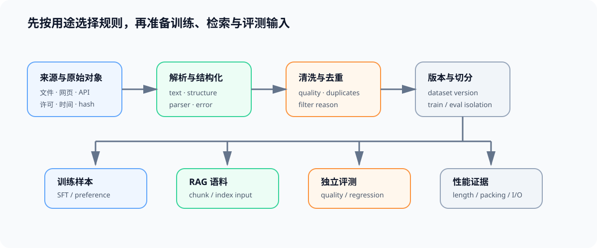
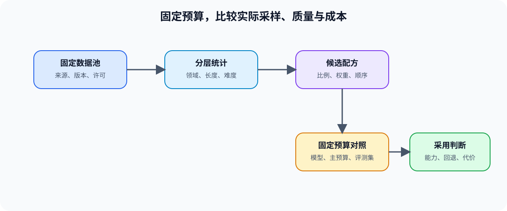
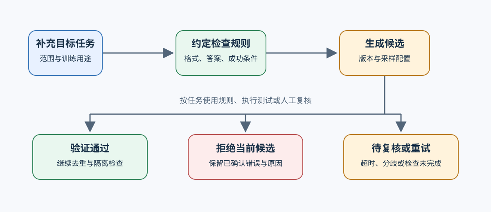
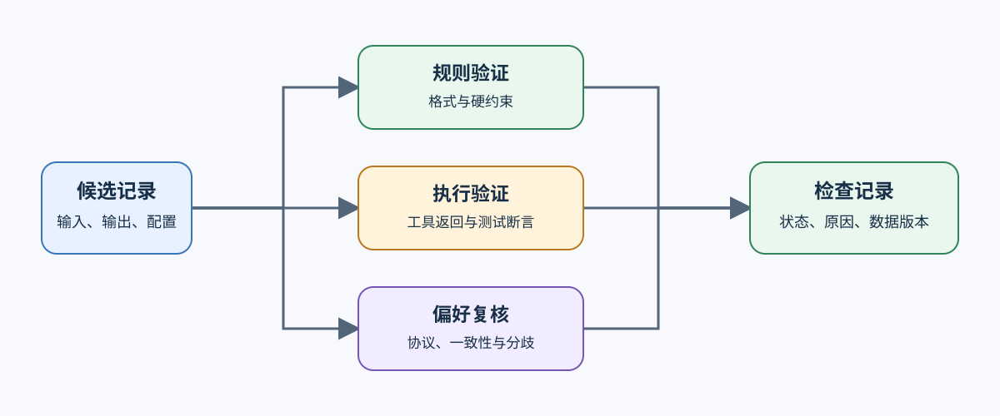
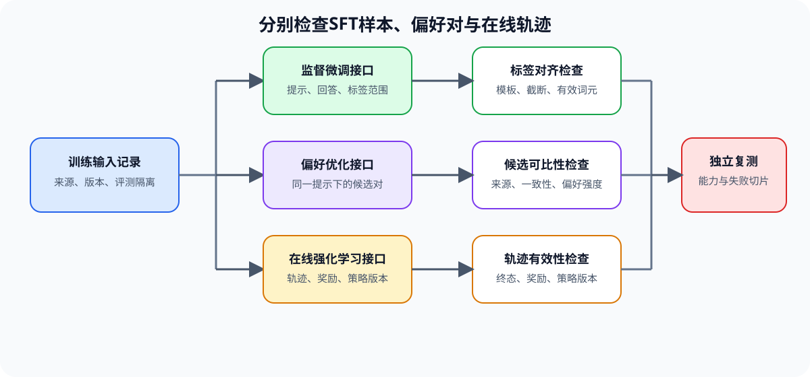
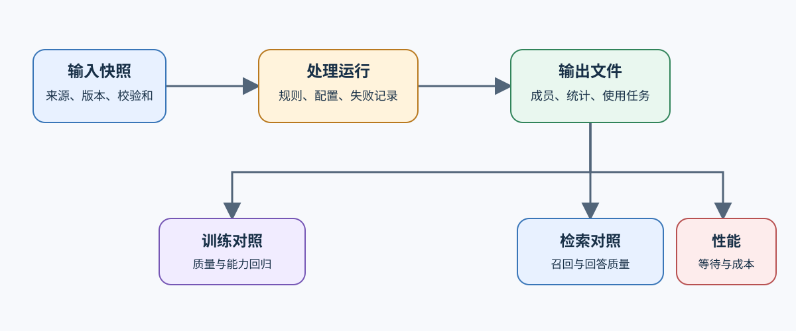
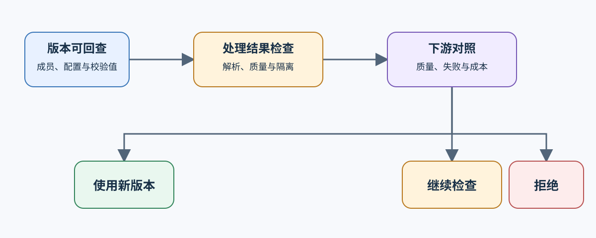

# 数据工程与模型评测问题链

一份设备说明被提取成文本、改写成问答后，仍要找回原文并识别派生关系。以下用教学构造的文档A说明这一过程：A1是文字版，A2是扫描版，A3是问答改写；另外的文档B用于验证规则，C留作最终测试。

已有文本样本可以从来源记录进入清洗与切分，再按训练要求转换字段，最后复查结果。下文的解析、配比与合成按当前问题选读：原始文档要先解析；调整采样比例时比较配比；补充生成样本后返回清洗和切分。各阶段都保存版本与处理记录，最终再汇总到06。

如果已有可运行模型，希望比较它的回答，则先确定目标和独立问题，准备参考依据与评分规则，再保存双方实际回答、逐题分数和失败状态。这个分支可直接进入下文[模型评分与比较](#model-scoring-comparison)，按需回查来源、隔离和输入处理。

## 数据为什么要先确定消费者

说明A中的“周一至周五09:00—18:00”，用于训练时可整理成有来源依据的问答，用于检索时保留标题和日期、时间的对应关系。若要评测未见设备说明的理解能力，则把C及其派生问题留出；开放资料检索另行声明文档是否在检索库中。先明确这些用途，才能决定保留哪些内容、隔离哪些记录。

先填写来源、许可、版本和用途，再按[00 数据来源、处理与使用](./00_data_lifecycle_and_contract.md)决定后续处理规则。

来源附带的使用范围也随派生内容保留：内部文档切成片段后，查询访问仍按原约定控制。对话或工具日志中出现联系人、账号或凭据时，先选择任务需要的字段，再对处理后的内容和残留信息复核。

## 异构来源怎样变成可复查的结构化内容

A1可以抽取文字和表格，A2需要先进行图像文字识别（OCR）。如果A2把“18:00”识别成“16:00”，回查原页面后另存修正版，并保留原识别结果。若提取表格时只留下时间而丢掉“周一至周五”，下一步的清洗无法凭空恢复这个限定，应回到解析过程修正。

解析后保留正文、来源、结构与解析状态，具体字段见[01 采集、解析与来源记录](./01_collection_parsing_contract.md)。

## 重复、污染与低质量风险怎样逐层缩小

修正后的A2与A1可以有相同正文，合并时仍保留两者来源。A3文字不同，但来自说明A；在未见文档评测中，它与A1属于同一来源组。先建立这些关系，再决定保留哪条训练任务以及怎样切分，才能避免训练读过的内容换个问法进入测试。

在B组上选择规则，固定C组作最终比较。分组和处理记录见[02 清洗、去重与评测隔离](./02_cleaning_quality_chain.md)；随后按需要调整配比，或直接准备训练输入。

同时统计各类记录留下多少。短样本保留九成、长样本只保留一成时，训练池的长度分布已经改变；先查解析和过滤原因，再决定是否调整采样，避免反复抽取少量幸存样本。

## 数据配比和呈现顺序怎样接受消融

混合长短训练样本时，先确定按什么计量。如果两组样本长度分别为900和100词元，各抽一半样本，长样本组就占输入词元的90%。[03 数据配比](./03_data_mixture_and_curriculum.md)在相同18万输入词元预算下比较两种抽样方式，并区分目标比例、实际读入量和重复次数。选择配比用验证样本，最终测试留到选择完成后再比较。

## 生成样本怎样获得可用证据

以分数加法问答为例，生成前约定输出一个最简分数，再根据题目独立计算答案。对3/4+1/8，7/8可以继续检查，8/9是答案错误，14/16则数值正确但不满足本例格式。生成或验证超时另记为未完成，重试后再判断，详见[04 示范、合成与轨迹验证](./04_synthetic_data_and_trajectory_validation.md)。

人工示范也使用同样明确的任务要求。偏好标注出现分歧时，先查正确性、格式和其他要求的排序，保存原判断与复核结果；确实相当或无法判断时，按相应状态处理。

不同任务使用不同检查方式：算术题核对数值，代码或工具任务检查执行输入、结果与断言，开放回答保留评审规则和分歧。通过后返回去重与切分检查，分别保存通过、拒绝和待复核记录。

## 训练目标和在线记录怎样对应实际输入

一条简短问答经模板和分词后，再选择进入损失的回答目标。提示提供上下文，即使提示目标被忽略也仍要可见；六个填充后位置的示例只有三个有效目标。截断或拼接后重新核对这些位置，详见[05 训练输入与采样记录](./05_post_training_data_interfaces.md)。成对偏好另外检查同一上下文下的候选与标注，在线更新则检查实际采样的轨迹、奖励及策略版本。

预训练则从文档序列检查后续词元的预测目标，并按实际窗口统计来源词元和读取位置。在线分支先保存生成记录，再关联反馈：RL使用相应奖励，OPD则把教师反馈对应到学生实际访问的前缀。奖励如何形成优势由训练方法决定；记录侧保留计算所需的组成员、版本和有效位置，便于检查它们怎样进入更新。

## 检索片段和测试请求怎样组织

文档用于RAG时，把服务标题、日期与时间切成仍保留适用条件的片段，再让索引连接查询和片段。说明更新或删除时，派生片段与索引成员也一起变化；用相同查询比较增量结果与全量重建，检查旧内容是否残留，过程见[07 检索切块、索引与增量更新](./07_retrieval_chunks_and_index_updates.md)。

把问题用于测试时，还要选择测质量还是测执行性能。质量测试保存参考依据与评分规则；性能测试保存长度、生成设置、共享前缀与到达方式。需要数据校准的量化方法另保存校准成员，最终质量测试保持独立。这些用途及具体检查见[08 评测集、推理负载与校准样本](./08_evaluation_workloads_and_calibration.md)。

## 模型回答怎样变成可比较的结果

计划测试四道题，只得到三份可评分回答时，同时保留覆盖和已评分部分的质量；超时若发生在模型生成和评分服务，后续处理也不同。先按[09 逐样本评分](./09_model_evaluation_metrics_and_scoring.md)明确评分对象、参考依据与失败规则，再计算对应指标，保留原始数量和任务类别。

比较模型时把同一问题的两侧结果配对，分别查看改善、退化、平局和缺失。总体更高也可能伴随工具任务退化，评分器重复判断一致也可能偏离任务要求；按[10 基线比较与评分复核](./10_baseline_comparison_and_regression.md)检查具体回答、分类结果和重复运行，再把结论带回相应项目。准备采用新的数据版本时，继续检查下面的更新与恢复过程。

## 处理记录怎样进入下游结论

一次数据更新可能同时包含保留、修改、删除和新增文件。未变文件的解析结果可以复用，新增重复文件后仍要更新重复组；解析中断时，临时结果先与正式版本分开，使用方继续读取已验证的数据。重试核对依赖后复用已完成阶段，再重算受影响结果，具体见[06 数据版本、增量处理与下游验证](./06_pipeline_lineage_and_downstream_validation.md)。

切换前，训练任务检查成员、标签和独立质量，检索任务检查文档、片段与索引是否一致；根据变化目的选择复测内容。保留新旧版本及使用方配置，出现硬失败时按对应方式恢复：已更新的模型需要训练检查点，旧文档引用也需要匹配旧索引。

在线采样还会遇到“回答已生成但未评分”“工具已执行但返回丢失”等中间状态。恢复时根据原尝试继续处理，重新生成另记尝试；有副作用的工具先确认执行结果。把采样与训练使用记录对应到实际保存的检查点，才能确定恢复后从哪一步继续。

