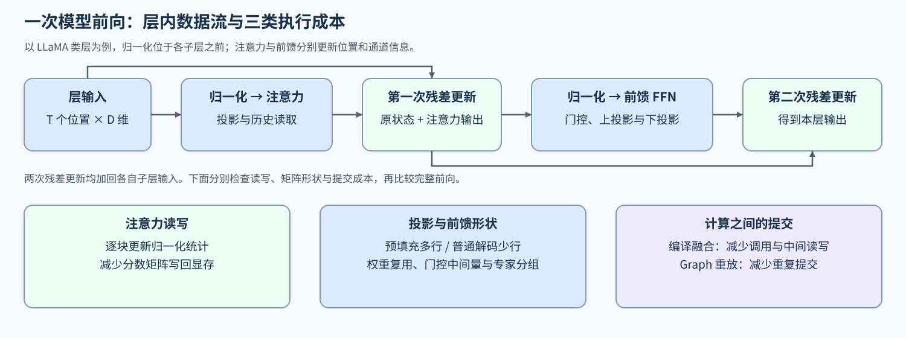
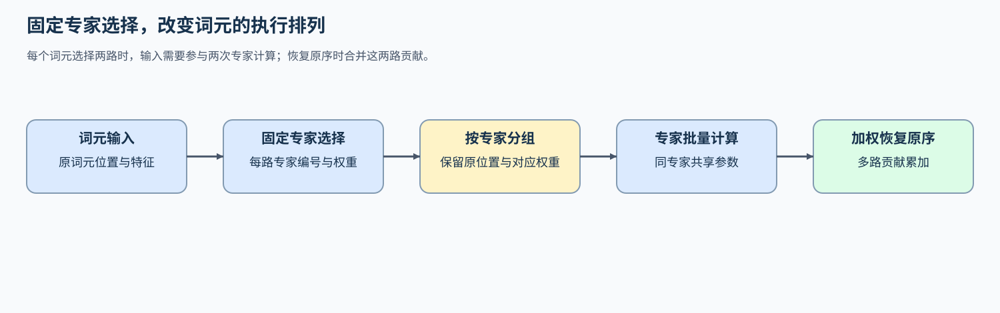

# 02 模型前向与计算执行（Model Forward and Execution）

## 学习问题

长输入的首词元等待可能来自注意力，也可能来自投影、前馈网络或大量小计算的提交。先把一次前向放回解码器层，才能判断应该减少中间读写、扩大计算批量，还是改变执行路径。

沿着同一个层的输入，分别观察注意力、稠密前馈与稀疏专家计算；再区分预填充和解码的形状，以及融合和后端分派带来的变化。

## 一次前向不只有注意力

以 LLaMA 类的 Pre-Norm 解码器层为例，Pre-Norm 指在注意力和前馈子层计算之前进行归一化。主状态先经归一化，再经过注意力和残差更新，随后经过另一次归一化、前馈网络（FFN）与第二次残差更新。其他模型的归一化位置或残差组织可能不同，需要按实际层结构拆分。注意力混合不同位置的信息，前馈网络变换每个词元的通道；投影、归一化和残差读写也消耗时间。仅统计 Attention 内核，无法解释整个层。

同一组权重在预填充时处理多个输入位置，在普通解码时处理各活跃请求的新位置。令本轮词元总数为 $T$、隐藏宽度为 $D$，层输入为 $X\in\mathbb R^{T\times D}$。输入行数变化，会同时改变投影与前馈矩阵形状；注意力还受历史长度和 KV 表示影响。因此，预填充快的实现可能不适合小批量解码。

例如，单请求的 512 个输入位置可以在预填充中形成 512 行投影；进入普通解码后，每次前向通常只有这个请求的一个新位置，却仍要读取该层权重和此前的 KV。前者有更多行共同使用权重，后者每次计算的行数少、历史读取持续增长。理解这种差异，再看分块与融合，才能解释为什么减少中间读写或短调用开销只在某些形状下明显有效。计算量与硬件直觉可分别回补 [参数与 FLOPs](../../01_Hardware_Math_and_Systems/02_LLM_Params_and_FLOPs.ipynb)和 [GPU 架构与显存](../../01_Hardware_Math_and_Systems/03_GPU_Architecture_and_Memory.ipynb)。

| 层内对象 | 主要工作 | 需要分开的成本 |
| --- | --- | --- |
| 投影与注意力 | 生成 Q/K/V、读取上下文并聚合 | 投影矩阵、注意力内核、KV 读写 |
| 稠密前馈 | 每个词元经过门控与输出投影 | 矩阵计算、中间激活读写 |
| MoE 前馈 | 路由、分组、专家计算与合并 | 词元重排、专家批量、输出恢复 |
| 归一化与残差 | 归约、缩放与逐元素更新 | 内存读写、小任务提交与融合 |

## 注意力分块与请求粒度是不同改动

显式注意力会将大的分数矩阵写回 GPU 显存。FlashAttention 逐块计算分数，在线更新 Softmax 所需的最大值、归一化分母和输出累积量，避免保存完整分数矩阵。它改变一次注意力的计算方式；分块预填充改变服务端一次接纳多少输入词元，前缀缓存则跳过已计算的相同输入。三者分别作用于内核、调度粒度和计算复用。需要推导分块间的更新关系时，进入 [Part 02 · 20 FlashAttention 模拟](../../02_PyTorch_Algorithms/20_FlashAttention_Sim.ipynb)，再回到这里比较读写与完整前向成本。

长输入出现后，先检查预填充是否真的占用主要时间。若算子内部读写占主导，可比较实际 SDPA 路径；若已有解码请求被长输入阻塞，应观察服务轮次；若多次处理相同前缀，则观察复用词元数。这三类原因分别进入注意力内核、阶段调度与前缀复用分析，而不是把 TTFT 变化直接归因于注意力。

## 稠密前馈怎样形成三次投影

以 SwiGLU 为例，令中间宽度为 $F$，门控和上投影权重 $W_g,W_u\in\mathbb R^{D\times F}$，下投影权重 $W_d\in\mathbb R^{F\times D}$。忽略偏置时，同一批输入的前馈输出为：

$$
\operatorname{FFN}(X)=
\bigl[\operatorname{SiLU}(XW_g)\odot(XW_u)\bigr]W_d.
$$

其中 $\odot$ 是逐元素乘法，$\operatorname{SiLU}(z)=z\,\operatorname{sigmoid}(z)$；SwiGLU 用这一路激活结果调节另一路投影，形成门控。前两次投影产生两个 $T\times F$ 中间量，再由门控乘法形成下投影输入。融合门控与乘法，可以减少某些中间写回；矩阵投影是否也能融合，则取决于实现和资源限制。

当 $T$ 很小时，每次计算短而调用次数不变，启动和主机提交可能占较大比例；$T$ 增大后，矩阵效率与中间读写的影响也会变化。比较时应计入完整前馈调用，而不是只测激活函数。归一化加残差等相邻小计算还可能提供融合机会，实际收益需要生成路径和组件计时共同解释。

## MoE 将一批行拆成多个专家批次

MoE 用少量选中专家处理每个词元。八个专家、每词元选择两个专家时，一个词元只有两次分配，可能对应两个单行矩阵；十六个词元均匀分配时共有三十二次分配，每个专家平均处理四行。总词元数相同而路由集中程度不同，仍会形成不同的活跃专家数与矩阵形状。

执行器按专家重排输入，完成计算后再按原词元位置加权合并。重排、专家计算和合并都属于完整调用成本；不能只用激活参数量推断速度或总权重驻留。固定路由下的分组与加权恢复见 [MoE 专家执行](../../02_PyTorch_Algorithms/INF-MOE-EXECUTION_MoE_Inference_Dispatch_and_Expert_Execution.ipynb)。这里保持专家选择不变，服务调度器也不能为了均衡随意修改模型路由。

下图只展开这段专家调用：原词元身份和路由权重随分组保留，输出沿相反映射恢复。它与前面的注意力图分别解释两类层内计算。

## 融合与分派决定实际执行什么

同一数学表达可能经过逐算子执行、编译融合或专用内核。SDPA 是缩放点积注意力接口，实际后端取决于形状、数据类型、掩码与设备；稠密前馈与归一化也有各自的能力条件。检查运行轨迹中的内核名称、调用次数和中间张量读写，才能知道接口调用最终执行了哪些计算。

以残差连接、RMSNorm 与 SwiGLU 组成的片段为例，RMSNorm 按特征的均方根归一化，再使用可学习的缩放参数。编译可能减少这些算子之间的提交和中间读写，也会引入首次编译成本。[执行分派实验](../../02_PyTorch_Algorithms/INF-EXECUTION-DISPATCH_Inference_Fusion_and_Backend_Dispatch.ipynb)分别测量首次准备与稳态调用；稳态指准备完成后的重复执行，短期任务和高复用服务因此可能选择不同路径。

假设一个片段逐算子执行耗时 1 ms，编译后稳态耗时 0.6 ms，但比参考路径多花 200 ms 准备时间；这些是构造值。重复调用 $N$ 次时，参考总计 $N$ ms，候选总计 $200+0.6N$ ms，因此超过 500 次才开始抵消准备成本。若完整前向原本耗时 10 ms，其中只有这段 1 ms 被优化，其他部分保持不变，稳态前向也只是从 10 ms 降到 9.6 ms。组件的 40% 降幅对应整次前向的 4%，请求还有输入处理、排队与返回时间，收益需要按实际受影响的时间范围解释。

CUDA Graph 解决的是另一部分成本：把满足捕获条件的一段 GPU 工作记录下来，后续重放，减少 CPU 逐次提交的开销。编译融合可以改变内核数量和中间张量读写，Graph 重放则不自动融合这些内核，两者可以组合。若上述片段的设备计算已经很短，而调用之间仍有明显提交间隙，可比较相同计算的逐次提交与 Graph 重放；不能把重放收益归因为矩阵计算本身变快。

重放要求执行结构和所引用的内存地址等满足捕获约束。请求长度或批次变化时，可能需要分桶、填充或维护多张图，增加准备时间与驻留。先用固定形状比较捕获成本、稳态完成时间和输入更新后的数值，再回到实际负载检查适用比例；具体练习见 [Part 04 · 11 CUDA Graph 与 JIT 编译](../../04_CUDA_and_System_Optimization/11_CUDA_Graph_and_JIT_Compile.ipynb)。

减少一次前向的耗时后，普通自回归生成仍需等待选出当前词元，才能确定下一个位置的输入。若目标是减少生成整段回答所需的目标模型调用轮数，就要进一步比较草稿候选与批量验证；其中新增的草稿计算和验证开销也必须计入请求耗时。

| 观察 | 下一项比较 | 关键证据 |
| --- | --- | --- |
| 注意力内部时间与中间读写较大 | 显式参考与实际 SDPA 路径 | 数值、内核、时间和峰值 |
| 归一化、门控等短任务间隙明显 | 逐算子与编译融合 | 图中断、启动与稳态成本 |
| MoE 专家矩阵很小或调用很多 | 固定路由下逐词元与按专家执行 | 重排与合并成本、负载和调用形状 |
| 层内加速未改善请求 | 回到队列、缓存或阶段配额 | 完整请求时间与服务轮次 |

确认实际调用的内核及其耗时后，按[基准与决策](./07_benchmark_and_decision.md)比较目标负载；需要改写分块或内核时，进入[算子优化](../operator_optimization/intro.md)。

## 相关阅读

- [FlashAttention 论文](https://arxiv.org/abs/2205.14135)
- [PyTorch SDPA](https://docs.pytorch.org/docs/stable/generated/torch.nn.functional.scaled_dot_product_attention)
- [解码器层的数据流](../../02_PyTorch_Algorithms/05_LLaMA3_Block_Tutorial.ipynb)
