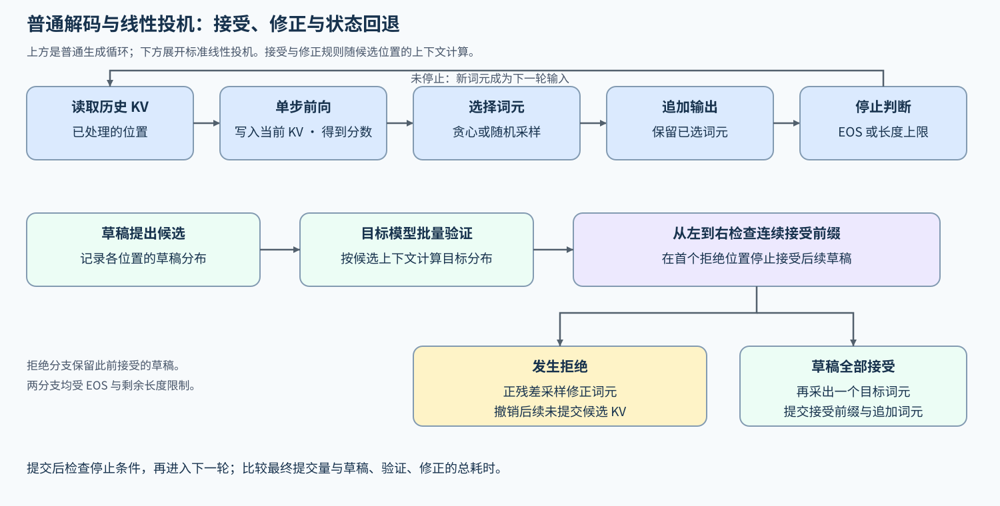

# 03 解码策略（Decoding Strategies）

## 学习问题

首个词元产生后，模型如何反复读取历史状态、选择下一个词元并判断停止？引入草稿候选后，怎样在保持目标模型分布的前提下提高每轮有效推进量？

## 核心机制

### 单步解码、停止与输出检查

带 KV 缓存的普通解码每轮把尚未处理的新词元作为输入，读取此前缓存，计算该输入位置的 K/V 并追加。模型输出词表上各词元的未归一化预测分数（logits），经采样规则处理并归一化后得到预测分布。随后选出的词元立即加入输出序列；它自身的 K/V 通常要等下一次前向处理它时才产生。预填充也遵循这个时序：处理完提示词后可以采出首个输出词元，此时缓存主要对应已经处理的提示词位置。

贪心解码选择概率最大的词元，适合作为确定性基线。随机采样中，温度调节概率分布的集中程度；Top-k 只保留分数最高的 k 个候选，Top-p 按概率从高到低保留累计概率达到阈值的候选集合，再从保留集合中采样。不同生成比较需要记录这些参数与随机种子，才能解释词元选择的差异。

当前词元的选择决定下一次前向的输入，因此一条请求的普通自回归生成具有串行依赖。降低单次前向成本可以缩短每一步，但生成较长回答时仍需逐步推进。投机方案先提供一段候选输入，让目标模型在一次前向中评估多个位置；能提交多少位置，再由验证规则决定。

每次选择后还要判断是否继续：遇到协议指定的终止词元（EOS）可以正常停止，达到最大新增词元数则因长度预算停止。两种情况都结束本次生成，却不能都解释为回答已经完整。多请求批次中，一个请求先结束，其余请求仍可继续；单步选择、单请求停止与批次成员更新因此需要分别观察。词元选择见[解码与采样](../../02_PyTorch_Algorithms/21_Decoding_Strategies.ipynb)，输出长度和停止原因随请求记录保存。

比较时，确定性生成可以逐项核对提交词元；随机生成则需要检查采样规则及分布正确性，相同种子也不保证不同执行路径得到相同序列。任务答案是否正确、格式是否合规还需单独评价：分布保持、输出复现与任务质量回答的是不同问题。

| 生成环节 | 核心问题 | 需要固定或记录的证据 |
|:---|:---|:---|
| 读取历史状态 | 本轮访问了多长的 KV Cache？ | 上下文长度、缓存表示、单轮延迟 |
| 计算与选择 | 使用贪心还是随机采样？ | 随机种子、温度、Top-k、Top-p |
| 停止 | 是否遇到终止词元或长度上限？ | 生成词元数、停止原因 |
| 质量检查 | 更快的路径是否改变输出分布或任务质量？ | 固定输入、独立质量；输出散列仅辅助复现 |

### 草稿、验证与校正

投机解码先用较低成本的路径提出一段候选，再由目标模型验证多个位置。设当前上下文下目标分布为 $p$、草稿分布为 $q$，草稿词元为 $x$。标准随机投机采样以 $\min(1,p(x)/q(x))$ 接受候选；候选从 $q$ 采出，因此其草稿概率为正。验证从左到右保留连续接受前缀，第一次拒绝时，从归一化的正残差分布采样修正词元：

$$
r(v)=\frac{\max(p(v)-q(v),0)}{\sum_{u\in\mathcal V}\max(p(u)-q(u),0)}.
$$

其中 $\mathcal V$ 是词表，$v$ 是待采样词元，$u$ 是求和索引。这个修正分布补偿接受步骤造成的概率偏差，不能替换为直接从 $p$ 重采样。修正后丢弃后续草稿及其未提交状态；如果整段草稿全部接受，则从接受前缀后的目标分布再生成一个词元。上述接受与修正规则共同保持目标采样分布，贪心验证使用对应的确定性规则。

以两个词元 A、B 为例，草稿概率为 $(0.8,0.2)$，目标概率为 $(0.4,0.6)$。A 的接受概率是 0.5，B 的接受概率是 1；拒绝 A 后，正残差只在 B 上有质量，因此修正词元必为 B。最终 A 的概率为 $0.8\times0.5=0.4$，B 的概率为 $0.2+0.8\times0.5=0.6$，恢复了目标分布。若拒绝后直接从目标分布再采样，A 又会获得额外概率。逐步实现接受、修正和状态回退见 [Part 02 · 23 投机解码](../../02_PyTorch_Algorithms/23_Speculative_Decoding.ipynb)，再用下面的提交量和时间判断收益。

真正的收益来自“每轮提交更多有效词元”，而不是候选数量本身。候选过长会增加草稿和验证成本；候选过短则不足以摊薄目标模型调用。因此需要同时观察：

$$
\text{有效推进量}=\frac{\text{最终提交词元数}}{\text{目标模型验证轮数}}
$$

这里的提交词元包括接受的草稿，以及按协议产生的修正或全接受后的追加词元，并受 EOS 与剩余长度预算限制。连续接受长度只计草稿前缀，两者需要分别记录；每轮推进量还要与该轮实际耗时一起观察。

| 证据 | 回答的问题 |
|:---|:---|
| 连续接受长度与总提交量 | 草稿前缀接受了多少，加上修正或追加后实际推进多少？ |
| 接受率与首个拒绝位置 | 草稿从哪里开始偏离目标模型？ |
| 草稿与验证耗时 | 接受收益是否覆盖额外计算？ |
| 回退次数 | 校正路径被触发得多频繁？ |
| 端到端延迟与输出质量 | 局部接受率是否转化为真实收益？ |

### 从双模型草稿到内置、特征与块草稿

经典双模型方案用一个较小的自回归模型逐词元生成草稿，再由目标模型验证。草稿还可以来自内置预测头、外置特征草稿器或并行块草稿。它们都需要说明候选怎样被目标模型验证、拒绝后怎样处理状态；具体接受协议取决于候选结构、采样方式和后端实现，不能把上面的线性随机采样公式直接当作所有候选树或块草稿的实现。

| 候选来源 | 候选如何产生 | 主要收益 | 主要约束 |
|:---|:---|:---|:---|
| 经典双模型草稿 | 较小的自回归模型逐词元提出候选 | 草稿计算通常低于目标模型单独推进 | 两个模型的分词与生成协议需要匹配，并计入草稿成本 |
| 原生多词元预测（MTP） | 目标模型内部的预测层提出后续词元 | 不需要加载独立草稿模型 | 模型必须包含对应预测层，后端必须支持 |
| EAGLE | 外置轻量草稿器读取目标模型隐藏表示并扩展候选树 | 候选与目标模型特征更一致 | 草稿权重必须与目标模型版本配对 |
| DFlash / DSpark | 块扩散并行提出候选；DSpark 再加入块内依赖与置信度控制 | 降低逐词元草稿的串行成本 | 需要专用草稿资产和执行后端 |

DFlash 关注一次提出一个候选块；DSpark 在并行主干之外加入轻量顺序依赖和置信度估计，动态决定候选前缀。它们不是经典双模型投机解码的必经步骤，而是候选生成的扩展分支。

### 动态候选预算与净收益

固定候选长度无法适应所有输入：草稿置信度高时可以增加候选，偏离风险升高时应尽早停止。动态预算依据置信度、历史接受情况或服务负载调整本轮候选长度，但不能改变首个拒绝位置之后全部回退的正确性规则。

用一组构造时间说明取舍：普通解码每提交一个词元耗时 10 ms；某候选方案一轮草稿耗时 4 ms、验证耗时 12 ms、采样与回退等其余处理耗时 2 ms，串行总计 18 ms。若平均提交三个词元，成本为每词元 6 ms；若只提交一个，则为 18 ms。两种情况下都执行了候选验证，只有前者比普通解码更省时间。这里假定没有重叠与排队，数值用于解释成本，不是实测结果。

实际比较应在相同输出与停止协议下，用累计生成耗时除以累计提交词元数，避免将不同推进量的轮次直接平均。候选变长后，接受量与总耗时都会改变；根据置信度与历史接受情况调整长度，需要同时解释两者。引入服务负载后，还要观察较长验证是否占用更多批次与缓存预算、推迟其他请求，结合[服务调度](./05_serving_scheduling_and_pd.md)再比较尾延迟。

候选还会带来临时状态：例如提出四个候选，只接受前两个后发生拒绝，目标模型验证产生的后续候选 KV 就不能作为已提交历史继续读取。实现需要保留有效前缀、撤销未提交部分，并让修正词元与下一轮输入的缓存进度一致。普通生成的持续追加、投机生成的状态回退，以及跨请求的前缀共享，都依赖逻辑位置与物理块的正确映射；[缓存管理](./04_kv_cache_lifecycle_and_reuse.md)进一步解释这些状态怎样驻留与回收。

下图对照普通解码与标准线性投机：拒绝分支提交接受前缀和修正词元，全接受分支再追加目标词元；两者都在提交时检查停止条件。

## 选择条件与验证证据

| 现象 | 优先检查 | 动作 |
|:---|:---|:---|
| 接受率高但端到端延迟没有下降 | 草稿器和验证器额外开销 | 缩短候选或换用更轻的草稿路径 |
| 首个拒绝位置长期靠前 | 草稿与目标模型不匹配 | 检查模型版本、分词器和采样配置 |
| 短候选稳定、长候选退化 | 候选预算过大 | 使用置信度或历史接受长度收缩预算 |
| 单请求加速但高负载尾延迟变差 | 候选占用挤压批处理或缓存预算 | 进入服务调度实验复测 |

普通解码与投机候选的比较，重点保留连续接受长度、最终提交量以及草稿、验证和回退耗时。请求配对、质量门槛与多轮统计使用[基准与决策](./07_benchmark_and_decision.md)的方法。

## 相关阅读

- [投机解码论文](https://arxiv.org/abs/2211.17192)
- [EAGLE-3 论文](https://arxiv.org/abs/2503.01840)
- [DFlash 论文](https://arxiv.org/abs/2602.06036)
- [vLLM Speculators 算法指南](https://docs.vllm.ai/projects/speculators/en/latest/user_guide/algorithms/decision_guide/)
