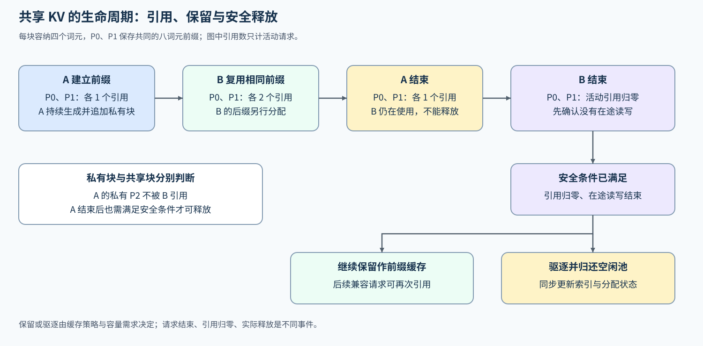
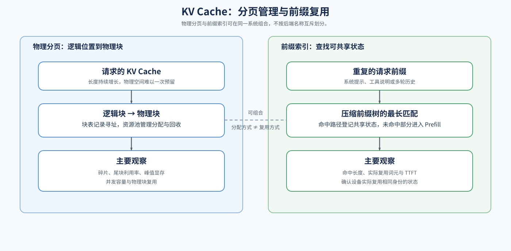

# 04 KV Cache 表示、管理与复用（Representation, Management, and Reuse）

## 学习问题

预填充建立的键值缓存如何随解码增长？系统怎样分配、共享、驱逐和回收这些状态，并在容量、延迟与正确性之间取舍？

## 核心机制

### 表示与容量

多头注意力（MHA）、分组查询注意力（GQA）和多查询注意力（MQA）决定每个词元保存多少组键和值；多头潜在注意力（MLA）进一步改变历史状态的表示。对普通键值表示，容量随层数、KV 头数、上下文长度、并发请求数和元素字节数近似线性增长。

$$
\text{KV 字节数}\approx
2\times L\times H_{kv}\times D\times S\times B\times \text{bytes(dtype)}
$$

这里假设各请求缓存长度相同，各层使用相同 KV 头数与头维度，K/V 使用同一精度；系数 2 分别对应键和值。上式按请求分别累加逻辑状态：若共享前缀，重复引用的位置仍会被多次计入。估算物理驻留时，应按唯一物理块及其分配大小计数，再考虑块表、量化元数据、分配器和执行工作区。请求长度不同时，用各请求的实际缓存长度之和替代 $S B$；无共享时，逻辑有效字节与物理分配之间仍可能存在尾块和预留空间的差额。

| 变量 | 含义 | 增长后的直接影响 |
|:---|:---|:---|
| $L$ | 缓存覆盖的模型层数 | 单词元状态增大 |
| $H_{kv}$ | 每层 KV 头数 | 单词元状态增大 |
| $D$ | 每个键或值头的特征维度 | 单词元状态增大 |
| $S$ | 每个驻留请求的缓存词元数 | 单请求缓存增大 |
| $B$ | 同时保留 KV 状态的请求数 | 总驻留容量增大 |
| $\text{bytes(dtype)}$ | 每个缓存元素的字节数 | 容量与读取带宽变化 |

例如，24 层、8 个 KV 头、头维度 128、每请求缓存 4096 个词元，四个请求使用每元素 2 字节的缓存，上式给出约 1.5 GiB。相同条件下，每个请求再追加一个词元，会增加约 96 KiB 的逻辑 K/V。物理分配若按页进行，实际申请会在跨页时阶梯式增长。

MLA 和 KV Cache 量化可以减少每个词元的状态字节数，但不会替代物理分页、生命周期管理和前缀匹配。

这几类改动节省的成本不同：紧凑表示减少单词元状态，分页减少预留与碎片浪费，回收释放不再需要的驻留，前缀复用则跳过已有输入的重复计算。多出可用容量后，服务可能接纳更多请求，但每条请求仍需读取自己的历史状态。因此应分别观察逻辑字节、实际占用、重复计算量和请求时间，容量下降本身不能证明单步解码加快。

### 分页分配与生命周期

分页缓存把物理显存切成固定大小的块，并用块表记录请求的逻辑位置到物理块的映射；块表也称 block table，执行注意力时通过它找到历史 K/V 的实际存储位置。请求不再按最大长度预留连续空间，而是在预填充和持续解码中按需申请。尾块仍可能浪费少量空间，但已结束请求的块可以回收到共享池中。

设每块容纳四个词元，请求 A 的八个提示词位置写入两块 P0、P1。预填充结束后采出序列的第九个词元，下一次前向处理该词元并写入它的 K/V 时，需要第三块 P2；再处理第十个位置时，仍使用 P2 的剩余空间。执行器可以提前预留 P2，但采样出词元与写入该位置的 KV 是两个时刻。这解释了输出进度、有效缓存长度与物理块分配为何需要分别记录。

若请求 B 与 A 的前八个词元相同，并且使用相同的模型权重、适配器、位置编码与位置编号、缓存表示，且访问权限允许共享，B 可以引用 P0、P1，再为自己的后缀申请 P3。此时四个物理块承载两条请求，而不是分别保存两份完整前缀。两个请求的后缀写入不同块，共享前缀保持不变。

A 结束后释放它对各块的活动引用，但 P0、P1 仍被 B 使用，不能回收。P2 没有活动引用后可以进入可回收集合；是否继续保留作前缀缓存由缓存策略决定。B 结束后，P0、P1 也可能成为可驱逐的缓存块，但还需确认在途读写已经结束，并同步更新索引和分配状态。容量压力决定何时需要驱逐，不是安全驱逐的条件。请求结束、引用归零和物理容量重新可用因此是不同事件。

调度器选择下一轮运行哪些请求，缓存资源池维护块的分配、引用、驻留和回收。在 A 结束后，P2 是否已经释放，P0、P1 是否仍被 B 引用，会决定下一条请求能否申请足够空间。缓存管理提供可用块数与受保护的活动状态；调度器据此决定准入、推进量或抢占，并将恢复所需的传输、重算时间计入等待。调度动作必须通过缓存状态机执行，不能绕过引用约束直接覆盖共享块。

### 前缀匹配、索引与复用

多个请求从开头拥有连续相同的词元时，可以复用已经计算的前缀状态。通用前缀缓存先定义“哪些状态可以命中”；Radix 索引再用压缩前缀树组织大量共享路径，提高最长前缀匹配效率。

| 层次 | 核心问题 | 主要证据 |
|:---|:---|:---|
| 前缀匹配 | 从请求开头连续命中了多少词元？ | 命中长度、未命中后缀长度 |
| Radix 索引 | 大量前缀如何插入、分裂和查找？ | 索引节点、最长匹配路径 |
| 状态引用 | 命中的缓存是否被安全共享？ | 引用计数、复用词元数；例中的 P0、P1 在 A 结束后仍属于 B 的活动状态 |
| 请求收益 | 跳过重复预填充是否改善首词元延迟？ | TTFT、吞吐、失败请求 |

在上述例子中，B 少计算八个前缀词元，却仍要等待准入并计算自己的后缀。节省的预填充时间能否反映到 TTFT，还取决于排队和后缀长度；比较时同时读取复用词元数与请求时间。

比较缓存关闭与开启时，分别记录首次建立前缀和后续热复用。复用长度由后端实际匹配和可复用块决定；保留前缀还会占用容量，可能挤压其他请求。将复用词元数、驻留块数与 TTFT 对照，才能解释省下的是重复计算还是等待；请求配对和交替顺序见[基准与决策](./07_benchmark_and_decision.md)。

### 容量动作与正确性

容量不足时可以驱逐冷缓存、抢占活动请求、重算被丢弃的状态，或使用更紧凑的表示。驱逐移除暂时没有活动请求使用的缓存；抢占则暂停仍未完成的请求。暂停后可以将状态换出到其他存储位置，恢复时搬回，也可以丢弃状态，恢复时重新计算。每种动作都把显存压力转化为另一种成本；引用增减与容量动作的机制练习见 [Part 02 · 37 KV Cache 生命周期与容量控制](../../02_PyTorch_Algorithms/37_KV_Cache_Lifecycle_and_Capacity_Control.ipynb)，完成后对照下表判断各自的时间代价。

| 动作 | 容量收益 | 代价与风险 |
|:---|:---|:---|
| 驱逐 | 释放满足安全释放条件的冷缓存 | 后续访问该前缀时可能未命中，需要重新预填充 |
| 抢占并换出 | 释放 GPU 驻留容量 | 增加传输与恢复延迟 |
| 抢占并重算 | 释放被丢弃状态的驻留，无需另存这些状态 | 恢复时重算历史；尚未输出的请求可能增加 TTFT，已开始生成的请求可能出现更长生成间隔，两者都可能增加 E2E |
| 紧凑表示或量化 | 减少每词元缓存字节数 | 引入重建、内核支持和质量风险 |

前缀索引需要同时核对词元序列和生成这些 K/V 的计算条件。文本相同但分词结果不同，或模型、适配器、位置与缓存精度不同，都可能使旧 K/V 不再适用；租户权限还决定能否访问共享状态。

## 选择条件与验证证据

| 观察到的现象 | 优先检查 | 下一步 |
|:---|:---|:---|
| 上下文或并发增大后容量快速耗尽 | 单词元状态与块利用率 | 比较 GQA/MLA、分页和 KV 量化 |
| 重复前缀明显但 TTFT 没有下降 | 命中条件、索引和真实复用计数 | 检查前缀匹配与 Radix 索引 |
| 容量压力下出现抢占和长尾 | 驱逐、换出或重算策略 | 读取生命周期与容量压力证据 |
| 缓存容量充足但吞吐仍低 | 批次组织或执行调度 | 进入服务迭代与调度分析 |

## 相关阅读

- [PagedAttention 论文](https://arxiv.org/abs/2309.06180)
- [vLLM](https://github.com/vllm-project/vllm)
- [SGLang](https://github.com/sgl-project/sglang)
