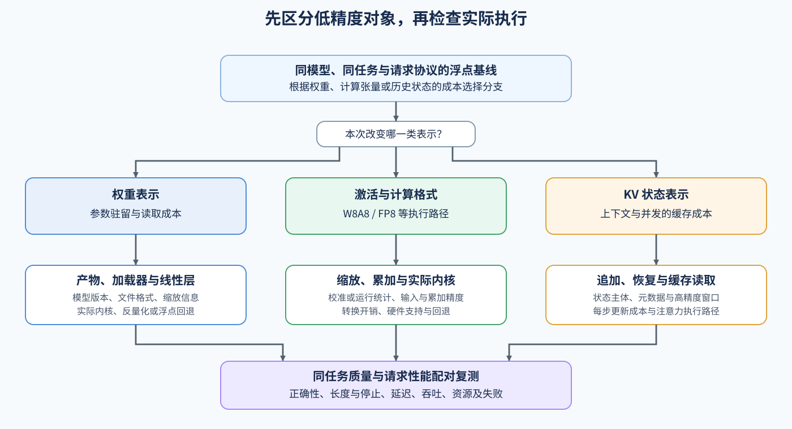

# 06 量化推理与部署（Quantized Inference and Deployment）

## 学习问题

模型已经装入显存，长上下文和并发请求却仍可能耗尽 KV 容量；另一个模型可能在请求开始前就被权重驻留限制。两种情况需要降低的字节不同，量化后的执行和质量代价也不同。

先区分权重、计算张量和请求状态，再跟踪对应的产物或运行配置怎样影响执行。比较以同一模型与请求协议的浮点路径为起点，性能和任务质量分别检查。

## 先找到需要减少的驻留或读写

权重量化改变模型参数的表示，激活或计算格式改变运行中的张量和矩阵路径，KV 量化改变生成期间持续保存的历史状态。位宽是存储一个数值使用的位数，降低位宽可以减少部分字节，但额外缩放、反量化、布局转换和硬件支持会影响实际时间。常见名称中的 W 表示权重、A 表示激活，例如 W8A8 指两者均采用 8 位表示；FP8 指 8 位浮点格式，不等同于 8 位整数。

例如，在一个构造的容量账本中，权重占 8 GiB，KV 和工作区共占 3 GiB，可用预算为 10 GiB。若权重压缩后连同元数据占 5 GiB，总量可降至 8 GiB，从而容纳原本无法运行的请求。但当上下文继续增长、KV 再增加 3 GiB 时，总量又达到 11 GiB；权重压缩没有改变每个新词元的缓存增长量。

| 主要约束 | 优先对象 | 同时观察的代价 |
| --- | --- | --- |
| 权重驻留或参数读取 | 权重表示与对应线性层 | 格式、反量化、矩阵路径与任务质量 |
| 计算或激活读写 | 激活及计算格式 | 缩放、溢出、内核支持与数值误差 |
| 上下文与并发容量 | KV 状态 | 状态恢复、读取成本与长上下文质量 |

## 三类对象进入不同的执行检查

选择分支后，先确认低精度数值怎样通过缩放表示和恢复；需要回补时可读 [Part 02 · 25 W8A16 量化](../../02_PyTorch_Algorithms/25_Quantization_W8A16.ipynb)。若方案依赖校准样本确定范围或裁剪阈值，再进入 [Part 02 · 52 量化校准范围与裁剪](../../02_PyTorch_Algorithms/52_Quantization_Calibration_and_Error.ipynb)。已有产物先读取保存的缩放信息；动态方案在运行中获取统计量；KV 方案还需准备追加和恢复所用的状态。

权重分支从保存的参数与缩放信息开始，先确认产物可以被目标加载器识别，再看线性层怎样计算。激活与计算分支还需要观察运行中的缩放统计、输入与累加精度；累加精度指矩阵乘加中保存部分和所用的数值格式，可以高于输入精度。静态校准、动态缩放和内核融合会产生不同成本，不一定另存一份低比特权重文件。整数 W8A8 的范围迁移可从 [SmoothQuant](../../02_PyTorch_Algorithms/53_Activation_Quantization_and_SmoothQuant.ipynb) 进入，低精度浮点路径可从 [FP8](../../02_PyTorch_Algorithms/41_FP8_Runtime_Low_Precision_Paths.ipynb) 进入。

KV 分支随请求追加历史状态，要同时保存量化状态、缩放元数据和可能保留的高精度窗口。高精度窗口指暂不量化的一段历史状态，例如某些方案保留最近若干位置，较旧位置再压缩；它的容量也要计入总驻留。每步读取还可能需要恢复旧状态；缓存变小却恢复更慢时，容量收益与生成延迟会朝不同方向变化。[KV 量化](../../02_PyTorch_Algorithms/54_KV_Cache_Quantization_Strategies.ipynb)据此比较追加、恢复与残留窗口，而不是要求先生成量化权重文件。

沿用 Task1 的完整调用成本，假设浮点矩阵片段耗时 1 ms，低精度矩阵计算降为 0.6 ms，但缩放与格式转换新增 0.5 ms，完整调用反而成为 1.1 ms。若通过融合把这部分开销降至 0.1 ms，完整调用才降为 0.7 ms。这里使用构造值，比较范围包含输入转换、矩阵计算和输出处理。

再看 Task3 的缓存账本：假设某组历史状态的浮点载荷为 4 GiB，量化载荷为 1 GiB，缩放元数据与高精度残留窗口另占 0.2 GiB，总驻留为 1.2 GiB。若每步历史读取与注意力原需 2 ms，量化后读取与计算为 1.2 ms、状态恢复另需 1 ms，总计仍增至 2.2 ms。容量可以改善而单步延迟退化；只有在新增容量能支持目标上下文或并发、且任务质量满足要求时，才有理由继续比较整体请求收益。这里同样使用构造值，实际缓存格式和恢复是否融合由后端决定。

量化算法、文件格式与执行后端处于不同位置。GPTQ／AWQ 根据数据与权重生成量化表示；GGUF 是承载权重与元数据的格式；加载器解释产物，后端再选择支持的计算。文件更小与设备使用低比特内核是两个需要分别确认的事实。

如果比较对象是一份量化权重目录，先经 [Part 02 · 82 量化产物评估](../../02_PyTorch_Algorithms/82_Quantization_Artifact_Evaluation_Project.ipynb)检查身份、质量与目标加载，再进入 [Part 02 · 67 量化推理与部署](../../02_PyTorch_Algorithms/67_Quantized_Inference_and_Deployment.ipynb)比较浮点与量化执行，最后由 [Part 02 · 83 量化服务 Profile 基准](../../02_PyTorch_Algorithms/83_Quantized_Serving_Profile_Benchmark.ipynb)扩大请求压力。若改变的是运行时精度或 KV 配置，则在支持相应路径的后端下固定浮点基线和目标配置进行比较，不额外要求生成权重文件；这两支仍需分别核对质量、实际执行与请求收益。

上述权重即使只占 5 GiB，执行时也可能先恢复成浮点张量，再调用普通矩阵乘法，省下文件或常驻容量却增加转换成本。直接在支持格式上计算的内核，也可能因小矩阵效率不足而没有延迟收益。下图分别检查三类对象，再汇合到相同任务与请求协议的复测。

## 误差接近与任务可用分别检查

用相同输入检查 logits（词表上各词元的未归一化预测分数）或输出张量，可以定位严重数值回归。长上下文还要检查远处信息能否被正确使用，结构化输出要检查字段与格式，工具调用要检查参数；这些任务检查分别记录正确性、终止和重复情况。

量化可能改变某个位置的词元选择，随后生成序列和停止时刻也会变化。若回答因此提前结束，总时间下降可能来自少生成了内容；将实际长度、停止原因与任务检查一起读取，才能解释这部分变化。

| 验证层 | 观察 | 不满足时的动作 |
| --- | --- | --- |
| 表示与输入 | 权重核对模型版本、格式和文件身份；运行配置核对精度与缩放；KV 核对状态格式与元数据 | 先修复兼容或来源问题 |
| 设备执行 | 张量精度、内核名称、回退日志与转换耗时 | 定位发生转换或回退的层，按实际调用计算收益 |
| 数值与生成 | 有限性、误差、实际长度与停止原因 | 定位误差，调整校准或表示 |
| 任务与服务 | 独立质量、延迟、吞吐、尾部与显存 | 在预先声明门槛下采用、调整或拒绝 |

需要选择校准方法与位宽时，进入[量化与压缩](../quantization_compression/intro.md)；目标后端的浮点／低精度配对与采用判断见[基准与决策](./07_benchmark_and_decision.md)。

## 相关阅读

- [量化校准与误差](../../02_PyTorch_Algorithms/52_Quantization_Calibration_and_Error.ipynb)
- [KV Cache 量化](../../02_PyTorch_Algorithms/54_KV_Cache_Quantization_Strategies.ipynb)
- [GPTQ 论文](https://arxiv.org/abs/2210.17323)
- [AWQ 论文](https://arxiv.org/abs/2306.00978)
