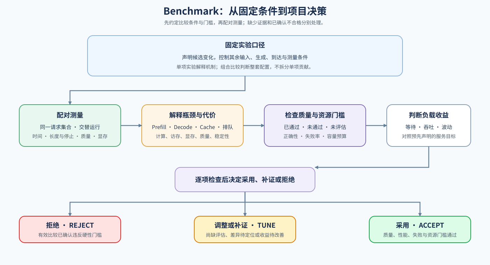

# 07 端到端基准与决策（Benchmark and Decision）

## 学习问题

开启缓存的候选首词元更快，却可能占用更多常驻显存；提高并发上限的候选吞吐更高，也可能让少数请求等待更久。比较需要回答目标负载中的取舍，而不是找一个最大的加速比。

先声明候选改变什么，再共用请求、质量与测量协议。比较一次缓存开关时和比较整套配置时，可以共用测量方法，但两者能解释的原因不同。

## 单项归因与组合比较

前缀缓存单项实验可以保持模型、并发上限和请求流不变，只切换缓存；组合比较则可以同时改变缓存与并发上限，回答整套配置是否适用。后者不能把吞吐变化全部归功于缓存。

量化、后端或精度本身是候选变量时，应记录两侧实际取值，共用模型语义、任务质量和请求协议。固定其余条件，而不是强制固定正在比较的变量。配对比较是让同一请求或同一请求集合分别在基线和候选下执行，并对应保留结果；它不要求两侧同时运行，也不要求两侧的执行批次完全相同。下图按这一含义组织比较。

## 分开启动、缓存状态与稳态

首次调用可能包含加载、编译、内核选择和缓存准备。长驻服务的稳态比较可以在准备后测量，但一次性任务还需要报告启动成本。预热不能悄悄替候选预先建立应当计费的前缀缓存。

缓存实验应明确冷请求与热复用请求：分别记录状态建立、复用范围和请求顺序。调度实验则保留到达协议与请求事件，比较相同的请求集合，而不是只比较同一时刻的活跃数量。

多轮交替测量可以降低顺序与设备状态的影响；汇总保留各轮样本、失败和超时。样本不足时，尾部分位数只是当前小样本描述，不足以代表生产尾延迟。

## 同一组结果为何有不同选择

设一组构造结果中，候选将吞吐从每秒 100 个词元提高到 130 个，却让首词元 P95 从 200 ms 升到 350 ms。若交互服务要求首词元 P95 不超过 300 ms，它不满足门槛；若离线任务允许等待且质量与成本通过，整套候选仍可能可用。这里的数值仅说明决策方法。

质量、失败和资源预算先构成可接受范围，再在通过门槛的方案间排序。更短但错误或截断的回答，不算有效产出。长度桶是按事先约定的输入长度或目标输出预算，将请求分组统计，例如短、中、长输入分别计算延迟；两侧保持相同分组，避免平均值掩盖长请求退化，也避免候选提前结束后被重新划入更短的一组。

| 比较对象 | 保留的证据 | 决策用途 |
| --- | --- | --- |
| 输入与候选身份 | 模型、请求、到达、采样、配置差异和版本 | 确认比较范围与归因边界 |
| 请求结果 | TTFT、TPOT、总时间、实际长度、停止与失败 | 判断等待与有效产出 |
| 资源与路径 | 显存、执行后端、内核、缓存或通信事件 | 解释资源代价与实际命中 |
| 多轮与分桶 | 原始样本、轮次、长度桶和统计口径 | 观察波动、尾部和适用范围 |
| 质量与成本 | 独立任务质量、资源时间、重试与有效输出 | 判断收益是否覆盖代价 |

## 从专项比较到综合复测

局部机制实验固定一个主要变化，专项服务实验验证真实请求路径，综合项目则独立固定服务负载与配置组合并重新测量。已有结果可以提供候选来源，不能替代新负载下的计时与质量检查。

单卡候选可以直接完成采用判断。只有目标容量、吞吐或可靠性仍不满足时，再比较副本或模型内部并行；进入[分布式推理](./08_distributed_inference_and_parallelism.md)后，额外记录设备数量、通信、最慢参与者和恢复代价。

采用判断需要区分“尚未证明满足要求”和“已经确认违反门槛”。例如，性能改善但独立质量尚未评估时，只能保留为待核验候选；输出等价性核对失败后，还要按事先声明的比较要求判断是否直接拒绝，或先定位差异再复测。缺少质量证据与已确认质量不合格不能混写为同一种原因，二者都不能直接采用。

读取已有报告时，`accept`、`tune`、`reject` 按该报告的比较协议解释，并同时查看各项检查结果；`tune` 本身不证明数值、执行或质量已经通过。比较条件不成立时，应先修复测量，不能用无效比较给候选作性能排序。

| 采用判断 | 判断依据 | 下一动作 |
| --- | --- | --- |
| 采用 | 当前负载的质量、性能、失败与资源门槛均通过 | 保留配置、来源与可恢复基线 |
| 调整或补证 | 尚不足以支持采用，需定位数值、执行或质量差异，补充评估，或改善性能与波动 | 逐项注明已通过、未通过和未评估的检查；保留基线，修复或补证后重新判断 |
| 拒绝 | 有效比较已确认违反事先声明的硬性门槛，如必须满足的输出正确性或资源预算 | 保留失败原因与原基线；候选修复后使用新标签复测 |
