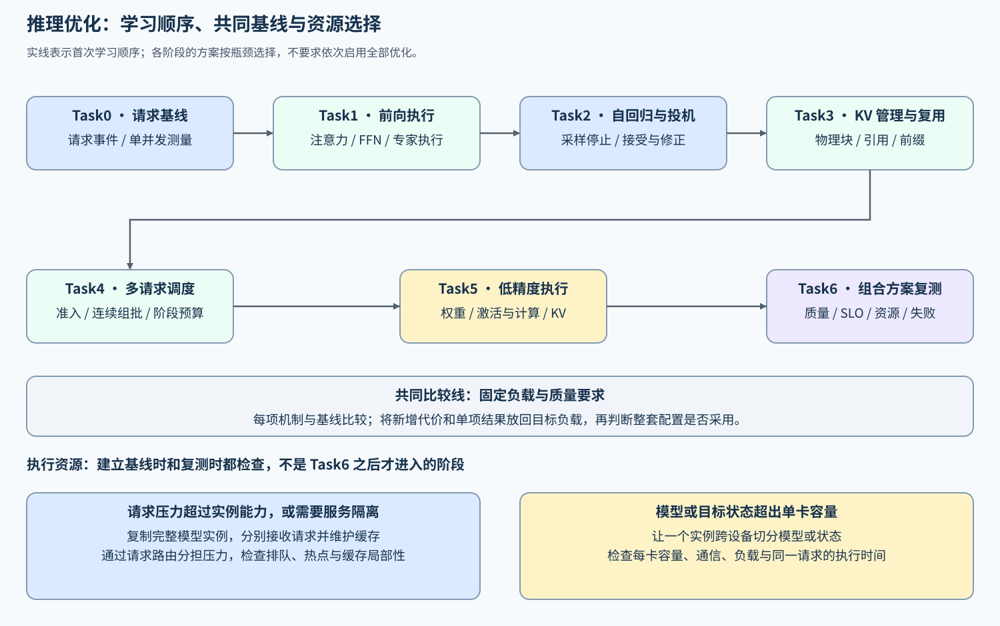
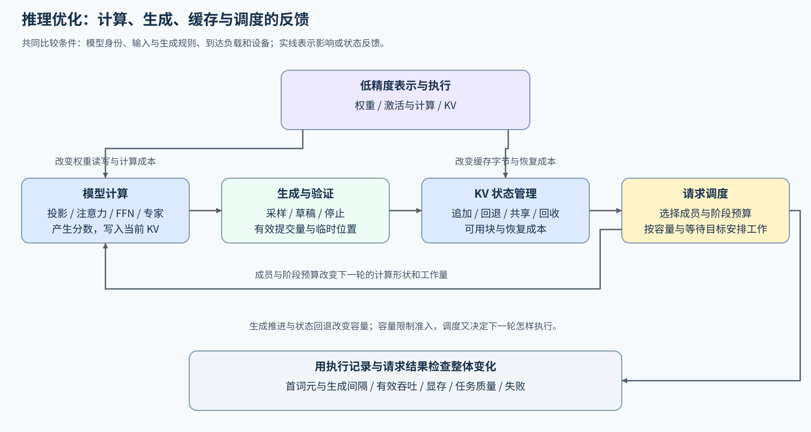

# 推理优化（Inference Optimization）

> 专题类型：主学习路线　学习目标：在质量与资源约束下解释请求等待，并比较计算执行、状态管理和调度方案。

长输入可能让首个词元迟迟无法返回，重复前缀可能被反复计算，并发增大后还可能出现排队和生成停顿。推理优化从这些请求现象出发，分别跟踪模型计算、KV Cache 和服务批次，解释时间与显存花在哪里，再判断改动是否改善目标负载。

缩短一次计算，可能仍留下排队等待；保留更多可复用前缀，也可能挤占新请求的缓存空间。理解这些取舍，才能选择适合目标负载的加速方案。

## 学习路线

先建立请求基线，再分别研究计算、生成、缓存与调度，随后按瓶颈选择低精度分支，最后复测组合方案。每阶段都从减少的工作或等待出发，计入新增代价，再回看请求表现；基本顺序与入口见下表。

[基准与决策](./07_benchmark_and_decision.md)从第一次比较开始使用：单项实验解释机制，组合实验判断整套配置。连续理解请求变化使用[问题链](./walkthrough.md)，按现象查找原因使用[判断手册](./casebook.md)，概念差异见[术语表](./glossary.md)。

| Task / 学习主题 | 优化对象与本阶段问题 | 学习入口与验证出口 | 学习顺序 | 主要正文入口 |
|:---|:---|:---|:---|:---|
| Task0 · 推理请求与测量基线 | 怎样建立工作量和时间口径明确的请求基线？ | 核心：[Part 02 · INF-REQUEST-LIFECYCLE 推理请求生命周期与核心指标](../../02_PyTorch_Algorithms/INF-REQUEST-LIFECYCLE_Inference_Request_Lifecycle.ipynb)；项目：[Part 02 · 66 单卡推理测量基线](../../02_PyTorch_Algorithms/66_Inference_Performance_Comparison.ipynb)；[nano-vLLM 请求入口](./nano_vllm_request_walkthrough.md#request-entry) | 请求事件与指标 → 引擎生成观察 → 单并发基线 → 多请求概念对照 | [01 请求链路与指标](./01_request_path_and_metrics.md) |
| Task1 · 模型前向、融合与执行分派 | 怎样减少一次前向的计算、读写与提交成本？ | 核心：[Part 02 · 05 LLaMA3 Block 教程](../../02_PyTorch_Algorithms/05_LLaMA3_Block_Tutorial.ipynb)、[Part 02 · 20 FlashAttention 模拟](../../02_PyTorch_Algorithms/20_FlashAttention_Sim.ipynb)、[Part 02 · INF-EXECUTION-DISPATCH 推理融合与后端分派](../../02_PyTorch_Algorithms/INF-EXECUTION-DISPATCH_Inference_Fusion_and_Backend_Dispatch.ipynb)；[nano-vLLM 模型执行](./nano_vllm_request_walkthrough.md#model-forward) | 层内数据流与形状 → 分块、融合与分派 → 准备成本与完整前向 | [02 模型前向与计算执行](./02_prefill_and_attention_kernel.md) |
| Task2 · 自回归生成与投机验证 | 怎样让生成更快，并保持约定的采样与质量要求？ | 核心：[Part 02 · 21 解码策略](../../02_PyTorch_Algorithms/21_Decoding_Strategies.ipynb)、[Part 02 · 23 投机解码](../../02_PyTorch_Algorithms/23_Speculative_Decoding.ipynb)、[Part 02 · INF-PROPOSAL 动态候选生成与验证预算](../../02_PyTorch_Algorithms/INF-PROPOSAL_Dynamic_Proposal_and_Verification_Budget.ipynb)；[nano-vLLM 普通生成参照](./nano_vllm_request_walkthrough.md#generation-loop)；项目：[Part 02 · 68 投机解码机制选型基准](../../02_PyTorch_Algorithms/68_Speculative_Decoding_Benchmark.ipynb) | 普通生成与停止 → 投机接受与修正 → 候选成本与净收益 | [03 解码策略](./03_decoding_strategies.md) |
| Task3 · KV 分页管理与前缀复用 | 怎样管理增长的 KV，并复用已有前缀？ | 核心：[Part 02 · 22 vLLM 分页注意力](../../02_PyTorch_Algorithms/22_vLLM_PagedAttention.ipynb)、[Part 02 · 37 KV Cache 生命周期与容量控制](../../02_PyTorch_Algorithms/37_KV_Cache_Lifecycle_and_Capacity_Control.ipynb)、[Part 02 · 24 Prefix Cache 匹配与复用](../../02_PyTorch_Algorithms/24_Prefix_Cache_Matching_and_Reuse.ipynb)；[nano-vLLM 块管理](./nano_vllm_request_walkthrough.md#cache-blocks)与[Mini-SGLang 前缀索引](./mini_sglang_cache_scheduling.md#prefix-cache)；项目：[Part 02 · 69 前缀缓存基准](../../02_PyTorch_Algorithms/69_Prefix_Caching_Benchmark.ipynb) | 逻辑容量 → 分页与引用 → 回收与前缀复用 | [04 KV Cache 表示、管理与复用](./04_kv_cache_lifecycle_and_reuse.md) |
| Task4 · 请求准入、连续组批与阶段调度 | 下一轮运行谁、推进多少，怎样权衡等待与吞吐？ | 核心：[Part 02 · INF-ITERATION-BUDGET Serving 迭代成本与批次容量上界](../../02_PyTorch_Algorithms/INF-ITERATION-BUDGET_Serving_Iteration_Cost_and_Batch_Bounds.ipynb)、[Part 02 · 36 解码调度](../../02_PyTorch_Algorithms/36_Decode_Scheduling.ipynb)、[Part 02 · INF-CONTINUOUS-BATCHING 连续批处理](../../02_PyTorch_Algorithms/INF-CONTINUOUS-BATCHING_Continuous_Batching.ipynb)、[Part 02 · 38 Prefill/Decode 调度](../../02_PyTorch_Algorithms/38_Prefill_Decode_Scheduling.ipynb)；[nano-vLLM 请求选择](./nano_vllm_request_walkthrough.md#iteration-scheduling)与[Mini-SGLang 阶段调度](./mini_sglang_cache_scheduling.md#phase-scheduling)；项目：[Part 02 · 70 推理服务调度基准](../../02_PyTorch_Algorithms/70_Serving_Scheduler_Benchmark.ipynb) | 队列与缓存 → 成员与阶段预算 → 连续轮次与等待 | [05 服务预算、连续批处理与阶段调度](./05_serving_scheduling_and_pd.md) |
| Task5 · 权重、激活与 KV 低精度执行 | 权重读取、计算或 KV 容量受限时，分别降低哪类数据的精度？ | 核心：权重：[Part 02 · 25 W8A16](../../02_PyTorch_Algorithms/25_Quantization_W8A16.ipynb) → [Part 02 · 40 GPTQ／AWQ](../../02_PyTorch_Algorithms/40_GPTQ_and_AWQ_Weight_Quantization.ipynb)；激活与计算：[Part 02 · 53 SmoothQuant](../../02_PyTorch_Algorithms/53_Activation_Quantization_and_SmoothQuant.ipynb) 或 [Part 02 · 41 FP8](../../02_PyTorch_Algorithms/41_FP8_Runtime_Low_Precision_Paths.ipynb)；KV：[Part 02 · 54 KV Cache 量化](../../02_PyTorch_Algorithms/54_KV_Cache_Quantization_Strategies.ipynb)；[Mini-SGLang 低精度源码对照](./mini_sglang_cache_scheduling.md#quantized-execution)（按所选分支能力）；项目：权重产物经 [Part 02 · 82 量化产物评估](../../02_PyTorch_Algorithms/82_Quantization_Artifact_Evaluation_Project.ipynb)，部署与服务比较进入 [Part 02 · 67 量化推理与部署](../../02_PyTorch_Algorithms/67_Quantized_Inference_and_Deployment.ipynb)、[Part 02 · 83 量化服务 Profile 基准](../../02_PyTorch_Algorithms/83_Quantized_Serving_Profile_Benchmark.ipynb) | 按瓶颈选择分支 → 核对表示、转换与实际内核 → 质量和请求收益；运行时精度与 KV 配置按后端能力复测，不强制生成量化权重产物 | [06 量化推理与部署](./06_quantized_inference_and_deployment.md) |
| Task6 · 目标负载复测与方案采用 | 组合方案是否满足目标负载的质量、SLO 与资源门槛？ | 项目：[Part 02 · 72 单卡推理部署与 Backend 对比项目](../../02_PyTorch_Algorithms/72_Multi_Model_Deployment_Comparison.ipynb)、[Part 05 · 01 推理服务交付综合项目](../../05_Integrated_Projects_and_Decisions/01_Inference_Service/index.md) | 固定比较条件 → 配对与分桶复测 → 采用、调整或拒绝 | [07 端到端基准与决策](./07_benchmark_and_decision.md) |

Task2–4 的先后是学习顺序，实际服务中三者相互约束：较长的投机候选可能多占缓存和验证时间，可用块减少又会限制请求准入与批次规模。每轮执行后，接受、回退和完成事件都会改变下一轮的选择，关系见[生成、缓存与调度约束图](./walkthrough.md#generation-cache-scheduling)。低精度也会改变计算成本和可用容量，因此单项比较之后还需返回生成、缓存与调度复测。

完整模型实例是能够接收并执行请求的运行单元，通常维护自己的权重、缓存和调度状态。复制实例让不同请求分别执行；一个实例也可以让多张卡协作处理同一请求。因此实例数与卡数不是同一个量，两种方式还可以组合。请求压力或隔离需求可能要求复制实例，模型与目标状态放不下时则可能在建立基线前就需要跨设备切分；具体入口见[分布式推理](./08_distributed_inference_and_parallelism.md)。

## 扩展与跨专题入口

关键前置按当前问题选择：估算层内计算与驻留资源时读 [Part 01 · 02 大模型参数量与算力推导](../../01_Hardware_Math_and_Systems/02_LLM_Params_and_FLOPs.ipynb) 和 [Part 01 · 03 GPU 物理架构与内存层级](../../01_Hardware_Math_and_Systems/03_GPU_Architecture_and_Memory.ipynb)；计算 KV 容量时读 [Part 01 · 11 KV Cache 与显存增长](../../01_Hardware_Math_and_Systems/11_KV_Cache_and_Memory_Growth.ipynb)；进入专家执行时先读 [Part 02 · 06 MoE 路由器](../../02_PyTorch_Algorithms/06_MoE_Router.ipynb) 与 [Part 01 · 22 MoE 模型参数量计算](../../01_Hardware_Math_and_Systems/22_MoE_Parameter_and_Compute.ipynb)。

计算细节按层内对象回补：[Part 02 · 04 多头注意力](../../02_PyTorch_Algorithms/04_Attention_MHA_GQA.ipynb)、[Part 02 · 01 RMSNorm 教程](../../02_PyTorch_Algorithms/01_RMSNorm_Tutorial.ipynb)、[Part 02 · 02 SwiGLU 激活](../../02_PyTorch_Algorithms/02_SwiGLU_Activation.ipynb)。缓存需要更紧凑表示或索引时，再选择 [Part 02 · ARCH-MLA MLA 与紧凑 KV 表示](../../02_PyTorch_Algorithms/ARCH-MLA_Multihead_Latent_Attention.ipynb)或 [Part 02 · 34 SGLang 基数注意力](../../02_PyTorch_Algorithms/34_SGLang_RadixAttention.ipynb)。

教学引擎分阶段阅读：Task0 用 nano-vLLM 认识请求与生成，Task3 加入 Mini-SGLang 对照前缀复用，Task4 继续观察轮次调度；Task5 按所选版本和分支能力对照低精度执行。具体入口见[教学引擎导读](./teaching_engines.md)。

| 遇到的问题 | 入口 | 衔接内容 |
|:---|:---|:---|
| 不清楚层结构、注意力表示或稀疏专家语义 | [模型架构](../llm_architecture_evolution/intro.md) | 确认模型计算与状态定义 |
| 不知道时间花在哪里 | [性能分析](../performance_analysis/intro.md) | 阶段归因、轨迹与资源瓶颈 |
| 局部候选引起瓶颈转移 | [性能优化](../performance_optimization/intro.md) | 比较组合与目标负载收益 |
| 需要修改分块、融合或内核 | [算子优化](../operator_optimization/intro.md) | 从已定位计算进入实现 |
| 需要校准、格式转换或低比特质量分析 | [量化与压缩](../quantization_compression/intro.md) | 产物与目标执行路径 |
| 单实例安排不足，需要资源拆分 | [Part 02 · 39 异构 PD 与服务分层](../../02_PyTorch_Algorithms/39_Hetero_PD_and_Serving_Tiers.ipynb)、[Part 02 · INF-AFD Attention–FFN 解耦](../../02_PyTorch_Algorithms/INF-AFD_Attention_FFN_Disaggregation.ipynb) | KV 或层间激活的跨角色交接；准备与搬运等待先比较[Part 02 · INF-SERVING-OVERLAP 服务重叠与状态交接](../../02_PyTorch_Algorithms/INF-SERVING-OVERLAP_Serving_Overlap_and_State_Handoff.ipynb) |
| 需要专家放置、模型切分或通信分析 | [通信与并行](../communication_parallelism/intro.md)、[08 分布式推理与并行扩展](./08_distributed_inference_and_parallelism.md) | 请求副本与模型内部并行的代价 |
| 需要跨设备放置、兼容性与资源选型 | [部署异构](../deployment_heterogeneous/intro.md) | 资源与运行时约束 |

## 实验与项目出口

环境创建见 [Quickstart](./quickstart.md)，机制与项目的输入、结果和验证状态见[实验资产表](./experiment_assets.md)。CPU 练习确认数值、状态和预算；设备执行、服务收益与多卡扩展分别需要对应运行证据。

| 实验层次 | 要回答的问题 | 与其他层的关系 |
|:---|:---|:---|
| 局部机制 | 数值、执行路径、时间或容量怎样随受控改动变化？ | 解释原因，为专项服务比较提供假设 |
| Part02 专项与部署比较 | 策略在真实请求中是否有效，候选证据是否足以支持部署判断？ | 使用相符的模型、请求和测量协议；结论限定于该实验 |
| Part05 独立综合实践 | 自行固定工作负载和配置组合后，哪套方案满足门槛？ | 独立测量；Part02 结果可提供候选来源，不是强制输入 |
