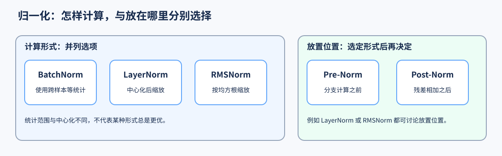

# 03 归一化演进（Normalization Evolution）

## 学习问题

同一段特征先减均值还是只按大小缩放，会给分支不同的输入；把归一化放在残差相加之前或之后，又会改变梯度路径。归一化需要分别考虑“怎样计算”和“放在哪里”，不能把这两种选择排成同一条替代链。

## 核心机制

### 深层状态为什么需要尺度约束

随着 Transformer 块堆叠，激活尺度、残差相加和梯度传播相互影响。批归一化（BatchNorm）使用跨样本等维度的统计量；层归一化（LayerNorm）在常见 Transformer 用法中处理单个词元的特征维度，因而不依赖同批其他序列的长度和内容。它们适合的统计范围不同，不能据此断言序列模型一律不能使用批次统计。

### 中心化与均方根缩放分别改变什么

LayerNorm 的归一化核心先减去特征均值，再按标准差缩放；均方根归一化（RMSNorm）不做这一步中心化，而是按平方均值的平方根缩放。例如 $[1,3]$ 减均值后成为 $[-1,1]$，其 RMSNorm 分母则为 $\sqrt{5+\epsilon}$。是否保留整体偏移，是两种形式的实际差异；可学习缩放或偏置随后还会改变输出。

对于输入向量 $x\in\mathbb{R}^d$，$d$ 是特征数，$\epsilon>0$ 是稳定分母的小常数。RMSNorm 的归一化核心为 $x / \sqrt{\frac{1}{d}\sum_i x_i^2+\epsilon}$，可学习缩放参数再逐特征相乘。前置归一化（Pre-Norm）把选定形式放在分支前，后置归一化（Post-Norm）放在残差合并后；例如 LayerNorm 或 RMSNorm 都可以讨论其放置位置。深层稳定性仍需结合初始化、学习率和残差尺度判断。

| 方案 | 统计或变换 | 在 Transformer 块中的作用 | 主要取舍 |
|:---|:---|:---|:---|
| BatchNorm | 依赖批次统计 | 稳定视觉网络激活 | 变长序列和小批次下不自然 |
| LayerNorm | 每个词元做中心化与尺度归一 | 不依赖同批其他样本的统计 | 包含均值计算，仿射参数按实现配置 |
| RMSNorm | 只按均方根缩放 | 保留尺度约束，计算更简洁 | 不执行显式中心化 |
| Pre-Norm | 子层前归一化 | 残差主干更直接，深层优化通常更稳 | 子层输出仍会持续累积到残差流 |

## 选择条件与验证证据

归一化选择应同时观察激活尺度、梯度范数、训练损失、溢出或 NaN 和推理成本。单次前向的算子减少不能替代训练稳定性证据；跨模型对比也不能把所有差异归因于归一化形式。

归一化轴与统计量见 [Part 00 · 15](../../00_Prerequisites/15_Normalization_Techniques.ipynb)，LayerNorm/RMSNorm 的局部差异由 [Part 02 · 01](../../02_PyTorch_Algorithms/01_RMSNorm_Tutorial.ipynb)验证；前置归一化进入残差路径后，由 [Part 02 · 05](../../02_PyTorch_Algorithms/05_LLaMA3_Block_Tutorial.ipynb)和 [Part 02 · 60](../../02_PyTorch_Algorithms/60_Decoder_Block_Stability_Benchmark.ipynb)分别检查块内关系与多层稳定性。

## 相关阅读

- [Layer Normalization](https://arxiv.org/abs/1607.06450)
- [Root Mean Square Layer Normalization](https://arxiv.org/abs/1910.07467)
- [DeepNet](https://arxiv.org/abs/2203.00555)
