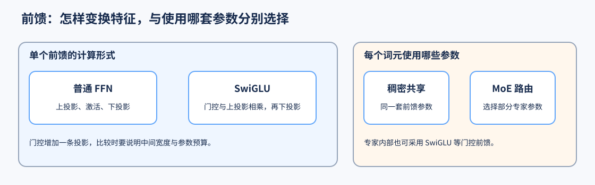

# 07 MLP / FFN 演进（MLP and FFN Evolution）

## 学习问题

注意力混合不同词元的信息后，每个词元自身的特征怎样继续变换？前馈网络（FFN，在 Transformer 中也常称 MLP）用线性投影与激活处理每个位置。门控形式改变特征怎样相乘，混合专家（MoE）则改变词元选择哪套前馈参数，两者可以组合。

## 核心机制

### 扩大中间层会增加哪些工作

扩大 FFN 中间维度可以增加容量，也会同步增加参数、计算和内存访问。门控结构在相近预算下增加内容相关调制；MoE 则把“所有词元使用同一组参数”改为“每个词元激活部分专家”。

### 两次投影和门控投影怎样比较预算

设每个词元输入的特征数为 $d_{model}$，前馈中间层宽度为 $d_{ff}$。普通 FFN 先把特征上投影到中间层，经过激活后再下投影回输入宽度；忽略偏置时，参数量为 $2d_{model}d_{ff}$。SwiGLU 另加门控投影：`up` 产生中间特征，`gate` 经 SiLU 激活后逐元素调节它，`down` 将乘积映射回输入宽度，参数量为 $3d_{model}d_{ff}$。

例如固定 $d_{model}=12$，普通 FFN 取 $d_{ff}=24$ 时有 576 个权重；SwiGLU 若也取 24，就有 864 个。把后者中间宽度改为 16，才在这个构造例子中匹配到 576 个权重。固定参数预算与固定中间宽度是不同的比较，实际时间还受激活、投影形状与实现影响。

门控 FFN 改变的是每个词元内部的通道调制；MoE 进一步改变参数访问范围，让不同词元进入不同专家。前者主要检查激活、参数和算子代价，后者还必须检查路由容量、分发和负载。

| 结构 | 主要路径 | 容量与计算特征 |
|:---|:---|:---|
| ReLU / GELU FFN | `up → activation → down` | 所有词元使用同一稠密路径 |
| GLU / SwiGLU | 门控分支与上投影相乘，再下投影 | 激活形式依具体变体，SwiGLU 对门控使用 SiLU |
| MoE-FFN | 路由器 → 选中专家 → 合并输出 | 总参数增长快，单个词元只激活部分专家 |

## 选择条件与验证证据

稠密 FFN 的执行规则稳定，MoE 则引入路由、容量上限、分发/合并和跨设备通信。结构审计需要把“模型容量”与“每个词元的激活计算”分开记录，并补充负载分布与容量溢出证据。

门控结构与参数容量由 [Part 02 · 02](../../02_PyTorch_Algorithms/02_SwiGLU_Activation.ipynb)验证，并在 [Part 02 · 05](../../02_PyTorch_Algorithms/05_LLaMA3_Block_Tutorial.ipynb)放回完整 Transformer 块；进入 MoE 后，再用 [Part 02 · 06](../../02_PyTorch_Algorithms/06_MoE_Router.ipynb)和 [Part 02 · 07](../../02_PyTorch_Algorithms/07_MoE_Load_Balancing_Loss.ipynb)检查专家选择、利用率与稳定性。

## 相关阅读

- [Gaussian Error Linear Units](https://arxiv.org/abs/1606.08415)
- [GLU Variants Improve Transformer](https://arxiv.org/abs/2002.05202)
- [Switch Transformers](https://arxiv.org/abs/2101.03961)
