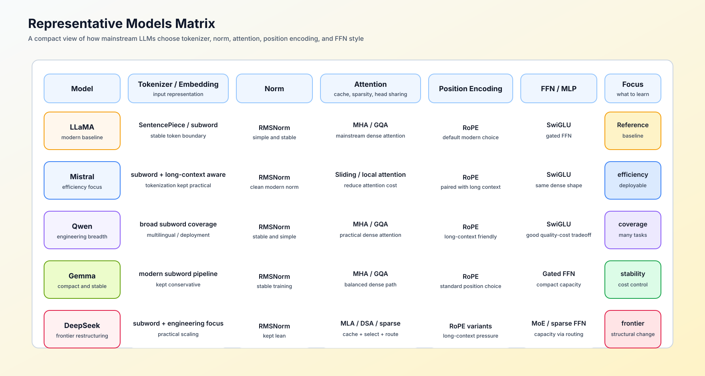

# 08 代表模型与结构审计（Representative Models and Architecture Audit）

## 学习问题

两个名称相近的模型，可能使用不同注意力头、专家或词表；同一模型也可能被不同后端执行。先把名称还原为固定版本的配置，再检查实际创建的模块及其运行方式，才能区分结构、训练能力和实现路径的变化。

## 核心机制

### 从模型名称回到结构字段

模块树指模型中实际创建的子模块及其包含关系；权重形状则能帮助核对投影维度、头数和专家数量。配置声称有八个 KV 头时，既要看该字段，也要核对键值投影与模块实现是否按它创建。一次结构审计沿输入、解码器块、注意力、位置、前馈和记忆接口逐项进行。

| 审计层 | 需要核对的字段 | 常见误判 |
|:---|:---|:---|
| 输入表示 | 分词器、词表、嵌入、权重绑定 | 把词表变化误写成 Transformer 块变化 |
| Transformer 块主干 | 仅解码器、前置归一化、残差顺序、层数 | 只看模型名称推断残差路径 |
| 注意力 | MHA/MQA/GQA/MLA、KV 注意力头、访问范围 | 把 KV 压缩与稀疏访问混为一谈 |
| 位置机制 | RoPE 参数、缩放、训练长度与目标长度 | 只凭声明长度判断可用上下文 |
| FFN 与稀疏性 | 稠密 FFN、SwiGLU、MoE、共享专家、Top-k | 只看总参数量推断每个词元的成本 |
| 记忆接口 | 完整 KV、局部 KV、递推状态、混合层 | 把 SSM 直接称为注意力变体 |
| 实例化结果 | 配置、模块树、权重形状、运行路径 | 把配置声明当成实际执行证据 |

### 用代表模型建立参照系

代表模型用于观察结构组合，不用于给模型家族贴固定标签。同一家族会跨代改变注意力、MoE、上下文和部署策略，最终判断必须回到固定版本的配置与权重。

| 参照系 | 适合观察的结构问题 | 本专题入口 |
|:---|:---|:---|
| LLaMA 类稠密解码器 | 指定快照中的归一化、RoPE、SwiGLU 与残差如何组合 | [解码器主干](./01_transformer_decoder.md)、[归一化](./03_norm_evolution.md)、[残差](./06_block_residual_path.md) |
| 采用窗口访问的 Mistral 快照 | 窗口大小和层间访问安排怎样改变长序列读取 | [位置与访问范围](./05_rope_position_encoding.md)、[Part 02 · 44 访问模式](../../02_PyTorch_Algorithms/44_Local_Sliding_and_Sparse_Attention.ipynb) |
| Qwen 的指定稠密或 MoE 快照 | 词表、稠密／专家分支与模块配置怎样对应 | [输入表示](./02_tokenization_embedding.md)、[MoE](./09_moe_sparsity_evolution.md) |
| 采用 MLA 的 DeepSeek 快照 | 潜在 KV 与专家机制分别改变哪些状态和计算 | [注意力表示](./04_attention_evolution.md)、[Part 02 · ARCH-MLA](../../02_PyTorch_Algorithms/ARCH-MLA_Multihead_Latent_Attention.ipynb) |
| 推理／对话派生模型 | 能力和生成方式变化时，基础模块是否也改变 | [后训练优化](../post_training_optimization/intro.md)；仍核对实际配置与模块 |

## 选择条件与验证证据

结构审计按“声明—实例化—运行”三层取证。只完成其中一层时，结论必须停留在对应证据等级。

| 证据层 | 检查对象 | 可以得出的结论 |
|:---|:---|:---|
| 声明层 | 模型卡、论文、`config.json` | 模型声称采用哪些结构与参数 |
| 实例化层 | 模块树、权重名称与形状、加载日志 | 当前模型快照实际包含哪些模块 |
| 运行层 | 性能分析记录、状态大小、执行后端路径、输出质量 | 目标环境中真正执行了什么，代价是否符合预期 |

审计时固定模型版本、分词器版本、数据类型和执行后端；将关键结构字段、来源、冲突项和未验证项写入同一份记录。基础模型与后训练派生模型应分别登记，避免把能力变化错误归因于 Transformer 块变化。

| 审计记录 | 需要写清的内容 |
|:---|:---|
| 基线组件 | 以解码器块、MHA、稠密 FFN 或显式 KV 为基线说明比较对象 |
| 实际替换 | 当前模型快照真正实例化的结构、配置值和来源 |
| 目标与代价 | 它要改变的质量、上下文、容量或通信问题，以及可能新增的计算、显存、通信和质量风险 |
| 证据等级 | 理论估算、CPU 机制测试、单卡测量或多卡 / 在线基准 |
| 决定 | 采用、继续验证或不采用，以及尚缺的下一项证据 |

- [Part 02 · 08 架构技巧](../../02_PyTorch_Algorithms/08_Architecture_Tricks.ipynb)：读取配置、模块树与结构不变量。
- [Part 02 · 61 模型架构审计](../../02_PyTorch_Algorithms/61_Model_Architecture_Exploration.ipynb)：汇总声明、实例化与运行证据。
- [Part 02 · 71 MLA 与 KV 表示项目](../../02_PyTorch_Algorithms/71_MLA_KV_Cache_Architecture_Benchmark.ipynb)：核对注意力表示与状态成本。
- [Part 02 · 77 长序列记忆架构基准](../../02_PyTorch_Algorithms/77_Long_Sequence_Memory_Architecture_Benchmark.ipynb)：比较显式 KV、递推状态和混合记忆。
- [Part 02 · 78 注意力访问模式项目](../../02_PyTorch_Algorithms/78_Attention_Access_Pattern_Benchmark.ipynb)：验证访问范围与长度代价。

## 相关阅读

- [LLaMA](https://arxiv.org/abs/2302.13971)：现代稠密解码器结构参照。
- [Mistral 7B](https://arxiv.org/abs/2310.06825)：窗口访问与长上下文效率参照。
- [Qwen2.5 Technical Report](https://arxiv.org/abs/2412.15115)：多语言与工程配置参照。
- [Qwen3 Technical Report](https://arxiv.org/abs/2505.09388)：稠密与 MoE 双路线参照。
- [DeepSeek-V2](https://arxiv.org/abs/2405.04434)：MLA 与 MoE 结构参照。
- [DeepSeek-V3 Technical Report](https://arxiv.org/abs/2412.19437)：更大规模 MoE 系统的结构参照。
