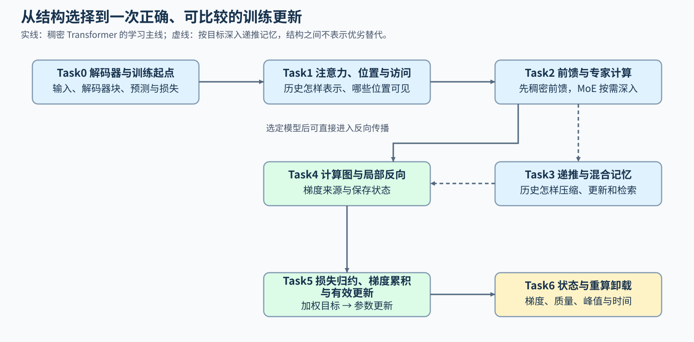

# 模型架构与训练（Model Architecture and Training）

> 专题类型：跨专题组合学习路线　学习目标：解释结构选择怎样改变前向计算、反向依赖与训练状态，并在正确更新的前提下比较质量和资源代价。

注意力头共享、访问窗口、稀疏专家和递推记忆改变模型处理信息的方式，也改变训练时需要保存和计算的内容。从同一个解码器块出发，先追踪结构与历史表示，再沿损失、梯度和参数更新分析训练过程，最后比较重算与搬运是否适合当前负载。

## 学习路线

从 Task0 建立共同基线，先看词元如何经过解码器形成预测和损失，再分别研究历史读取、前馈计算与记忆表示。需要的前置是张量形状、矩阵乘法和基本 PyTorch 操作，可用[Part 02 · 00 PyTorch 热身](../../02_PyTorch_Algorithms/00_PyTorch_Warmup.ipynb)回补。

首次学习可沿 Task0 → Task1 的注意力与位置基础 → Task2 的稠密前馈 → Task4–6，先完成一个普通 Transformer 的训练理解。潜在注意力、长上下文、混合专家（MoE）和状态空间模型（SSM）按目标深入；Task3 的递推记忆不是开始反向传播的前置。连续衔接见[从模型结构到一次训练更新](./walkthrough.md)；希望完整研究某一侧时，也可独立使用[模型架构路线](../llm_architecture_evolution/intro.md)或[训练机制路线](../backpropagation_training_mechanism/intro.md)。

| Task / 主题 | 本阶段要回答的问题 | 学习入口与验证出口 | 学习顺序 | 主要正文入口 |
|:---|:---|:---|:---|:---|
| Task0 · 解码器主干与训练起点 | 输入怎样经过模型形成预测，并与目标构成损失？ | 核心：[Part 02 · 05 LLaMA3 Block](../../02_PyTorch_Algorithms/05_LLaMA3_Block_Tutorial.ipynb)与[Part 00 · 12 最小训练接口](../../00_Prerequisites/12_PyTorch_Minimal_Training_Interface.ipynb)；项目：[Part 02 · 60 Block 稳定性](../../02_PyTorch_Algorithms/60_Decoder_Block_Stability_Benchmark.ipynb) | 输入表示 → 归一化、注意力、前馈与残差 → 输出分数 → 预测损失 | [架构正文01 · 仅解码器主干](../llm_architecture_evolution/01_transformer_decoder.md) |
| Task1 · 注意力表示、位置与访问范围 | 模型怎样读取历史，哪些位置可以参与当前计算？ | 核心：[Part 02 · 04 MHA／GQA](../../02_PyTorch_Algorithms/04_Attention_MHA_GQA.ipynb)与[Part 02 · 03 RoPE](../../02_PyTorch_Algorithms/03_RoPE_Tutorial.ipynb)；扩展：[Part 02 · ARCH-MLA 潜在注意力](../../02_PyTorch_Algorithms/ARCH-MLA_Multihead_Latent_Attention.ipynb)、[Part 02 · 44 局部与稀疏注意力](../../02_PyTorch_Algorithms/44_Local_Sliding_and_Sparse_Attention.ipynb)；项目：[Part 02 · 71 MLA／KV 结构基准](../../02_PyTorch_Algorithms/71_MLA_KV_Cache_Architecture_Benchmark.ipynb)／[Part 02 · 78 注意力访问模式](../../02_PyTorch_Algorithms/78_Attention_Access_Pattern_Benchmark.ipynb) | 查询、键、值与头映射 → 位置和因果范围 → 按目标比较历史表示或长上下文访问 | [架构正文04 · 注意力表示](../llm_architecture_evolution/04_attention_evolution.md) |
| Task2 · 前馈网络、专家容量与稀疏计算 | 每个词元经过哪些参数，怎样扩大容量而不等量增加计算？ | 核心：[Part 02 · 02 SwiGLU](../../02_PyTorch_Algorithms/02_SwiGLU_Activation.ipynb)；扩展：[Part 02 · 06 MoE 路由](../../02_PyTorch_Algorithms/06_MoE_Router.ipynb) → [Part 02 · 07 负载均衡](../../02_PyTorch_Algorithms/07_MoE_Load_Balancing_Loss.ipynb)；项目：[Part 02 · 80 MoE 专家并行](../../02_PyTorch_Algorithms/80_MoE_Expert_Parallel_Benchmark.ipynb)，跨设备部分按硬件条件进入 | 稠密前馈与门控 → 专家选择 → 容量和溢出 → 负载与通信成本 | [架构正文07 · MLP／FFN](../llm_architecture_evolution/07_mlp_ffn_evolution.md) |
| Task3 · SSM、递推状态与混合记忆 | 历史被压入递推状态后，模型保留和检索信息的方式怎样变化？ | 核心：[Part 02 · 45 线性注意力与递推状态](../../02_PyTorch_Algorithms/45_Linear_Attention_and_Recurrent_State.ipynb) → [Part 02 · ARCH-HYBRID-MEMORY 混合记忆](../../02_PyTorch_Algorithms/ARCH-HYBRID-MEMORY_Attention_SSM_Hybrid.ipynb)；项目：[Part 02 · 77 长序列记忆架构](../../02_PyTorch_Algorithms/77_Long_Sequence_Memory_Architecture_Benchmark.ipynb) | 显式历史 → 递推更新 → 信息压缩与检索 → 混合层的分工 | [架构正文10 · 线性注意力、SSM 与混合记忆](../llm_architecture_evolution/10_linear_attention_ssm_and_hybrid.md) |
| Task4 · 计算图与 Transformer 局部反向 | 损失对参数的梯度怎样算出，局部反向要用到哪些前向中间量？ | 核心：[Part 00 · 07 自动求导](../../00_Prerequisites/07_PyTorch_Autograd_and_Backward.ipynb) → [Part 02 · 09 激活与损失反向](../../02_PyTorch_Algorithms/09_Activation_and_Loss_Backward.ipynb) → [Part 02 · 10 Attention 反向](../../02_PyTorch_Algorithms/10_Attention_Backward_and_Custom_Autograd.ipynb) | 损失与计算图 → 上游梯度和局部反向 → 分支贡献汇合 → 保存状态与梯度核对 | [训练正文02 · 自动求导与 Transformer 反向](../backpropagation_training_mechanism/02_autograd_and_transformer_backward.md) |
| Task5 · 损失归约、梯度累积与有效更新 | 微批次的有效目标数不同时，损失怎样加权才能形成正确更新？ | 核心：[Part 02 · 11 梯度累积](../../02_PyTorch_Algorithms/11_Gradient_Accumulation.ipynb) → [Part 02 · TRAIN-MIXED-PRECISION-BACKWARD 混合精度反向](../../02_PyTorch_Algorithms/TRAIN-MIXED-PRECISION-BACKWARD_Mixed_Precision_Backward.ipynb) → [Part 02 · 12 优化器与调度](../../02_PyTorch_Algorithms/12_Optimizer_Updates_and_Learning_Rate_Scheduling.ipynb)；扩展：[Part 02 · 55 更新动力学](../../02_PyTorch_Algorithms/55_Training_Update_Dynamics.ipynb) | 目标位置与有效计数 → 损失加权与梯度累积 → 混合精度与跳步 → 优化器更新与学习率推进 | [训练正文03 · 损失归约、梯度累积与有效更新](../backpropagation_training_mechanism/03_loss_reduction_gradient_accumulation_effective_update.md) |
| Task6 · 训练状态与重算卸载取舍 | 保持训练正确时，怎样用额外计算或搬运降低峰值显存？ | 核心：[Part 02 · 19 激活检查点](../../02_PyTorch_Algorithms/19_Activation_Checkpointing.ipynb)／[Part 02 · 42 激活卸载](../../02_PyTorch_Algorithms/42_Activation_Offload.ipynb) → [Part 02 · 43 统一训练内存账本](../../02_PyTorch_Algorithms/43_Unified_Training_Memory_Ledger.ipynb)；项目：[Part 02 · 73 训练基线](../../02_PyTorch_Algorithms/73_Training_Performance_Analysis.ipynb) → [Part 02 · 76 检查点与卸载对照](../../02_PyTorch_Algorithms/76_Activation_Checkpoint_Offload_Benchmark.ipynb) | 状态创建与最后使用 → 选择重算或搬运 → 核对梯度和更新 → 比较质量、峰值与时间 | [训练正文05 · 激活检查点与卸载](../backpropagation_training_mechanism/05_checkpointing_and_offload.md) |

### 结构选择怎样进入训练比较

Task0 的[输入表示](../llm_architecture_evolution/02_tokenization_embedding.md)、[归一化](../llm_architecture_evolution/03_norm_evolution.md)和[残差路径](../llm_architecture_evolution/06_block_residual_path.md)说明共同基线；[训练闭环](../backpropagation_training_mechanism/01_training_loop_and_computation_graph.md)把模型输出接到损失。Task1 从注意力表示继续到[位置与长上下文](../llm_architecture_evolution/05_rope_position_encoding.md)，Task2 从稠密前馈继续到[MoE](../llm_architecture_evolution/09_moe_sparsity_evolution.md)。

选定结构后，用[结构审计](../llm_architecture_evolution/08_representative_models.md)核对配置与实际模块。Task4 解释梯度从哪里来，Task5 再检查各预测目标的损失怎样加权、多个微批次怎样合成一次更新。进入 Task6 前，用[训练状态生命周期](../backpropagation_training_mechanism/04_training_state_lifecycle.md)标出中间量最后被使用的时刻。普通 Transformer 的局部反向练习解释共同方法；MoE 路由或 SSM 递推的梯度仍需结合各自计算定义核对。

改变头结构、专家或记忆方式时，比较的是模型结构候选，需要任务质量与训练预算等条件；保持模型不变、只替换反向实现或重算策略时，才检查同输入下的输出、梯度和更新是否在容差内一致。两种比较分别采用对应的[架构证据](../llm_architecture_evolution/experiment_assets.md)和[训练正确性要求](../backpropagation_training_mechanism/06_correctness_and_performance_evidence.md)。

## 扩展与跨专题入口

| 当前问题 | 进入哪里 | 带回的观察 |
|:---|:---|:---|
| 需要完整研究结构演进或新模型审计 | [模型架构演进](../llm_architecture_evolution/intro.md) | 模块差异、头结构、访问范围和质量／资源比较 |
| 需要深入梯度边界、数值安全或恢复语义 | [反向传播与训练机制](../backpropagation_training_mechanism/intro.md) | 梯度来源、成功更新数和状态生命周期 |
| 需要用示范、偏好或奖励改变模型行为 | [后训练优化](../post_training_optimization/intro.md) | 数据、训练目标与独立任务评测 |
| 模型结构已确定，需要降低生成和服务成本 | [推理优化](../inference_optimization/intro.md) | 请求时间、缓存与调度条件 |
| 已定位局部计算，需要改编译或内核实现 | [算子优化](../operator_optimization/intro.md) | 实际执行路径、数值和完整调用成本 |
| 需要定位整步热点、峰值或多设备通信 | [性能分析](../performance_analysis/intro.md)／[通信与并行](../communication_parallelism/intro.md) | 时间线、状态重叠和暴露通信 |

概念回查分别使用[架构术语表](../llm_architecture_evolution/glossary.md)与[训练术语表](../backpropagation_training_mechanism/glossary.md)。线性注意力与状态空间模型（SSM）都可以涉及递推状态，但更新公式与表示能力不同，不能仅因都使用固定大小状态就视为同一种结构。

## 实验与项目出口

架构实验按[架构 Quickstart](../llm_architecture_evolution/quickstart.md)与[架构实验资产表](../llm_architecture_evolution/experiment_assets.md)选择环境和输入；梯度与训练状态实验按[训练 Quickstart](../backpropagation_training_mechanism/quickstart.md)与[训练实验资产表](../backpropagation_training_mechanism/experiment_assets.md)进入。运行状态、固定版本和正式结果以各实验条目为准。

| 比较对象 | 主要验证 | 项目或证据入口 |
|:---|:---|:---|
| 结构声明与模块组成 | 配置和实际模块是否一致，结构收益是否有对应证据 | [Part 02 · 61 模型架构探索](../../02_PyTorch_Algorithms/61_Model_Architecture_Exploration.ipynb)；各结构专项见 Task0–3 |
| 固定模型的一次有效更新 | 目标位置、损失权重、梯度和更新数是否符合所选训练定义 | Task4–5 机制页；[训练正确性与性能证据](../backpropagation_training_mechanism/06_correctness_and_performance_evidence.md) |
| 固定训练负载的状态策略 | 质量和更新要求成立后，峰值与时间如何变化 | [Part 02 · 73 训练性能基线](../../02_PyTorch_Algorithms/73_Training_Performance_Analysis.ipynb)与[Part 02 · 76 策略对照](../../02_PyTorch_Algorithms/76_Activation_Checkpoint_Offload_Benchmark.ipynb) |
