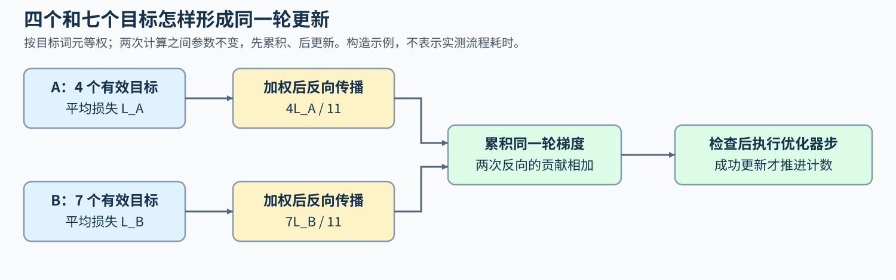

# 从模型结构到一次训练更新（From Model Structure to a Training Update）

一个解码器先把输入变成预测，训练再用目标词元形成损失，并沿前向计算的依赖求出参数梯度。注意力头、访问窗口或专家改变了前向中的工作，也会改变反向要读取的中间量。追踪同一批序列，可以把结构选择、有效更新与显存峰值联系起来。

沿一批序列追踪：`输入与选定结构 → 前向输出 → 预测目标与损失 → 局部梯度 → 参数更新 → 状态策略复测`。结构分支可以分别研究，训练过程则在每个选定模型上建立自己的基线。

## 同一批序列先经过哪些计算

设输入包含 A、B 两条序列，实际长度分别为五和八，A 补齐到八个位置，隐藏维度取十六。词元编号的形状为 $2\times8$，嵌入后成为 $2\times8\times16$ 的隐状态。归一化调整特征尺度，注意力混合可见位置的信息，前馈网络逐位置变换特征；残差连接把子层输入加回输出。输出头再给出每个位置的词表分数。这些尺寸用于构造例子，不是实验模型配置。

把注意力或前馈部分替换成新结构时，残差相加处仍需对齐形状。形状相同只能说明接口能够连接，不能说明计算的信息或模型能力相同。[解码器主干](../llm_architecture_evolution/01_transformer_decoder.md)与[Block 残差路径](../llm_architecture_evolution/06_block_residual_path.md)解释这组输入输出关系，具体实现见[Part 02 · 05 LLaMA3 Block](../../02_PyTorch_Algorithms/05_LLaMA3_Block_Tutorial.ipynb)。

## 当前查询能读取怎样的历史

注意力中的查询（Q）与键（K）形成分数，再按归一化权重混合对应的值（V）。多个查询头共享键值头，会改变需要保存多少组 K/V；历史键值采用潜在表示时，还会改变恢复或计算它们的方式。在 A 的第三个位置计算因果注意力时，可见范围只含 A 的前三个有效位置，后续位置和补齐位置都应排除。位置编码再让位置关系参与分数计算；缩小访问窗口，则可能继续排除较远的历史。

头共享和潜在表示改变历史信息怎样保存与使用，位置和窗口分别改变分数中的位置关系与可见范围。两类变化可以组合，原因和代价仍要分别解释，见[注意力表示](../llm_architecture_evolution/04_attention_evolution.md)与[位置和访问范围](../llm_architecture_evolution/05_rope_position_encoding.md)。

## 专家计算与递推记忆是否解决同一个问题

稠密前馈网络让每个有效词元经过同一组参数。门控前馈则用一条分支调节另一条分支产生的特征，具体计算见[MLP／FFN](../llm_architecture_evolution/07_mlp_ffn_evolution.md)。混合专家（MoE）进一步由路由器为词元选择部分专家：A、B 中的不同词元可能使用不同参数，总参数量因而与单词元激活的参数量分开。容量不足时是否丢弃、重路由或采用其他处理，又会影响实际输出与负载，见[MoE](../llm_architecture_evolution/09_moe_sparsity_evolution.md)。

状态空间模型（SSM）关注另一件事：处理后续位置时，怎样通过递推状态表达此前信息，而不逐项保存完整历史 K/V。线性注意力也可以采用递推形式，但公式与表示能力不因此相同；混合模型则在不同层保留不同的记忆方式，见[SSM／混合记忆](../llm_architecture_evolution/10_linear_attention_ssm_and_hybrid.md)。研究前馈分工或历史表示后，都可以在选定模型上继续训练；理解普通 Transformer 的反向传播，不要求先换用这些结构。

## 前向输出怎样成为参数的训练信号

以这两条序列的下一词元预测为例，假设只把下一个已给定词元作为当前预测的目标，A 有四个预测目标，B 有七个，补齐位置不参与损失。用这些目标约束预测，就是这里的监督信号；它可以从文本自身构造，也可以来自人工示范，不专指监督微调。注意力掩码限制读取范围，损失掩码决定哪些预测贡献训练信号。

计算图记录损失依赖哪些操作和参数。某个中间量的上游梯度表示损失对它的变化率，局部反向再结合该操作的导数，把这份影响传给输入和参数。残差或共享参数存在多条依赖时，对同一对象的梯度贡献需要相加。

局部反向有时要使用前向中的输入、归一化统计量或其他中间量，这些张量必须保存或在反向时重新计算。推理解码保存的 KV 缓存供后续查询读取；递推记忆供后续状态更新；反向保存张量供梯度计算，三者不能直接合成一份“缓存”。先用[训练闭环](../backpropagation_training_mechanism/01_training_loop_and_computation_graph.md)确认损失依赖，再通过[局部反向与保存状态](../backpropagation_training_mechanism/02_autograd_and_transformer_backward.md)追踪消费者。

## 不同长度的损失怎样合成一次有效更新

若显存只允许每次处理一条序列，可以先计算 A、再计算 B，把每次处理的部分称为一个微批次。设二者在各自有效目标上的平均损失为 $L_A,L_B$；损失归约就是把这些预测位置的损失合成一个训练标量。按目标词元等权时，整个批次的损失应为：

$$
L=\frac{4L_A+7L_B}{11}.
$$

例如，$L_A=1,L_B=3$ 时得到 $L=25/11$，直接平均两个微批次则是 2，给四个目标的 A 分配了过高权重。两次计算之间保持参数不变，分别对 $4L_A/11$ 和 $7L_B/11$ 反向传播，先把梯度贡献相加，再执行一次优化器更新，才对应上述损失定义。

优化器根据累积后的梯度改变参数，学习率调度则按约定的进度调整步长。混合精度让部分计算和存储使用较低精度，也需要检查损失或梯度是否出现非有限值；某些更新路径因此会跳过当前优化器步。处理完 A、B 并不保证参数已经成功改变，按成功更新数设计的调度也不应只因处理了数据就前进。精度处理、跳步和更新计数的具体顺序见[损失归约、梯度累积与有效更新](../backpropagation_training_mechanism/03_loss_reduction_gradient_accumulation_effective_update.md)。

## 少保存的张量，会在什么时候付出代价

训练峰值由同一时段仍保存在设备上的参数、梯度、优化器状态、激活与工作区共同形成；不同用途若共享同一存储，账本中只计算一次。张量大小相同，最后被使用的时刻不同，对峰值的影响也可能不同。先依据[训练状态生命周期](../backpropagation_training_mechanism/04_training_state_lifecycle.md)标出创建和释放时刻，再选择策略。

激活检查点减少长期保存的部分中间量，反向需要它们时重新运行前向；卸载则把数据移到主机或其他存储，消费前再搬回。两者分别增加计算或传输，可能改善峰值，却增加单步时间。[检查点与卸载](../backpropagation_training_mechanism/05_checkpointing_and_offload.md)从这两种代价继续比较，梯度与更新核对则检查策略有没有改变训练含义。

## 哪种比较需要相同输出，哪种需要任务质量

将稠密前馈换成 MoE，或将显式历史换成递推记忆，通常会改变模型计算本身。结构候选需要在事先约定的数据、训练预算和评测条件下比较任务质量、容量与时间，不以两种架构输出逐项相同作为采用要求。配置与模块是否相符，可从[结构审计](../llm_architecture_evolution/08_representative_models.md)检查。

模型保持不变、只改变重算、卸载或局部反向实现时，输出、梯度和有效更新的一致性才是直接要求。在这些条件成立后，再读取峰值显存和时间；缺少梯度检查时先补证，已经发现错误梯度时先修实现。相应门槛见[训练正确性与性能证据](../backpropagation_training_mechanism/06_correctness_and_performance_evidence.md)，项目比较进入[Part 02 · 73 训练基线](../../02_PyTorch_Algorithms/73_Training_Performance_Analysis.ipynb)与[Part 02 · 76 策略对照](../../02_PyTorch_Algorithms/76_Activation_Checkpoint_Offload_Benchmark.ipynb)。
