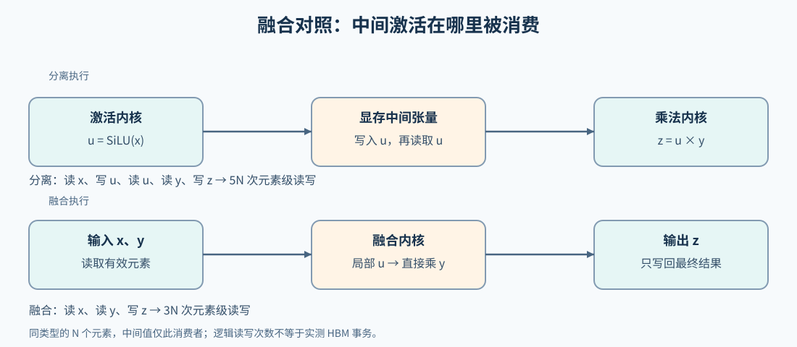
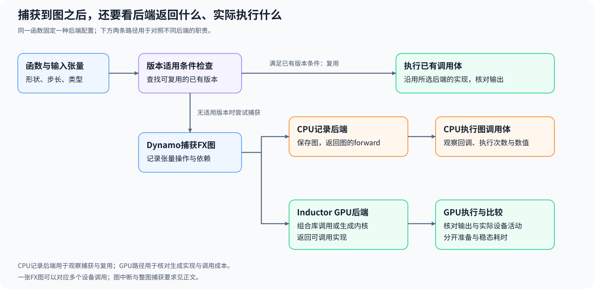

# 02 图编译、融合与执行候选（Graph Compilation and Fusion）

## 学习问题

一段“先做激活，再逐元素相乘”的计算，在 Python 中是两步，在 GPU 上却可能只用一个内核完成。理解编译优化，可以从这两步之间的中间张量开始：它为什么需要写回，又在什么情况下可以省去？

以 $u=\mathrm{SiLU}(x)$、 $z=u\odot y$ 为例， $x,y$ 是同形状输入， $\odot$ 表示逐元素乘法。SiLU 将每个值 $t$ 变成 $t/(1+e^{-t})$，产生的中间值 $u$ 再被乘法读取。它是否还要供其他计算使用，会影响融合后能否省去单独写回。

## 两次调用之间，中间张量经历了什么

分离执行时，激活内核读取 $x$ 并写出 $u$；乘法内核再读取 $u,y$，写出 $z$。若四个张量都含 $N$ 个元素，这两次调用合计产生 $5N$ 次元素级读写。融合后，内核可以读取 $x,y$，在局部计算中得到 $u$ 并立即相乘，最后只写出 $z$，合计为 $3N$ 次读写。这里计算的是逻辑读写量，实际显存事务还受缓存和访问方式影响。

省掉的正是 $u$ 的一次写入与一次读取。如果融合区域之外的另一条分支也使用 $u$，当前内核就要继续为它写出中间值，或者让那条分支重新计算激活；若这些使用者也能一同融合，仍可能省去完整中间张量。编译器通过依赖图识别使用者，再决定保留、重算还是省去写回，因此减少一次调用不一定省去同样多的搬运。

## 从激活与乘法的依赖图到 GPU 内核

图捕获从程序中取得张量运算及依赖：激活节点产生 $u$，乘法节点读取 $u,y$。这些关系构成计算图，表达先算什么、谁使用结果。编译器据此检查两步能否组成一个计算区域；后端负责把这个区域落实为目标设备上的实现，可能生成内核，也可能调用已有计算库。

运算以什么顺序执行、数据怎样分工，涉及调度（scheduling）；这里安排的是计算与数据访问，不是服务端的请求排队。以 Triton 为例，一个程序实例负责一片逻辑数据区域。若每个实例处理 4 个元素，长度为 10 的输入就分成三段，最后一段只有 2 个有效元素。生成的内核计算各段地址，读取 $x,y$，完成激活与乘法后写出结果；尾段屏蔽越界位置，中间值则有机会留在寄存器中。这是用于说明分块的简化安排，具体映射由编译器和目标设备决定。

## 编译中的改写与复用条件

同一段激活计算可以用高层函数表达，也可以展开为指数、加法、除法和乘法。编译器使用中间表示保存这类运算关系，并逐步转换为更接近设备执行的形式，这一过程称为下沉（lowering）。若当前表示中的操作不能直接由目标后端处理，就先改写为它支持的操作，同时保持类型和数值要求，这属于合法化（legalization）。两者在实际编译过程中可能交错进行。

编译版本通常有适用条件，例如形状、步长、类型或某些参数取值。复用前的编译版本适用条件检查（guard）判断当前输入能否继续使用该实现；输入变化仍满足条件时可以复用，超出条件时先查找其他适用版本，没有可用版本时再按配置尝试重新编译或回退。图中断则是另一类情况：当前计算无法继续被捕获，允许分段的模式会尝试分别执行可编译区域，要求整图捕获的模式可能直接报错。因此，融合未发生时先看计算在哪里被拆开；融合已发生时，再分析生成内核的成本。

先在[Part01·09 图编译](../../01_Hardware_Math_and_Systems/09_AI_Compilers_and_Graph_Optimization.ipynb)按给定依赖和分组推导读写与调用变化，再在[Part03·21 图捕获与版本复用](../../03_Triton_Kernels/21_Torch_Compile_Graph_Reuse.ipynb)用CPU记录后端观察这些行为：同形状的新数值复用已有图，静态形状或步长变化可能新增版本，返回旧条件又能命中已有版本；再用主动捕获边界比较分段与整图要求。这里记录的是FX图和调用体执行；随后读取Part03·03的GPU三路径记录，比较准备与稳态成本。前一步观察是否捕获和复用，后一步检查实际执行与耗时；需要展开输入条件、形状分桶与填充时，再回补[Part01·30 动态形状](../../01_Hardware_Math_and_Systems/30_Dynamic_Shape_Handling.ipynb)。

FX是PyTorch表示计算图的工具，TorchDynamo负责从函数中捕获可处理的张量运算；后端接收图并返回可调用对象。下图将两种后端配置并列：记录后端返回图调用体供CPU执行，Inductor GPU路径则组合库调用或生成内核。输入命中已有版本时，沿用对应调用体；捕获、后端处理与设备执行各有自己的观察记录。

## 融合为什么仍可能更慢

对简单的激活与乘法，融合可让 $u$ 算出后立即参与乘法，省去它作为完整中间张量的写回；若继续合入更多操作，一个程序却可能需要同时保存更多输入和部分结果。寄存器是线程保存局部值的片上存储，需求上升后，可同时驻留的线程块可能减少；放不下的值还可能转存到局部内存，形成寄存器溢出访问。此时虽然省去了显式中间张量，内核本身却可能更慢。布局描述张量元素在内存中的排列与步长；为融合而新增的转置或复制，也要计入完整调用。

| 进一步改动 | 希望省去的工作 | 可能增加的工作 |
|:---|:---|:---|
| 激活与乘法合并 | 中间值写回、读取与任务启动 | 寄存器和并行度变化 |
| 共享输入的阶段组合 | 重复读取 | 更长存活期与更大工作集 |
| 布局统一 | 转置或复制 | 其他消费者是否需要重新转换 |
| 按形状特化 | 通用路径的分支或边界成本 | 编译次数、缓存规模和覆盖范围 |

## 手写内核的比较对象

如果编译后激活与乘法已经合并，手写内核就应与这条融合实现比较，而不是只与分离调用比较。若主要时间仍在融合内核内部，可以继续分析访存与分块；若两步仍然分开，则先查图中断、输入条件或后端支持，弄清未融合的原因。融合还可能改变中间舍入与运算顺序，数值核对使用预先确定的容差，不默认逐位相同。

把这个例子放回 PyTorch，可以比较三条路径：即时执行（eager）按算子逐次调用；`torch.compile` 接收这段计算，由所选编译后端生成实现；手写 Triton 则显式描述分块计算。Inductor 是这里使用的编译后端，并非所有 `torch.compile` 调用的统称。[Part 03 · 03 SwiGLU 的三路径基准](../../03_Triton_Kernels/03_Triton_Fused_SwiGLU.ipynb)在共同容差下对照这三种实现，分别记录准备成本、逐轮耗时和设备活动。先读该页Step1–3理解输入与输出，再从Step5读取已有记录；实现细节在后续布局、融合与归约练习中展开。

在[已有三路径记录](../../benchmarks/results/swiglu_three_path_rtx5070ti_20261111_v1.json)的六组形状与类型中，编译路径的完整调用都慢于eager。设备活动采集显示，eager有两个计算事件，编译路径只有一个，但完整调用还包含Python提交、输出分配和完成等待。少一次设备调用，仍可能被其他开销抵消；要判断哪项占主导，还需进一步分解时间。这些事件支持对当前调用的观察，不等于追踪了整个编译过程，也不是HBM读写计数。

三条路径处理固定形状时，比较的是该输入上的结果和成本。稳态指准备和预热之后的重复执行阶段；当候选的稳态单次耗时更低时，重复使用才可能抵消额外准备成本。若候选稳态也更慢，调用次数增加会继续扩大时间差。首次调用的差额还可能包含初始化或缓存读取，应与稳态分别记录，不能全归为冷编译。输入变化后能否复用编译版本，再检查当前输入是否满足编译版本的适用条件。

需要改变内核内部的地址、分块或归约时，进入[计算内核语义与访存](./03_kernel_semantics_and_memory.md)，再回到SwiGLU或行归约的实现练习。已有实现通过数值核对、需要进一步解释准备与稳态成本时，再用[测量与性能归因](./05_measurement_profiling_and_autotuning.md)分析。
