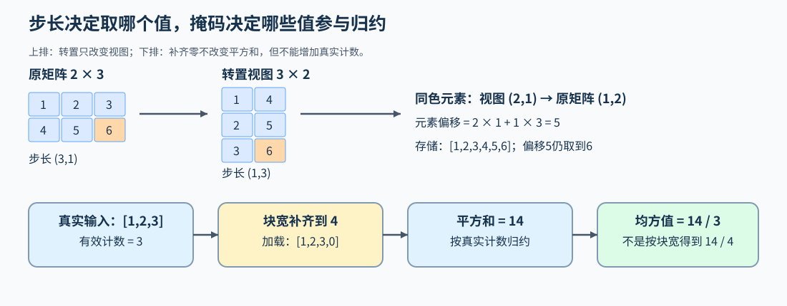

# 03 计算内核语义与访存（Kernel Semantics and Memory Access）

## 学习问题

两个矩阵拥有相同形状，仍可能从不同地址取数；一行数据补齐后，即使没有越界，也可能算错平均值。内核既要找到正确元素，也要让补齐位置按原来的数学定义参与或退出计算。

先用转置矩阵追踪坐标与地址，再用三元素均方值追踪有效计数。归约指沿一个维度把多个值合成一个或少量结果，例如一行求和；同一组元素交给哪些执行者处理，则是随后要解决的分工问题。

## 逻辑坐标怎样变成实际地址

设二维张量的行、列索引为 $i,j$，两个步长为 $s_0,s_1$，步长以元素数为单位。相对该视图首元素的地址偏移为：

$$
\operatorname{offset}(i,j)=i\,s_0+j\,s_1.
$$

连续的 $2\times3$ 矩阵通常具有步长 $(3,1)$；它的转置视图形状为 $3\times2$，步长变成 $(1,3)$。对转置视图继续按“行索引乘逻辑行宽”寻址，会把正确坐标映射到错误元素。内核因此应显式使用步长，或者在输入要求中限定连续布局；若选择复制为连续张量，性能比较还要计入复制成本。

这些坐标先描述要处理的数据，还没有规定线程分工。Triton 用程序实例（Program）负责一片逻辑数据区域，称为数据块（tile）；编译器再把块中的运算分给线程。一个 Program 因而可以处理多个元素，tile 宽度也不等于线程数。CUDA 中，线程块（Block）则是组织线程及其块内共享资源的执行单位，要与数据块区分。

地址正确后，再看同时访问的线程取到了哪些位置。在 NVIDIA GPU 上，32个线程组成一个线程束（Warp）。同一线程束的访问通常按地址覆盖的存储单元合并服务，这些成组的访问称为内存事务；连续且适当对齐的地址往往需要较少事务，跨步访问则可能分散到更多事务。合并访存关注这组地址，向量化关注单条指令读取多个元素，两者不由张量形状单独决定。[Part 04 · 02 合并访存](../../04_CUDA_and_System_Optimization/02_CUDA_Global_Memory_Coalescing.ipynb)推导连续、错位和跨步地址的覆盖范围，GPU练习核对连续拷贝；事务数和访问效率还需实际测量。

## 掩码怎样同时保护访存和数学范围

向量尾块需要阻止无效位置读取和写回；归约还要保证补齐值不会改变有效结果。例如，真实一行是 $[1,2,3]$，逻辑块宽为 4，第四列加载为零后得到 $[1,2,3,0]$。平方和仍是 $1+4+9=14$，但均方值应为 $14/3$；若除以块宽 4，就错误地得到 $3.5$。保护访问地址与保持归约定义，是两个都要完成的步骤。

掩码（mask）按位置决定是否访问或参与计算。不同归约需要不同的中性值，也就是加入后不改变结果的值：求和可补零，求最大值可排除无效项或补负无穷。Softmax 把每个分数的指数除以整行指数和，无效位置必须在计算这个分母之前排除；只在输出写回时屏蔽，已经改变的权重不会恢复。

| 边界对象 | 需要保持的条件 | 容易遗漏的错误 |
|:---|:---|:---|
| 输入与输出地址 | 真实坐标内才访问 | 只保护读取，写回仍越界 |
| 归约范围 | 补齐项不影响有效结果 | 补齐位置进入最大值、求和或计数 |
| 累加类型 | 中间量满足所需精度 | 输入类型被直接当作全部累加类型 |
| 输出归属 | 写入者与合并方式明确 | 不同程序覆盖同一输出 |

## 数据复用与片上存储

全局显存保存输入与输出；缓存可复用近期访问的数据；共享内存供同一线程块的线程交换数据；寄存器保存线程正在使用的局部值。这些存储的容量和访问方式不同。Tensor Core则是矩阵计算单元，使用它时仍要安排输入怎样到达计算位置。

以矩阵乘法（GEMM）$C=AB$ 为例，一个输出 tile 可以复用加载的 A、B 子块，让同一输入参与多次乘加；扩大 tile 也会增加需要保存的部分和。逐元素融合则可能让中间值算完即被使用，避免单独写回。两者都可能减少全局显存读写，但分块复用需要容纳更多局部数据，融合则可能缩短中间值的存活时间。

## 输出块怎样分给多个程序

分块决定一个输出区域怎样计算，任务分配决定由哪个 Program 计算它。若 GEMM 共有 7 个输出 tile，可以启动 7 个 Program 各处理一个，也可以启动 3 个循环处理：Program 0 负责 0、3、6，Program 1 负责 1、4，Program 2 负责 2、5。这里的 K 是 A 的列数、B 的行数，也是乘法中求和的长度。每个输出 tile 都要沿完整 K 维累加；开始新 tile 时，上一块的部分和必须清零。

两种方式都可以在一次内核启动中完成全部输出。有限 Program 改变设备侧的任务分工和访问次序，也减少可同时处理的输出块数量；任务少时还可能与普通网格完全相同。是否更快，要在相同计算和配置下测量，不能从 Program 更少直接推出加速。

## 并行协作怎样保持同一个数学结果

若一个程序独立负责完整输出区域，主要核对覆盖和边界；若多个线程或程序共同形成结果，还要明确局部结果如何合并、何时可读、何时可覆盖。共享内存中的装载—读取—覆盖顺序需要对应同步。原子操作让对某个共享位置的特定更新不可分割地完成，可避免并发更新互相覆盖，但不能代替整个计算过程的依赖设计。

例如，一个线程写入共享内存后，其他线程必须等数据就绪再读取；而下一轮覆盖同一缓冲区前，还要等这一轮读取结束。前者避免读到旧值，后者避免读到被提前覆盖的新值。

以一行求和为例，每个 Warp 可以先合并自己线程持有的值，再由块内协作合并多个 Warp 的局部和，参见[Part 04 · 03 Warp 协作](../../04_CUDA_and_System_Optimization/03_Warp_Level_Primitives.ipynb)。共享内存还按可并行访问的存储分组（bank）组织；一组访问中的不同字落入同一 bank，可能需要分次服务，而多个线程读取同一个字还可能由广播服务。[Part 04 · 04 Bank 映射](../../04_CUDA_and_System_Optimization/04_Bank_Conflict_Deep_Dive.ipynb)据此比较地址安排怎样影响协作成本。

从转置进入实现时，可在[Part 03 · 02 二维布局](../../03_Triton_Kernels/02_Triton_Layouts_and_Memory_Access.ipynb)追踪实际步长；均方值与补齐范围可在[Part 03 · 04 RMSNorm](../../03_Triton_Kernels/04_Triton_Fused_RMSNorm.ipynb)继续展开。激活融合和行归一化则分别见[Part 03 · 03 SwiGLU](../../03_Triton_Kernels/03_Triton_Fused_SwiGLU.ipynb)与[Part 03 · 07 Softmax](../../03_Triton_Kernels/07_Triton_Fused_Softmax.ipynb)。

地址、有效范围与协作顺序确定后，可通过[测量与性能归因](./05_measurement_profiling_and_autotuning.md)分析当前调用的成本；矩阵子块的复用与跨块归一化，则在[矩阵计算与推理状态的数据路径](./04_attention_and_inference_data_paths.md)中继续展开。
